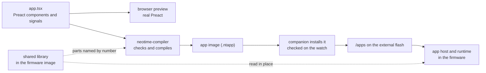

# App runtime

This page describes how NeoTime apps are stored and run: the design, the app image format, the
bytecode, the shared library and the runtime in the firmware. [writing-apps.md](writing-apps.md)
shows how to write an app, [app-reference.md](app-reference.md) lists what apps can use, and
[compiler.md](compiler.md) describes the compiler.

## Goals

- **Apps are data, not programs.** An app declares its name, icon, state, screens, the events it
  answers and the sensors it wants. The runtime owns everything that runs: it schedules work,
  calls the app's functions, persists state and draws the screen.
- **Functions are pure.** An app function takes the current state and an event, and returns the
  state changes and the effects it wants, such as a vibration. It cannot touch hardware, loop
  forever or keep anything between calls.
- **Event driven, not ticking.** The runtime works out from what a screen shows when it must
  redraw, and sleeps otherwise. A stopwatch stores its start time and shows `now - start`, so
  nothing ticks while it runs.
- **Apps live on the external flash,** in `/apps`, never in the internal flash. Only the open app,
  its state and its screen take RAM.
- **Apps are assembled from shared parts.** The firmware and the shared library hold the widgets,
  functions, images and font that apps have in common, and an app connects them like building
  blocks. See [Building apps from shared parts](#building-apps-from-shared-parts).
- **A broken app cannot break the watch.** Every app image is checked when it is installed and when
  it opens, and every call ends: a call that loops is stopped after 200,000 steps.

## Choosing the format

| Option | How it would work | Why not |
|---|---|---|
| A JavaScript engine, such as [MicroQuickJS](https://github.com/bellard/mquickjs) | Apps ship as JS bytecode and run in the engine. | The engine alone needs about 10 KB of RAM and 100 KB of flash, the whole app budget before any state. |
| [Preact](https://preactjs.com) running on that engine | Apps are components that re-render on every change. | It needs the engine plus a virtual DOM, and re-renders on every change, which is the ticking this design avoids. Apps are still written as Preact components, but compiled ahead of time. |
| WebAssembly, such as wasmi | Apps compile from any language to Wasm. | A Wasm memory page is 64 KB, all of the chip's RAM, and sandboxed native code is more than pure functions need. |
| [Slint](https://slint.dev) | Its language has a widget tree with property bindings and callbacks. | Its runtime targets chips with around 264 KB of RAM. Its language is still a good model to borrow from. |
| **NeoTime's own bytecode** | A compiler on the computer turns each app into a compact image that the runtime runs. | The choice. It costs a compiler and a small interpreter, both written in Rust. |

The closest existing designs evaluate the screen's bindings in the renderer, not in app code:
[Wear OS dynamic expressions](https://developer.android.com/training/wearables/data/dynamic),
[Remote Compose](https://proandroiddev.com/remotecompose-another-paradigm-for-server-driven-ui-in-jetpack-compose-92186619ba8f),
[Fitbit apps](https://dev.fitbit.com/build/guides/application/) and
[Pebble's Alloy](https://moddable.com/blog/pebble/).

Apps stay Preact-flavoured TSX. Solid, Svelte, Nim, Python, plain Rust, a custom language and
Jsonnet were compared. Solid would have removed only about 1% of the compiler and SDK, at the cost of
rewriting the browser preview and its tests, and the parity tests already catch the preview and the
watch drifting apart. Ranged number types would have saved 1.3 KB across every app. Neither was
worth it.

## How it fits together



## From source to image

Preact never runs on the watch. The compiler reads the components ahead of time, running each one
once, and produces the app image; the same source runs on real Preact in the browser preview.
Signals match what the runtime does: a `signal` holds a value, and a `computed` knows which signals
it reads. On the watch a signal becomes a state slot, and a `computed`, or JSX that reads signals,
becomes an expression with an input mask. Only expressions whose inputs change are evaluated again,
and nothing re-renders.

```tsx
import { computed, define_app, persisted, now, format_duration, type Duration, type Instant } from "neotime";
import { icons } from "neotime/icons";
import { Button, Label, Screen } from "neotime/widgets";

const started_at = persisted<Instant | null>("started_at", null);
const stopped_after = persisted<Duration>("stopped_after", 0);

const elapsed = computed(() =>
  started_at.value !== null ? now.value - started_at.value : stopped_after.value,
);

function toggle() {
  if (started_at.value !== null) {
    stopped_after.value = now.value - started_at.value;
    started_at.value = null;
  } else {
    started_at.value = now.value - stopped_after.value;
  }
}

function reset() {
  stopped_after.value = 0;
}

function Stopwatch() {
  return (
    <Screen padding={8} gap={6}>
      <Label font="large">{format_duration(elapsed.value, "mm:ss")}</Label>
      <Button onClick={toggle}>{started_at.value !== null ? "Stop" : "Start"}</Button>
      {started_at.value === null && <Button onClick={reset}>Reset</Button>}
    </Screen>
  );
}

export default define_app({ id: "stopwatch", name: "Stopwatch", icon: icons.stopwatch, screens: { main: Stopwatch } });
```

`Stopwatch` is never called on the watch. The compiler turns it into a fixed widget tree. The
label's text becomes one expression that reads `started_at`, `stopped_after` and `now`, and because
its pattern shows whole seconds the runtime redraws it once a second while the screen is on and the
stopwatch runs. The Reset button's `{... && ...}` becomes a binding on its `visible` property.

| In the source | On the watch |
|---|---|
| `signal(...)` at the top of the file | A state slot that lasts while the app is open. |
| `persisted("key", ...)` | A state slot saved with the app's state, so it survives a restart. |
| `useSignal(...)` inside a component | A state slot for that place in the tree. |
| `const` values that never change | Constants, worked out while compiling. |
| `computed(...)` | Inlined into each expression that reads it, which inherits its inputs. |
| A function component and its props | Inlined into the widget tree wherever it is used. |
| JSX that reads `.value` | Expressions bound to widget properties. |
| `{condition && <Widget/>}` | The widget's `visible` property. |
| `array.value.map(...)` over a fixed-length array | A `Repeat` widget holding the row once. |
| `onClick`, `onSwipe` | Handlers. An inline arrow function is lifted out into a handler of its own. |
| `on("event", handler, ...)` at the top of the file | A subscription. |
| `now`, `heart_rate`, `steps_today` and the rest | System values the runtime provides. |
| `neotime/lib` functions and `icons` | References by number into the [shared library](#the-shared-library). |

A handler is compiled as one transaction, as Signals' own `batch` is: reads after a write see the
new value, the writes are applied together when it returns, and a handler that fails changes
nothing. Effects are recorded during the handler and carried out only after it finishes without
failing. Work that would be a timer or a `useEffect` in a web app is an `on` subscription, so the
runtime can schedule it and run it while the app is closed.

The compiler's steps, its language and its limits are in [compiler.md](compiler.md). Every image it
writes has passed the same checks the watch runs at install. Editors get type errors from the type
declarations in the `neotime` package; the compiler does not depend on them.

## The app image

The `neotime-runtime` crate (`neotime/runtime/`) reads and checks images. An image is little-endian.
It starts with a 20-byte header and a table of sections.

| Bytes | Holds |
|---|---|
| 0–3 | Magic `NTAP`. |
| 4–5 | Format version, now 2; an image of any other version is refused. |
| 6 | Kind: 0 for an app, 1 for a watch face, 2 for the shared library. |
| 7 | Flags: bit 0 means the app's image 0 is its icon for the launcher. |
| 8–9 | The shared library version the app was built against, now 2. |
| 10–11 | How many sections follow. |
| 12–15 | CRC-32 (IEEE) of every byte from 16 to the end. |
| 16–17 | The string holding the app's id. |
| 18–19 | The string holding the app's name. |
| 20 on | One 12-byte entry per section: kind (2 bytes), entry count (2), offset from the start of the image (4), length (4). |

Each kind of section appears at most once:

| Kind | Section | Layout |
|---|---|---|
| 1 | Strings | A table of (offset, length) pairs, 2 bytes each, then the UTF-8 text they point into. |
| 2 | State | 16 bytes per variable: key string (2), type (1), flags (1), array length (2, 0 for a single value), reserved (2), default value (8). Flags bit 0 means the variable persists; bits 1–2 give an array's element width: 0 for 8 bytes, 1 for 1, 2 for 2, 3 for 4. At most 64 variables, 2 KB in all and 1 KB for any one. |
| 3 | Expressions | A table of (offset, length) pairs, then the bytecode they point into. At most 128. |
| 4 | Handlers | The same layout as expressions. |
| 5 | Widgets | A table of (offset, length) pairs, then one record per widget, described below. At most 128 widgets. |
| 6 | Subscriptions | 16 bytes per subscription, described below. |
| 7 | Resources | The app's own images, as a table of (offset, length) pairs followed by the images. |
| 8 | Initial values | Optional. For arrays whose elements do not all start the same: a table of (offset, length) pairs, then per array its number (1 byte) followed by its elements packed as they are stored in RAM. |
| 9 | Fonts | The shared library only; see [Fonts](#fonts). |
| 10 | Functions | Optional. Up to 256 functions, the same layout as expressions. Each function's bytes start with its argument count, its result count (0 or 1) and how many locals it uses, then its code. |
| 11 | Launcher | Optional. 2 bytes: the string naming the launcher group the app declares. |
| 12 | Data | The shared library only. Files the firmware reads, laid out as resources: number 0 is Bosch's configuration for a BMA421 accelerometer and 1 for a BMA425, in `LibraryData` order. |
| 13 | Facts | Every image, last. 12 bytes: the heap the app needs while open (4), what it adds to a launcher's list (4), a flags byte (bit 0: it shows the list of apps; bit 1: it reads the app list, so the shell keeps its full list while it is open), then 3 spare bytes. `ImageWriter` works them out from the finished image, and the package manager checks them against its own analysis at install. |

A list of apps never reads an image whole. `neotime_packages::image_reader` reads the header and
the section table, then each part through its table entry: the facts, the id, name and group
strings, and for the launcher the icon alone. Listing fifty apps holds no image on the heap. These
reads trust the image's structure; install and opening both check its CRC, and an image that fails
install is turned off, so the launcher never lists it.

### Widget records

Widgets are stored depth first, so a widget's children follow it. Each root is one screen, and the
first is the screen the app opens on. A widget record is:

| Bytes | Holds |
|---|---|
| 0 | The kind, numbered in the order of `WidgetKind` in `runtime/src/widgets.rs`. |
| 1 | How many children it has. Only containers, buttons, arcs and click areas may have any. |
| 2 | How many properties follow. |
| 3 | Reserved, 0. |
| 4 on | 6 bytes per property: its id (1), numbered in the order of `Property` in `runtime/src/widgets.rs`; where its value comes from (1: 0 a constant, 1 an expression, 2 a handler); and the value (4): the constant itself, a string number for text, an array's variable number for an array property, or the expression or handler number. |

Expressions do not record what they read or how often they redraw. The runtime works both out from
the code when the app opens, so a wrong compiler can never make a widget miss an update.

### Subscriptions

Each subscription is 16 bytes:

| Bytes | Holds |
|---|---|
| 0 | The kind, numbered in the order of `SubscriptionKind` in `runtime/src/subscriptions.rs`: open, close, screen on, screen off, every, at, daily, clock change, heart rate, steps, step goal, motion, acceleration, battery, phone, notification, call, music, weather, navigation, settings change, derive. |
| 1 | Flags: bit 0 means it only runs while the app is open. |
| 2–3 | The handler to call. |
| 4 | Where the value comes from: 0 the constant in bytes 8–15, 1 the state variable those bytes name. |
| 5 | Detail: the unit of a clock change (minute, hour, day), the kind of motion, battery or phone event. |
| 6–7 | For a daily time, the weekdays it runs on, bit 0 for Monday. |
| 8–15 | The value: a period in milliseconds, an instant, or a local minute of the day. |

Every, heart rate and acceleration repeat with a period. A period under a minute, and any
acceleration, must be marked only-while-open, so a closed app can never keep the watch busy. An `at`
or daily value may name a state variable, so moving an alarm reschedules it without other code.
`Subscription::next_due` works out when a timer-like subscription next fires, in local time.

A derive subscription keeps an array worked out from other state, such as a `computed` array a
CellGrid or Chart shows. The compiler gives it a hidden array and a handler that rebuilds it; the
runtime runs that handler when the app opens and again whenever anything it reads changes. Its
effects, if any, are ignored.

### Images

An image starts with its format (1 byte: 0 colour, 1 mask), a reserved byte, then its width and
height (2 bytes each, at most 240). Then come runs: a colour image is runs of (count, RGB565
colour), 3 bytes each; a mask is runs of (count, coverage from 0 to 255), 2 bytes each, drawn in
the widget's colour, which is how icons follow the theme. Runs go left to right and top to bottom,
and may continue onto the next row. The image check confirms the runs cover every pixel exactly.

An image of format 2 holds no pixels: its 4 bytes are the format, a reserved 0 and the number of a
shared library image, which is drawn in its place. An app whose launcher icon is a library icon
keeps it this way as image 0, so the icon costs 4 bytes.

An `image` or `icon` property names an image by number: below 32768 it is one of the app's own
images; 32768 to 65535 is the shared library's image of that number less 32768; and 65536 and up is
the launcher icon of the installed app of that number less 65536.

### Saved state

`AppState::save_persistent` writes every variable marked as persisting into a buffer, and
`load_persistent` reads it back. The saved form starts with `NTST`, a version byte and a count,
then for each variable its key, type, array length, element width and stored bytes. Loading matches
each saved variable to the app's by key, type, length and width, and skips any that no longer
match, so a new version of an app keeps what still fits. The firmware keeps it in
`/apps/<id>/state` on the external flash, written when the app closes and when the screen turns off.

## The shared library

The internal flash keeps no apps. The firmware image carries the shared library after its code:
everything common to apps that would otherwise be copied into each one. The image header says where
it starts, it arrives with each firmware update, and it is read in place, so using it costs no RAM.
It is itself an image of kind 2, checked by the same verifier as an app.

| Part | Holds |
|---|---|
| Images | The icons, each a 32 by 32 mask, numbered in the order of `ICON_NAMES` in `compiler/src/types.rs`. |
| Font | The one font every text size is drawn from; see [Fonts](#fonts). |
| Functions | Bytecode for common work, compiled from `sdk/neotime/src/lib.ts` and numbered in the order of `LIBRARY_FUNCTIONS` in `compiler/src/shared_functions.rs`. |
| Data | The accelerometers' configuration files, for the firmware alone. |

An app calls a library function with `call library`, which costs 5 bytes in place of the function's
body. Library code takes only its arguments and system values; text it gives back is copied into
the app's text buffer. In a firmware without the library the call fails and the property it feeds
is left as it was.

The compiler records the library version in each image's header. The package manager refuses to
install an app built against a newer library than the firmware's, and the watch does not open one
(`OpenError::LibraryTooOld`); it shows the face instead, or the help screen if the face is the app
refused. A new library keeps the numbers of everything the old one had and adds new parts at the
end, so installed apps keep working.

Components from `neotime/components` are not in the library: the compiler inlines them into each
app from the SDK's source.

## Building apps from shared parts

This is the structure every app, face and runtime change follows. The watch has 64 KB of RAM. An
app's image is read into the heap while it is open, and every widget of its screen takes a node, so
every byte an app carries and every widget it builds costs RAM while it is open. Code and data in
the internal flash are read in place and cost none. So the work is split into three layers:

| Layer | Lives in | RAM while an app is open | Holds |
|---|---|---|---|
| Native widgets and builtins | The firmware, in Rust | One node per widget; the code costs none | Composite widgets with logic of their own, such as a time picker, the status icons or the list of installed apps, and work over whole arrays, such as sliding a 2048 board |
| The shared library | Inside the firmware image, after its code, read in place | None | Functions, images and the font that two or more apps use |
| The app | `/apps` on the external flash, read into the heap when it opens | All of it | Its own state, its layout, and the few lines that connect the shared parts |

Rules for each change:

- **Look in the shared parts first.** Before writing a helper, a component or a table in an app,
  check `neotime`, `neotime/components`, `neotime/lib` and the widgets in
  [app-reference.md](app-reference.md).
- **Move what repeats.** When a second app needs code that one app has, move it into the shared
  library and make both use it, written generically so later apps can use it too.
- **Make composites native.** A widget built from many widgets with logic between them, such as a
  picker, a dialog or a list, belongs in the firmware as one widget: one node instead of many, and
  no bytecode in the app.
- **Make heavy work native.** A loop over a whole array that runs often, such as a game board's
  move or a neighbour count, is far smaller and faster as a builtin than as bytecode.
- **Keep apps out of the internal flash.** It holds only the bootloader, the firmware and the
  shared library.
- **Never renumber the library.** A new version keeps every number the old one had.

The compiler also compiles an app function it would otherwise copy into several places once and
calls it, and turns code that repeats with only its constants changed into shared functions. The
firmware draws the native composites, such as `AppList`, `StatusIcons`, the pickers and
`ConfirmBox`, and answers the array functions of `neotime` (from `count_of` to `life_step`)
natively. Library components and further builtins are open work, under "Shared library and smaller
apps" in [todo.md](todo.md).

## The bytecode

The interpreter is a stack machine with room for 32 values. Values are 64 bits and carry no type
tag, because the compiler has already checked every type.

| Type | Stored as |
|---|---|
| `Int` | a 64-bit signed integer; there are no fractions |
| `Bool` | 0 or 1 |
| `Instant` | milliseconds since 1970 in UTC; an empty optional is the smallest 64-bit number |
| `Duration` | milliseconds |
| `Color` | RGB565, or a reference to a [theme colour](#theming) |
| `Text` | the number of a string in the image, or a slice of the call's 256-byte text buffer |

Each instruction is one opcode byte followed by its operands:

| Opcode | Instruction | Operands | Does |
|---|---|---|---|
| `01` | push small | 1 byte, signed | Pushes a number from -128 to 127. |
| `02` | push int | 4 bytes, signed | Pushes a 32-bit number. |
| `03` | push long | 8 bytes, signed | Pushes a 64-bit number, such as an instant. |
| `04` | push none | | Pushes the empty optional. |
| `05` | push text | string, 2 bytes | Pushes a string from the image. |
| `06` | read state | slot, 1 byte | Pushes a state variable. In a handler, it sees the handler's own earlier writes. |
| `07` | read system | value, 1 byte | Pushes a system value (see below). |
| `08` | read event | field, 1 byte | Pushes one of the event's 8 fields. Handlers only. |
| `09`, `0A`, `0B` | duplicate, drop, swap | | Stack housekeeping. |
| `0C` | read local | local, 1 byte | Pushes one of the call's 16 locals, which all start at 0. |
| `0D` | write local | local, 1 byte | Takes a value into a local. |
| `0E` | read event text | field, 1 byte | Pushes a text field of the event, such as a notification's title, copied into the call's text buffer. Handlers only. |
| `0F` | read system element | value, 1 byte | Takes an index and pushes that element of a list value, such as one day of the forecast, or none past its end. |
| `10`–`14` | add, subtract, multiply, divide, remainder | | Whole-number arithmetic. Overflow and division by zero fail the call; division rounds toward zero. |
| `15`–`18` | negate, minimum, maximum, absolute | | |
| `19` | random int | | Takes a lowest and a highest number and pushes a random one between them, both included. Handlers only. |
| `1A`–`1D` | bit and, bit or, bit xor, bit not | | For masks, such as the days an alarm rings. |
| `1E`, `1F` | shift left, shift right | | By 0 to 63 places; any other amount fails the call. Shifting right keeps the sign. |
| `20`–`25` | equal, not equal, less, less or equal, greater, greater or equal | | Push 1 or 0. |
| `26` | not | | 1 for 0, else 0. |
| `27` | is none | | 1 if the value is the empty optional. |
| `28` | jump | distance, 2 bytes | Skips forward that many bytes. |
| `29` | jump if false | distance, 2 bytes | Takes a value and skips forward if it is 0. `? :`, `&&` and `\|\|` compile to this. |
| `2A` | loop start | | Marks where a loop begins. The stack must be empty here. |
| `2B` | loop back | distance, 2 bytes | Goes back that many bytes, counted from the end of this instruction, to a loop start. The stack must be empty here too. |
| `2C` | call | function, 1 byte | Takes the function's arguments into its first locals, runs it, and leaves its result, if it has one. |
| `2D` | read row | | Pushes the number of the `Repeat` row the code runs for, or 0 outside one. |
| `2E` | call library | function, 2 bytes; arguments, 1 byte; results, 1 byte | Runs a shared library function as `call` runs one of the app's. Fails unless the firmware carries the library and the counts match. |
| `30` | time part | part, 1 byte | Takes an instant and pushes its local year, month, day, hour, minute, second or weekday (0 to 6, Monday first). |
| `31` | start of | unit, 1 byte | Takes an instant and pushes the start of its local minute, hour or day. |
| `40` | format number | minimum digits, 1 byte | Takes a number and pushes it as text, padded with zeros. |
| `41` | format duration | pattern string, 2 bytes | Takes a duration and pushes it as text in the pattern. |
| `42` | format time | pattern string, 2 bytes | Takes an instant and pushes the local time as text in the pattern. |
| `43` | join | | Takes two texts and pushes them joined. |
| `44` | text from codes | array, 1 byte | Takes a count and pushes text made of that many character codes from the start of the array. |
| `45` | to upper | | Takes text and pushes it in capitals. |
| `46` | text length | | Takes text and pushes how many characters it has. |
| `47` | slice text | | Takes text, a start and an end, and pushes the characters between them; a negative position counts from the end. |
| `48` | pad start | | Takes text, a width and a character code, and pushes the text padded in front up to the width. |
| `49` | format fixed | | Takes a number, a count of decimal places and a flag, and pushes the number with that many places, such as 1250 with 3 places as `1.250`; with the flag set, trailing zero decimals are left off. |
| `50` | write state | slot, 1 byte | Takes a value for a state variable. Handlers only. |
| `51` | effect | effect, 1 byte | Takes the effect's arguments and records it. Handlers only. |
| `60` | read element | array, 1 byte | Takes an index and pushes that element. An index outside the array fails the call. |
| `61` | write element | array, 1 byte | Takes an index and a value and writes that element. A value too wide for the element fails the call. Handlers only. |
| `62` | copy array | destination and source arrays, 1 byte each | Copies every element; the two must be the same length. Handlers only. |
| `63` | fill array | array, 1 byte | Takes a value and writes it to every element. Handlers only. |
| `64` | ask array | question, 1 byte; array, 1 byte | Takes the question's arguments and pushes the answer. Questions: 0 how many elements equal a value, 1 where the `n`th one is, 2 the longest line of a value through a cell of a grid, 3 whether a 2048 slide would change the grid, 4 what it scores, 5 how many pairs are out of order. |
| `65` | work array | work, 1 byte; destination, 1 byte; source, 1 byte | Compares two arrays of one length, or writes the destination from the source. Works: 0 equal, 1 the Game of Life's next generation, 2 the grid after a 2048 slide, 3 push a value from the stack at the end, 4 at the front, 5 shuffle some places, 6 the first bytes of the file whose path, an image string, is on the stack, and 7 the same from an offset on the stack after the path. Files are read through `SystemValues::read_file`, with 0 past the end. Writing is for handlers only, and the source may be the destination. |

Only `loop back` goes backward. A call stops with a failure after 200,000 instructions.

A handler never writes to the app's state directly. The first time it writes to a variable, the
interpreter copies the whole variable into a scratch area as large as the app's variables, at most 1 KB, and every later read and write of
that variable uses the copy. When the handler finishes, the copies are written back and the outcome
lists which variables changed; when it fails, the copies are dropped. So one handler can change at
most 16 variables and 1 KB of state.

### System values

`read system` numbers system values in the order of `SystemValue` in `runtime/src/instruction.rs`,
which only grows at its end; numbers 110, 111, 113, 120 and 121 are unused.
[app-reference.md](app-reference.md#system-values) lists them by the names apps read. List values
are read an element at a time with `read system element`, through `SystemValues::read_element`, or
`read_element_text` for text. Text values, such as the location, the track or the firmware version,
come from `SystemValues::read_text`, and `read system` copies them into the call's text buffer.

An expression's input mask has 32 bits, so values that change together share one bit
(`SystemValue::bit`):

| Bit shared by | Values |
|---|---|
| `heart_rate` | the heart rate and when it was measured |
| `battery_percent` | the charge and `battery_millivolts` |
| `steps_today` | today's steps and the whole step history |
| `unread_notifications` | the kept notifications and every field of them |
| weather | every weather and forecast value |
| music, navigation, call | each its own values |
| installed apps | the installed apps, the packages and the launcher's look and groups |
| settings | every value under `settings` and `watch_face_name` |
| system info | the firmware, bootloader and hardware facts, the heap counters, the tasks, `app_memory_budget` and `firmware_state` |
| folder | `current_folder` |
| `shake_speed` | itself, since it changes ten times a second |

Every other value has its own bit.

### Effects

`effect` numbers effects in the order of `EffectKind`, with how many arguments each takes:
`vibrate` (1), `vibrate_pattern` (1), `stop_vibrating`, `set_brightness` (1), `keep_screen_on` (1),
`wake_screen`, `screen_off`, `go` (1), `back`, `open_app` (1), `close`, `show_toast` (1),
`notify` (2), `dismiss_notification` (1), `mark_notifications_read`, `send_to_phone` (2),
`music_control` (1), `call_control` (1), `find_phone` (1), `measure_heart_rate`,
`start_heart_rate`, `stop_heart_rate`, `reset_step_trip`, `set_setting` (2), `set_do_not_disturb` (1),
`log` (1), `request_music_state`, `set_heart_rate_led` (3), `set_bluetooth` (1),
`request_navigation_state`, `set_app_enabled` (2), `prefetch_file` (3), then 32 `open_folder` (1),
33 `set_clock` (3), 34 `confirm_firmware`, 35 `step_watch_face` (1) and 36 `roll_back_firmware`.
`send_to_phone`'s two arguments are texts: the channel, and the data as the JSON object the compiler
builds, which the firmware sends as `{"t":"app","ch":...,"d":...}`.

### Checking an image

The watch checks every image when it is installed and again when it opens. Reading the header
checks:

- the magic, the format version and the CRC;
- that every section and every table entry lies inside the image, and no section repeats;
- that every string is UTF-8, and every state variable has a known type and a default that fits it.

Then one pass over each expression and handler checks:

- that every instruction and operand is known, and every state slot and string exists;
- that every format pattern is valid, so a typo in one is caught at install;
- that every jump lands on the start of an instruction or the end of the code;
- that single-value instructions only name single values and array instructions only arrays, that
  copied arrays have the same length, and that locals are within the 16;
- that every loop back lands on a loop start, and the stack is empty at both;
- that every call names a function numbered below the code calling it, so no call can recurse, and
  that calls nest at most 8 deep with their locals inside the pool of 48;
- that a function's header asks for at most one result and no more arguments than locals, and its
  code leaves exactly that result;
- that the stack never goes below empty or above 32 values, and that every path into a jump
  target arrives with the same depth;
- that an expression ends with exactly one value and a handler with none;
- that expressions do not read events, write state, cause effects or use random numbers, nor call
  a function that does;
- that a list system value is read only by element and a single value never by element;
- in the shared library, that no function reads or writes state, reads the event, causes an
  effect, draws a random number or calls the library.

Last, a pass over the widgets checks:

- that they form whole trees no deeper than 16 levels, and only containers, buttons, arcs and
  click areas have children;
- that every property exists on its widget, appears once, and screen-wide ones such as `onSwipe`
  are only on a screen's root;
- that every event names a handler, every other property is a constant or an expression, and every
  expression, handler and string named exists;
- that constants fit: a flag is 0 or 1, a colour is RGB565 or a theme colour, text names a string,
  and an array property, such as a CellGrid's `cells`, names an array variable directly.

The interpreter still checks every step as it runs, so even an image that slipped past makes a call
fail rather than crash the watch.

## The runtime

The runtime is part of the firmware, not a separate image, and runs in place from the internal
flash. `neotime-app-host` (`neotime/app-host/`) is the loop that runs one open app on top of
`neotime-runtime`; the firmware's shell, the [simulator](simulator.md) and the test harness all
embed it.

### Opening an app

1. The shell reads the image from `/apps/<id>/` into the heap, and the host parses and verifies it,
   checking the shared library version.
2. The state is set up from its defaults, with the saved state put over them.
3. The host works out from the code which inputs each expression reads and how often the clock
   changes what it shows.
4. It builds the nodes of the first screen, evaluates every expression once, lays the screen out
   and runs the screen's `onShow`.

### Events

Touches and swipes reach the handlers the widgets name. A handler runs to the end, its changes are
written back, and it returns which variables changed and its effects. The host works out again only
the expressions whose inputs include a changed variable, and redraws only what they feed.

A handler reads its event's fields by position. `runtime/src/events.rs` fixes the order, and the
compiler and the runtime both follow it:

| Event | Fields |
|---|---|
| `onClick`, `onLongPress`, `onDoubleClick`, `onPress`, `onRelease` | `x`, `y`, `value` |
| `onDrag` | `x`, `y`, `start_x`, `start_y`, `value` |
| `onSwipe` | `direction`: 0 up, 1 down, 2 left, 3 right |
| `onChange` | `value` |
| `onPageChange` | `page` |
| `onScrollEnd` | `offset` |
| `onShow`, `onHide` | none |
| Timers, alarms, daily times and clock changes | `time` |
| `heart_rate_reading` | `beats_per_minute`, `confidence` |
| `steps`, `step_goal` | `steps_today` |
| `motion` | `kind` |
| `acceleration` | `x`, `y`, `z` |
| `battery` | `percent` |
| `phone` | `is_connected` |
| `notification` | `id`, `app` (text), `title` (text), `body` (text), `time` |
| `call` | `kind`, `caller` (text) |
| `settings_change` | `key` (text) |
| `music`, `weather`, `navigation`, and the app's open, close, screen on and screen off | none; the new values are system values |

Text fields are read with `read event text`; the host passes them with
`Interpreter::run_handler_with_text`. A touch's `value` is the number of the cell or button touched
in a CellGrid or ButtonMatrix, or the place of the app touched in an AppList, and 0 for any other
widget. Event fields `x`, `y`, `start_x` and `start_y` are screen pixels.

The firmware works out gestures itself from the touch panel's reports (`GestureFinder` in
`neotime-touch`): a stroke of 40 pixels is a swipe while the finger is still down, a quick flick of
20 pixels at over 400 pixels a second is one on lift, half a second held still is a long press, and
a touch under 30 ms is no tap. After a swipe the rest of its touch sends no drags. A touch that woke
the screen goes no further.

### Time

The runtime never ticks on an app's behalf. It knows from each expression's redraw period, such as
"every second" for `mm:ss` or "every minute" for `HH:mm`, when the screen next changes. The period
is the smallest unit the expression's format patterns show; hundredths are capped at a tenth of a
second, and an expression that reads the clock without formatting it redraws once a second. Steps
are counted on the wall clock, so a minute display changes as each minute begins. The host sets one
wake-up for the earliest of those times, and none when the screen is off or nothing on it depends
on the clock. Timer subscriptions line up with the clock: `every: MINUTE` fires on each whole
minute.

### Background work

A subscription runs its handler even when the app is closed. `neotime_app_host::closed_apps` keeps,
for each closed app whose timers, alarms, daily times, clock changes or heart rate periods still have
a time to come (`Subscription::runs_while_closed`), when it is next due and the heap a run needs
(`memory_need::closed_run_bytes`: the image and the working memory, no nodes). Nothing else of the
app stays in RAM.

When an app comes due the shell loads it with `open_in_background`, which loads the state without a
screen, keeps the latest heart rate reading for it (`remember_heart_rate`), and calls
`run_while_closed`, which fires what came due since the record (`check_timers_from`). Its `System`
offers each effect to `ClosedRun::hold_back` first: `wake_screen` and `go` become a `WakeRequest`
naming the screen, and screen, brightness and navigation effects are dropped. The shell then saves
the state, records the app again, and opens it on that screen when it asked to wake. `next_alarm` is
the closed `alarm` app's next due time.

A passed `at` fires once each time the app is loaded, and that memory is not saved, so a handler
that rings should move or clear its time, as the alarm, timer and pomodoro do. Closed apps hear
timers only, not pushed events such as steps or notifications.

### Failures

A handler that overflows, divides by zero or runs past its step limit is stopped, and its changes
and effects are dropped; a failed expression leaves its property as it was. The host reports it
through `System::app_failed` and keeps the app open. A subscription that fails 3 times in a row is
turned off until the app is next opened. The simulator prints each failure.

### The app host

`AppHost::open` takes the whole image as bytes. `open_with_saved_state` puts saved state over the
defaults first, ignoring saved state that does not fit. `set_library(bytes)` gives the host the
shared library, and `set_installed_apps(images)` the installed apps, whose icons are numbered 65536
and up.

The host makes one node for each widget of the screen whose parents are all visible. A hidden widget
keeps its own node, which holds its `visible`, but nothing inside it has one, so a closed dialog
costs no heap. When a widget is shown or hidden the nodes are built again to match.

| Call | Does |
|---|---|
| `touch(touch, now, system)` | Finds the topmost shown widget under the finger that has a handler for the event, and runs it. A swipe goes to the screen's `onSwipe`. A tap on a `Switch`, or a tap or drag on a `Slider`, sends `onChange`. |
| `go_back_a_screen(now, system)` | Goes back one of the app's screens, as a click of the side button does. |
| `tick(now, system)` | Runs the timer-like subscriptions that are due, moves gliding lists on, and works out again the expressions the clock has changed. |
| `next_wakeup(now)` | The earliest of: when the clock next changes something on the open screen, the next due subscription, a gliding list's next step, and a scrolling label's next step. |
| `bring_to_front`, `close`, `screen_turned_on`, `screen_turned_off` | Run the `Open`, `Close`, `ScreenOn` and `ScreenOff` subscriptions. |
| `deliver(event, now, system)` | Hands a `PushedEvent` to the subscriptions of its kind. Acceleration readings are kept and handed over at each subscription's period. |
| `save_changed_state(out)` | Writes the persistent state when any of it changed since the last save, else returns `None`. |
| `system_values_changed(bits, now, system)` | Works out again what reads the system values whose `SystemValue::bit`s are given. |
| `report_system_value_changes(bits, now, system)` | Does the same, then delivers `steps` when `steps_today` changed and `phone` when `is_phone_connected` did. |
| `set_theme(theme)` | Resolves every colour again from the values already held. No app code runs. |
| `draw(screen)` | Paints only the parts of the screen that changed. |

An event answers `Handled`, `NotHandled` or `Failed`. `NotHandled` means the system's own meaning
applies. A swipe whose handler changed nothing and asked for nothing also goes on to the system.

After a handler finishes, the host carries out its effects in order, works out again the
expressions `Bindings::affected_by` names, lays the screen out again, and switches screen if the
handler called `go` or `back`. It keeps a history of up to 8 screens for `back()`; each `go` or
`back` takes its own step, and only the screen they end on is shown. `back()` on the first screen,
a `go` to a screen that does not exist, and a `go` or `back` from `onShow` or `onHide` are passed on
to the shell. Every other effect goes to the embedder's `System`, whose `carry_out` gets it with its
arguments readable as numbers or text (`AppEffect::text`).

Drawing needs no screen buffer. Each changed widget marks where it was last drawn and where it is
now, and the host paints each of those regions from the theme's background up, drawing every shown
widget that overlaps it, clipped to the region.

### Layout

Layout is a small flexbox, worked out again whenever a value changes:

- **`Column` and `Row`** place their children down or across. Spare space is shared out between
  children with `grow`. Across the flow, a child fills the space unless it has a size or an
  `align`; then it takes that size, or the size it wants, and `align` places it.
- **`Stack` and `Button`** put their children on top of each other. Each fills the inside unless
  it has a size or an `align`, except an `Icon`, which keeps its own size in the middle.
- **`x` and `y`** take a widget out of the flow and place it at that offset inside its parent.
- **A hidden widget** takes no space.
- **`padding`** is space inside a widget on every side; **`margin`** is space outside it.
- **The screen's root** fills the screen unless it has a size.
- **`gap`** is space between children, and **`justify`** spreads them along the flow: 0 `start`,
  1 `center`, 2 `end`, 3 `space_between`. **`align_items`** places them across it, with 4
  `stretch`.
- **`opacity`** is multiplied down through parents; a **`disabled`** widget is drawn at half
  opacity and ignores touches.
- **`Grid`** places its children in rows. **`Scroll`** and **`List`** scroll by dragging and send
  `onScrollEnd` when the scroll ends. Their **`scrolling`** property holds flags: 1 settles a drag
  on a whole page, 2 lays the children out across and scrolls them sideways, and 4 leaves the scroll
  bar out. While a scrolling widget's content is longer than it, layout keeps 4 pixels on its right,
  or bottom when it runs across, for the bar. A drag scrolls only a widget that runs the way the drag
  mostly goes.
- **A flung list glides on.** When the finger lifts from a smooth list at over 300 pixels a second,
  the list keeps moving, slowing by about two thirds every 325 ms, and stops at its end or below 40
  pixels a second; `onScrollEnd` comes when it stops. A touch stops a gliding list without pressing
  a row. A list that turns pages never glides.
- **`Pages`** builds only the page on show, the child numbered by its `value`. A swipe left turns
  to the next page and a swipe right to the one before, with a wipe the way the finger went, and
  sends `onPageChange`; a swipe past either end, or up or down, goes on to the screen's `onSwipe`.
  With more than one page it keeps 4 pixels along its bottom for a page bar. When a bound `value`
  changes, the new page wipes in from the side it lies on.

A widget with no size gets the size it wants: a label's text, a button's text plus room around it
(at least 44 pixels high), and fixed sizes for the rest, such as 100 pixels for an arc.

### Property values

The image stores each property as one 32-bit number:

| Property | Value |
|---|---|
| `x`, `y` | Pixels from the parent's inside top-left corner. |
| `width`, `height` | Pixels when 0 or more. A negative value is a percentage of the parent's inside, so `"100%"` is `-100`. |
| `grow` | A weight, 0 or more. |
| `padding`, `margin`, `border_width`, `radius` | Pixels. |
| `background`, `color`, `border_color` | RGB565, or a theme reference; see [Theming](#theming). |
| `font` | 0 `small`, 1 `normal`, 2 `medium`, 3 `large`, 4 `huge`, 5 `giant`, 7 `dot_matrix`, 8 `condensed`. 6 draws as `huge`, so older images still look right; any other number is `normal`. |
| `align` | 0 `start`, 1 `center`, 2 `end`. Any other number means not set. |
| `visible` | 0 or 1. |
| `value`, `minimum`, `maximum` | Whole numbers. `minimum` is 0 and `maximum` 100 unless set. |
| `start_angle`, `end_angle` | Degrees clockwise from twelve o'clock. Used only when both are set, and equal angles make a whole ring; an arc otherwise runs from 225 to 135. |
| `long_mode` | 0 `wrap`, 1 `scroll`, 2 `clip`. |
| `image`, `icon` | An image number, as [Images](#images) says. |

[compiler.md](compiler.md#number-mappings) lists the numbers of every other property and argument.

### Fonts

Every text size is one font drawn from lines, arcs and dots. Its source is
`app-host/fonts/geometric.txt`, one glyph a line, and `tools/generate_fonts.py` turns it into
`app-host/fonts/geometric.ntfont`: 192 glyphs in 4,945 B, covering printable ASCII, the Latin-1
letters and signs (an accented letter is its letter with an accent glyph moved over it, `@é dx dy`
in the source), the curly quotes, dashes, ellipsis, bullet and euro sign notifications use, and
`°±×÷←✓✕`. A glyph has at most 8 shapes, in units where capitals are 100 tall, the x-height 76 and
descenders reach -26.

| Font | Capital height | Advance | Line | Stroke |
|---|---|---|---|---|
| `small` | 12 | 10 | 22 | 2 |
| `normal` | 14 | 12 | 27 | 2.5 |
| `medium` | 22 | 18 | 40 | 4 |
| `large` | 31 | 25 | 56 | 6 |
| `huge` | 57 | 46 | 62 | 6 |
| `giant` | 87 | 68 for digits, its colon and stops narrower | 92 | 6 |
| `condensed` | 35 | 20, the glyphs squeezed to fit | 39 | 4 |

All but `giant` are monospaced. Before drawing a glyph, the host puts its straight strokes, the
edges of each arc, and the font's capital, x-height, baseline and descender lines on whole pixels,
and stretches the rest of the glyph between them. Each pixel then takes its ink from the nearest
shape, over a ramp one pixel wide, so joins have no seams. A row of a glyph visits only the columns
each shape can reach, and only the rows the strip being drawn shows. Arcs need no trigonometry:
their ends come from a table of sines.

`dot_matrix` is drawn from dots on a 5 by 7 grid and takes no font data: digits, capital letters
(lower case is drawn as capitals), `-`, `:`, `.`, `/` and the space.

The font lives in the shared library's font section. The host's font starts empty, and the firmware
calls `fonts::install_from_library` once with the library; until then text takes no room. The
`built-in-fonts` feature starts it filled from `app-host/fonts/`, for the simulator and tests.

The browser preview draws text in the same letters: `tools/generate_preview_font.py` turns each
glyph's strokes into filled outlines with round ends and writes them, in the text weight and a light
one for `huge` and `giant`, as WOFF web fonts into `sdk/neotime/src/preview_font.ts`. Run it after
`tools/generate_fonts.py` whenever a glyph changes.

### Widgets in the host

| Widget | Drawn with | Notes |
|---|---|---|
| `Column`, `Row`, `Stack`, `Grid` | The host's frame | Transparent unless they have a `background`. |
| `Scroll`, `List` | The host's frame | Drag to scroll, fling to glide. One that grows takes only the room left over and scrolls the rest. |
| `Repeat` | The host | Its one child, the row, built once for each of `row_count` rows, each run with its row number for `read row`. Laid out as its parent's own children. Down a `List` or `Scroll` with a fixed row `height`, the host builds nodes only for the rows in view, building and dropping rows as the list scrolls. |
| `Label` | The host's text drawing | Wraps at spaces; `long_mode` scroll and clip work. `align` places the text across. |
| `Button` | The host's frame with a label or icon | `background` defaults to the theme's `surface`, and `radius` to 12. |
| `Image`, `Icon` | The host's image drawing | Colour images as they are, masks in `color`. A missing image draws a placeholder box. |
| `Arc` | `widgets::draw_arc` | `background` is the track and `color` the filled part; `border_width` is the ring's thickness. Its children are laid out as a column centred in it. Not draggable. |
| `Bar`, `Slider`, `Switch`, `Led`, `ClickArea`, `Checkbox` | The host | A tap on a `Switch` or `Checkbox`, or a tap or drag on a `Slider`, sends `onChange`. |
| `CellGrid` | The host | Cells from an array and a palette, with `gap` and shape; click and drag send `{value}`, the cell's index. |
| `Battery`, `StatusIcons`, `Badge` | The host | The battery outline, status icons and icon-with-text, drawn from bound values, with the library's icons by fixed numbers in `resources::library_icon`. |
| `NumberRoller`, `TimeRollers`, `DurationRollers`, `WeekdayPicker`, `Stepper`, `Confirm` | The host | Drawn from their `value`, with no list of options kept in the app's state. A tap works out the value it makes and sends it to `onChange`. |
| `AppList` | The host | A row or cell per installed app, its icon and name read from the system values; scrolls like a `List`, and a click sends `{value}`, the app's place. |
| `TextFile` | The host | A text file read through `SystemValues::read_file`. When its screen opens the host wraps the whole file once, 512 bytes at a time, keeping where every eighth line starts (4 bytes each); scrolling then reads back only the lines near the view. |
| `TextLines` | The host | The last lines of text kept as character codes in an array. |
| `BitmapFile` | The host | A one-bit picture read whole when its screen opens: a width and a height of at most 120, then each row packed eight pixels to a byte, leftmost in the high bit. Each pixel is drawn as the largest whole square that fits, centred, set pixels in `color`. A missing, larger or short file draws nothing. With a `value`, the number is written after `path`, so `path="/qr/"` and `value={2}` read `/qr/2`; a new number frees the picture and reads the new file, and a negative one draws nothing. |
| `Line`, `Chart`, `Scale`, `AnalogClock` | The host | `Chart` draws one series. |
| `ButtonMatrix` | The host | `"\n"` breaks rows; a press sends `{value}`; `value` holds one bit per button, counted across the rows, and lights the buttons whose bit is set. |
| `Roller`, `Dropdown`, `Radio` | The host | A dropdown opens its list on a tap. |
| `Pages` | The host's frame | With its page bar. |

`Tabs`, `RichText`, `AnimatedImage`, `ArcLabel`, `Spinner`, `Table`, `Calendar`, `ImageButton`,
`Spinbox`, `TextArea` and `Keyboard` are drawn as an empty box, with their `background` and border,
laying out any children like a `Column`.

## Theming

Every colour an app uses is either a fixed colour or the name of one of the theme's eight colours:
`background`, `surface`, `text`, `muted`, `accent`, `success`, `warning` and `danger`. A name is
stored as a reference, 65536 plus the colour's number in that order, in constants, state and
expression results alike. The runtime looks a reference up in the active theme only when it draws.

So changing the theme costs one redraw of the open screen: no app code runs again, and nothing
stored by an app changes. A watch face that wants its own look uses fixed colours.

`PRESET_THEMES` in `runtime/src/theme.rs` holds six presets: `dark` (`DEFAULT_THEME`), `light`,
`ocean`, `forest`, `sunset` and `contrast`. The companion app picks one or sets single colours; see
[companion-protocol.md](companion-protocol.md). The chosen theme is eight RGB565 colours in
`/settings/theme` on the external flash.

## Memory

`neotime-runtime` allocates only the open app's working memory, sized to its image:

| Part | Size |
|---|---|
| Interpreter: a stack of 32 values, 48 locals shared by the code and the functions it calls, 8 call frames and the 256-byte text buffer | 1,156 B |
| The interpreter's scratch area: as large as the app's variables together | up to 1 KB |
| A handler's results: which variables changed and up to 8 effects | 272 B, only while a handler runs |
| Bindings: what each of up to 128 expressions reads and its redraw period | 16 B each |
| State: up to 2 KB of variables and arrays, and 6 B for where each lies | the variables' bytes |

The largest app allowed takes about 6.6 KB of working memory, and a small one about 1.3 KB. `AppHost`
keeps it on the heap, the interpreter boxed from a constant and the rest in slices of the image's
size, so opening an app needs under 1 KB of stack. Each widget of the open screen is a node of about
128 B plus its text, and nodes hold only values, so drawing allocates nothing.

`memory_need::estimate_memory_need` adds up an app's heap need from its image: the image itself,
the working memory, the nodes of its largest screen, its text, and what a `TextFile`, `BitmapFile`,
`prefetch_file` or `open_folder` holds. An app that would not fit in the budget is refused when it
is installed rather than failing when it opens; [memory-map.md](memory-map.md#how-much-heap-an-app-needs)
lists each part.

## Crates

`neotime-runtime` in `neotime/runtime/` is a `no_std` crate with no dependencies. It never
allocates, and returns an error instead of panicking on any input; its tests check that flipping
any single byte of an image never panics. Its modules:

| Module | Does |
|---|---|
| `image` | Reads and checks the header, section table, strings and state variables in place. |
| `verifier` | The pass over every expression, handler and function. |
| `instruction` | The instructions, system values, effects and array work, and how to decode them. |
| `interpreter` | Runs expressions and handlers, keeping a handler's changes in working copies until it finishes. |
| `state` | Lays out an app's variables and arrays in one buffer, each element as wide as the image asks. |
| `bindings` | Each expression's inputs and redraw period, which expressions a change affects, and when the next clock-driven redraw is. |
| `subscriptions` | Reads subscriptions and works out when each is next due. |
| `widgets` | Reads the widget tree in place, walks screens and children, and checks it. |
| `events` | The fields each event carries, in the order handlers read them. |
| `resources` | The app's images and the library's icons. |
| `memory_need` | An app's heap need from its image. |
| `text`, `pattern` | The calendar and number formatting, and the format patterns. |
| `theme` | Theme colours, colour references and the presets. |
| `writer` | Writes images and assembles bytecode with labels, for the compiler and tests; built only with the `writer` feature. |

`neotime-app-host` in `neotime/app-host/` runs an app on top of it, as [The app host](#the-app-host)
says, and `neotime-compiler` in `neotime/compiler/` writes the images ([compiler.md](compiler.md)).

## Open questions

- Whether themes should also set fonts and corner rounding, not only colours.
- Whether the step limit should be one number or depend on the event.
