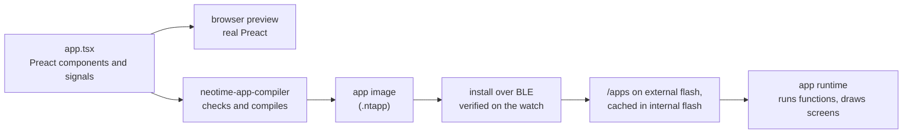

# App runtime

This page proposes how NeoTime apps are written, stored and run. Nothing here is built yet, and
the details will change as the runtime is written and measured. [app-reference.md](app-reference.md)
lists the events, widgets and effects apps can use.

## Goals

- **Apps are data, not programs.** An app declares its name, icon, state, screens, the events it
  answers and the sensors it wants. The runtime owns everything that runs: it schedules work,
  calls the app's functions, persists state and draws the screen with rlvgl.
- **Functions are pure.** An app function takes the current state and an event, and returns the
  state changes and the effects it wants, such as a vibration. It cannot touch hardware, loop
  forever or keep anything between calls.
- **Event driven, not ticking.** The runtime works out from what a screen shows when it must
  redraw, and sleeps otherwise. A stopwatch stores its start time and shows `now - start`, so
  nothing ticks while it runs.
- **Apps live on the external flash.** An app is read from its file a section at a time. Only
  its state, its expressions and the open screen take RAM, inside the 12 KB the
  [memory map](memory-map.md) gives the open app.
- **What apps share lives in the firmware's flash.** The internal flash holds no apps. Beside the
  firmware and its runtime, it keeps a shared library of images, fonts, components and functions
  that every app can use, so each app stays small.
- **A broken app cannot break the watch.** Every app image is checked when it is installed, and
  every call has a step limit.

## Choosing the format

| Option | How it would work | Why not |
|---|---|---|
| A JavaScript engine, such as [MicroQuickJS](https://github.com/bellard/mquickjs) | Apps ship as JS bytecode and run in the engine. | The engine alone needs about 10 KB of RAM and 100 KB of flash, the whole app budget before any state. |
| [Preact](https://preactjs.com) running on that engine | Apps are components that re-render on every change. | It needs the engine plus a virtual DOM, and re-renders on every change, which is the ticking this design avoids. Apps are still written as Preact components, but compiled ahead of time (see below). |
| WebAssembly, such as wasmi | Apps compile from any language to Wasm. | A Wasm memory page is 64 KB, all of the chip's RAM. The custom page sizes proposal would fix that, but runtime support is uncertain, and sandboxed native code is more than pure functions need. |
| [Slint](https://slint.dev) | Its language has a widget tree with property bindings and callbacks. | Its runtime targets chips with around 264 KB of RAM, and it is licensed GPL or commercially. Its language is still a good model to borrow from. |
| **NeoTime's own bytecode** | A compiler on the computer turns each app into a compact image that the runtime reads from flash. | This is the proposal. It costs a compiler and a small interpreter, both written in Rust. |

The closest existing designs evaluate the screen's bindings in the renderer, not in app code:

- [Wear OS dynamic expressions](https://developer.android.com/training/wearables/data/dynamic) bind
  a tile's text to an expression such as "platform time minus start", and the system keeps it
  current.
- [Remote Compose](https://proandroiddev.com/remotecompose-another-paradigm-for-server-driven-ui-in-jetpack-compose-92186619ba8f)
  ships a UI as a binary document, with a small RPN expression engine that has time and sensors
  built in.
- [Fitbit apps](https://dev.fitbit.com/build/guides/application/) pair a markup layout with
  handler code and load one view at a time.
- [Pebble's Alloy](https://moddable.com/blog/pebble/) runs standard JavaScript on Moddable's XS
  engine, with Piu as its declarative UI, on watches with far more RAM.

## How it fits together



## Writing an app

Apps are written as [Preact](https://preactjs.com) components in TypeScript, with state held in
[Preact Signals](https://preactjs.com/guide/v10/signals/). Preact never runs on the watch. The
compiler reads the components ahead of time and produces the app image, while the same source runs
on real Preact in a browser for previews.

Signals were chosen because they match what the runtime does. A `signal` holds a value, and a
`computed` is a value worked out from other signals that knows which ones it reads. On the watch, a
signal becomes a state slot, and a `computed` or a piece of JSX that reads signals becomes an
expression with an input mask. Only expressions whose inputs change are evaluated again, and
nothing re-renders.

```tsx
import { computed } from "@preact/signals";
import { define_app, persisted, now, format_duration } from "neotime";
import { Column, Label, Button } from "neotime/widgets";

const started_at = persisted<Instant | null>("started_at", null);
const stopped_after = persisted<Duration>("stopped_after", 0);

const elapsed = computed(() =>
  started_at.value ? now.value - started_at.value : stopped_after.value,
);

function toggle() {
  if (started_at.value) {
    stopped_after.value = now.value - started_at.value;
    started_at.value = null;
  } else {
    started_at.value = now.value - stopped_after.value;
  }
}

function reset() {
  stopped_after.value = 0;
}

function Stopwatch() {
  return (
    <Column>
      <Label font="large">{format_duration(elapsed.value, "mm:ss")}</Label>
      <Button onClick={toggle}>{started_at.value ? "Stop" : "Start"}</Button>
      {!started_at.value && <Button onClick={reset}>Reset</Button>}
    </Column>
  );
}

export default define_app({
  id: "stopwatch",
  name: "Stopwatch",
  icon: "./stopwatch.png",
  screens: { main: Stopwatch },
});
```

`Stopwatch` is never called on the watch. The compiler turns it into a fixed widget tree. The
label's text becomes one expression that reads `started_at`, `stopped_after` and `now`, and because
its pattern shows whole seconds the runtime redraws it once a second while the screen is on and the
stopwatch runs. The Reset button's `{... && ...}` becomes a binding on its `visible` property.

### From Preact to the watch

| In the source | On the watch |
|---|---|
| `signal(...)` at the top of the file | A state slot that lasts while the app is open. |
| `persisted("key", ...)` | A state slot saved to the app's key-value store, so it survives a reboot. |
| `useSignal(...)` inside a component | A state slot for that place in the tree, cleared when the screen closes. |
| `const` values that never change | Constants, kept in flash. |
| `computed(...)` | An expression with its own input mask. Expressions that read it inherit its inputs, and it is evaluated once however many widgets show it. |
| A function component and its props | Inlined into the widget tree wherever it is used. |
| JSX that reads `.value` | Expressions bound to widget properties. |
| `{condition && <Widget/>}` | The widget's `visible` property. |
| `array.value.map(...)` over a fixed-length array | A repeated row, one copy per element. |
| `onClick`, `onSwipe`, `onButton` | Handlers. An arrow function written inline is lifted out into a handler of its own. |
| `now`, `heart_rate`, `steps`, `battery` from `neotime` | System values the runtime provides. |
| `neotime/components`, `neotime/lib`, `icons`, fonts | References by number into the [shared library](#the-shared-library), never copied into the app. |

### Handlers

A handler is a function that writes to signals. It looks like mutation, but the compiler treats the
whole function as one transaction, as Signals' own `batch` does. Reads after a write see the new
value, and the writes are applied together when the function returns. A handler that fails, for
example by dividing by zero, changes nothing.

Effects, such as `vibrate(200)`, `go("settings")` and `notify("Timer done")`, are written as calls
from `neotime`. The runtime collects them and carries them out only after the handler has finished
without failing.

### Background work and screens

Anything that would be a timer or a `useEffect` in a web app is declared in `define_app` instead,
so the runtime can schedule it and run it while the app is closed:

```tsx
export default define_app({
  id: "heart-log",
  name: "Heart log",
  icon: "./heart.png",
  screens: { main: History, settings: Settings },
  subscriptions: [
    every({ minutes: 10 }, record_heart_rate),
    at(next_alarm, ring),
  ],
});
```

| Field | Holds |
|---|---|
| `id`, `name`, `icon` | Who the app is. |
| `kind` | `app`, the default, or `face`; a watch face has one screen and no buttons. |
| `screens` | One component per screen. `main` opens first, and the `go(...)` effect moves between them. |
| `subscriptions` | `every(period, handler)`, `sensor("heart_rate", handler)` and `at(instant, handler)`. An `at` time may be a signal, so changing an alarm reschedules it. |

### What the compiler accepts

Inside components and `computed`: `const`, arithmetic, comparisons, `&&`, `||`, `!`, `? :`,
calls to `neotime` functions and to the app's own functions (which it inlines), JSX, and `.map`
over fixed-length arrays.

Inside handlers, also: `let` locals, `if` and `else`, `for ... of` over fixed-length arrays,
writes to `.value`, and effect calls.

It rejects anything whose running time or state the runtime cannot see, and the error message
names the declarative form to use instead:

| Rejected | Use instead |
|---|---|
| `useState`, `useReducer`, `useRef` | `signal` or `useSignal` |
| `useMemo` | `computed` |
| `useEffect`, `setTimeout`, `setInterval` | `subscriptions`, or a binding that reads `now` |
| `while`, recursion | `for ... of` over a fixed-length array |
| `async`, `fetch`, classes | Not available; data from the phone arrives through a subscription |
| Imports other than `preact`, `@preact/signals` and `neotime` | Copy the code into the app |
| Creating a signal inside a handler | Declare it at the top of the file |

### Previewing in a browser

The `neotime` package also has a browser version. It draws each widget as a Preact component
inside a 240x240 frame styled like rlvgl, keeps `persisted` values in the browser's storage,
updates `now` from the computer's clock, and has a panel to fire sensor readings and subscriptions
by hand. An app can therefore be developed with Vite's hot reload and the Preact devtools.

The preview runs real JavaScript, so it would accept code the watch cannot run. The preview's dev
server therefore runs the NeoTime compiler on every save and shows its errors over the page.
The preview is close but not exact; the [simulator](simulator.md) shows the real pixels.

### Other ways to write apps

The image format does not depend on the source language, so another front end can be added later:

- **NeoTime's own language,** shaped like Slint or QML. It would read more cleanly and set no
  false expectations, but it needs its own parser, error messages and editor support.
- **KDL or RON for the tree, with expressions in strings.** This is the quickest way to feed the
  runtime while the bytecode settles, but it is unpleasant for logic.

## The compiler

`neotime-app-compiler` is a `std` command-line tool in the workspace, never built for the watch.

1. Parse the source with [oxc](https://oxc.rs), a TypeScript and JSX parser written in Rust.
2. Check that it stays inside the accepted subset, and resolve names against the `neotime` types.
3. Infer the type of every value. The bytecode carries no type tags, so types must be known here.
4. Give every signal, `persisted` and `useSignal` a state slot.
5. Inline the components of each screen into a widget tree, and turn every `computed` and every
   property that reads a signal into an expression.
6. Lift inline event functions out into handlers, and compile expressions and handlers to bytecode.
7. Work out each expression's inputs and redraw period.
8. Convert the icon and images to RGB565 with run-length encoding.
9. Write the image, and run the same verifier the watch uses.

Editors get type errors from TypeScript itself, through the type declarations in the `neotime`
package. The compiler does not depend on it.

## The app image

An image is little-endian and starts with a header, followed by sections that the header lists by
offset and size. The runtime reads the sections it needs from the file and never copies a whole
image into RAM.

| Section | Holds |
|---|---|
| Header | Magic `NTAP`, format version, app id, kind, the shared library version it was built against, the list of sections and a CRC32 of the image. |
| Strings | Every string the app uses: its name, labels and format patterns. |
| Resources | The app's own icon and images, RGB565 with run-length encoding. Anything from the shared library is referred to by number instead. |
| State | Each variable's key, type, default value and whether it persists. |
| Widgets | The widget tree in depth-first order. Each property is a constant or the number of an expression. |
| Expressions | One entry per dynamic property: its bytecode, its inputs as a bit mask, and its redraw period. |
| Handlers | Bytecode for each handler, and the event it answers. |
| Subscriptions | Each period, sensor or time the app wants, and the handler to call. |

### Where images live

Installed images are files in `/apps` on the external flash, each with its key-value store beside
it. The external flash cannot be read in place, so the runtime reads an image a section at a time.
When an app opens, the runtime copies its expressions into RAM, because they run on every redraw.
Handlers are read from the file when they run, which happens only on an event.

## The shared library

The internal flash keeps no apps. Its last 92 KB, after the firmware, holds the shared library:
everything common to apps that would otherwise be copied into each one. It can be read in place, so
using it costs no RAM.

| Part | Holds |
|---|---|
| Images | System icons, such as the battery, Bluetooth, heart and steps, and the icons of the built-in apps. |
| Fonts | The UI fonts at each size, so apps never carry their own. |
| Components | Ready-made widget trees with their bindings, such as a card, a list row, a header, a number picker and a confirm dialog. |
| Functions | Bytecode for common work: date and time formatting, unit conversion, small maths such as trigonometry from tables, sorting a fixed-length array. |
| Notification screens | The layouts that show a notification and the list of them. The notifications themselves are on the external flash. |

In the source, apps import these from the `neotime` package, for example
`import { Card } from "neotime/components"` or `icons.heart`. The compiler refers to them by number
instead of copying them into the image, and records the library version in the image's header. The
watch refuses an app built against a library it does not have.

The library changes only when it is updated, never in everyday use. Anything that changes often,
such as notifications, settings and app state, is stored on the external flash, whose file system
spreads writes across the chip. The internal flash wears out after about 10,000 erases.

The library is checked by the same verifier as an app image. It can be updated together with the
firmware or on its own, and a new version keeps the numbers of everything the old one had, so
installed apps keep working.

## The bytecode

The interpreter is a stack machine. Values are 8 bytes and carry no type tag, because the compiler
has already checked every type.

| Type | Stored as |
|---|---|
| `Int` | 32-bit signed integer |
| `Bool` | 0 or 1 |
| `Instant` | milliseconds since 1970, 64-bit |
| `Duration` | milliseconds, 64-bit |
| `Color` | RGB565 |
| `Text` | a string in the image, or a slice of the call's text buffer |
| `Array` | a fixed-length list of one type, in the app's state |

Instructions fall into these groups:

| Group | Instructions |
|---|---|
| Values | push a constant, read a state slot, read a system value (`now`, `heart_rate`, `steps`, `battery`, `is_charging`, ...), read an event field |
| Arithmetic | add, subtract, multiply, divide, remainder, negate, minimum, maximum, absolute value, with checked overflow |
| Logic | compare, `and`, `or`, `not`, and a forward-only jump for `? :` |
| Time | instant minus instant, instant plus duration, the parts of a duration, the date and time parts of an instant |
| Text | format a number, format a duration or time with a pattern, join texts |
| Arrays | read an element, the length, and a bounded loop for handlers |
| Results | set a state slot, emit an effect |

Expressions may only jump forward, so they always finish. Handlers may also loop, but only over a
fixed-length array. Each call also has a step limit.

### Checking an image

The watch checks every image when it is installed and refuses one that fails. It checks that:

- the CRC and format version are right;
- every instruction is known, every jump lands inside its code and expression jumps go forward;
- every state slot, string, expression and handler number is in range;
- the stack depth never goes above the limit at any instruction;
- every widget's properties exist on that widget.

Once an image has passed, the interpreter does not need to repeat these checks while it runs.

## The runtime

The runtime is part of the firmware, not a separate image. It runs in place from the internal flash
with the instruction cache on, as the rest of the firmware does, and the [memory map](memory-map.md)
sets aside 48 KB of the firmware's 384 KB for it. Only app data is ever read from the external
flash; no runtime code is.

### Opening an app

1. Open the image from `/apps` and read its header, checking the shared library version.
2. Load the state: defaults, overlaid with the values saved in the key-value store.
3. Copy the expressions into RAM, create the rlvgl widgets for the first screen and evaluate every
   expression once.
4. Note which expressions depend on the clock, and when each next needs a redraw.

### Events

Touches, buttons and swipes reach the handlers the widgets name. A handler runs to the end and
returns its state changes and effects. The runtime applies the changes, marks every expression
whose input mask includes a changed slot as dirty, and redraws only those properties. Persistent
slots that changed are written to the key-value store a moment later, so a burst of taps costs one
flash write.

### Time

The runtime never ticks on an app's behalf. It knows from each expression's redraw period, such as
"every second" for `mm:ss` or "every minute" for `HH:MM`, when the screen next changes. It sets one
timer for the earliest of those times, and none at all when the screen is off or nothing on it
depends on the clock.

### Background work

A subscription runs its handler even when the app is closed. For that the runtime loads only the
app's state and that one handler, never its widgets. Subscriptions from every app are merged, so
two apps that both want the heart rate every ten minutes share one measurement. Alarms are `at`
subscriptions with an absolute time, so a reboot or a clock change cannot lose them.

### Failures

A handler that overflows, divides by zero or runs past its step limit is stopped. Its changes and
effects are dropped, and the runtime shows a crash screen naming the app and the handler. A
subscription that keeps failing is turned off until the app is opened again.

## Memory

A rough budget for the open app, to be replaced by measurements:

| Part | Size |
|---|---|
| State: 32 slots of 8 bytes, plus small arrays | about 1 KB |
| Expression table: inputs, next redraw and the widget it sets, 8 bytes each | about 0.5 KB for 64 bindings |
| Interpreter stack, 32 values | 256 B |
| Text buffer for formatting | 256 B |
| Expression bytecode, copied in when the app opens | about 1 KB |
| Section reader for the image on the external flash | 256 B |

That is about 3.5 KB, which leaves most of the open app's 12 KB for larger arrays and for a second
app's state while a subscription runs. The widgets themselves are allocated from the UI heap.

## Open questions

- Whether to build the Preact front end first, or start with KDL to get the runtime running.
- How closely the browser preview must match rlvgl's layout before it is useful.
- How screens slide in and out, once the UI toolkit has page transitions.
- Which Bluetooth protocol carries phone data, such as the weather, music and app messages, to the runtime.
- Whether the step limit should be one number or depend on the event.

## Suggested order of work

1. The image format, the verifier and the interpreter as a `no_std` crate, tested on the computer
   with hand-written images.
2. The runtime in the simulator: open an app, draw its widgets, run handlers, redraw on time.
3. The compiler, starting with the stopwatch and a simple watch face, then the browser preview.
4. Persistence through the key-value store, then subscriptions.
5. Installing over BLE, the internal-flash cache, and running on the watch.
