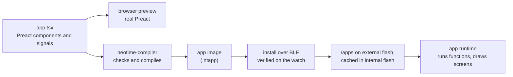

# App runtime

This page proposes how NeoTime apps are written, stored and run. Parts of it are built; see
[Built so far](#built-so-far). The details will change as the runtime is written and measured. [app-reference.md](app-reference.md)
lists the events, widgets and effects apps can use.

## Goals

- **Apps are data, not programs.** An app declares its name, icon, state, screens, the events it
  answers and the sensors it wants. The runtime owns everything that runs: it schedules work,
  calls the app's functions, persists state and draws the screen with `neotime-ui`.
- **Functions are pure.** An app function takes the current state and an event, and returns the
  state changes and the effects it wants, such as a vibration. It cannot touch hardware, loop
  forever or keep anything between calls.
- **Event driven, not ticking.** The runtime works out from what a screen shows when it must
  redraw, and sleeps otherwise. A stopwatch stores its start time and shows `now - start`, so
  nothing ticks while it runs.
- **Apps live on the external flash.** An app is read from its file a section at a time. Only
  its state, its expressions and the open screen take RAM, inside the 12 KB the
  [memory map](memory-map.md) gives the open app.
- **Apps are assembled from shared parts.** The firmware and the shared library hold the widgets,
  components, functions, images and fonts that apps have in common, and an app connects them like
  building blocks. RAM is the watch's scarcest resource, and shared parts are read in place from
  flash, so the less an app carries itself, the less RAM it takes and the easier it is to write.
  See [Building apps from shared parts](#building-apps-from-shared-parts).
- **A broken app cannot break the watch.** Every app image is checked when it is installed, and
  every call ends: a call that loops is stopped after 200,000 steps.

## Choosing the format

| Option | How it would work | Why not |
|---|---|---|
| A JavaScript engine, such as [MicroQuickJS](https://github.com/bellard/mquickjs) | Apps ship as JS bytecode and run in the engine. | The engine alone needs about 10 KB of RAM and 100 KB of flash, the whole app budget before any state. |
| [Preact](https://preactjs.com) running on that engine | Apps are components that re-render on every change. | It needs the engine plus a virtual DOM, and re-renders on every change, which is the ticking this design avoids. Apps are still written as Preact components, but compiled ahead of time (see below). |
| WebAssembly, such as wasmi | Apps compile from any language to Wasm. | A Wasm memory page is 64 KB, all of the chip's RAM. The custom page sizes proposal would fix that, but runtime support is uncertain, and sandboxed native code is more than pure functions need. |
| [Slint](https://slint.dev) | Its language has a widget tree with property bindings and callbacks. | Its runtime targets chips with around 264 KB of RAM, and it is licensed GPL or commercially. Its language is still a good model to borrow from. |
| **NeoTime's own bytecode** | A compiler on the computer turns each app into a compact image that the runtime reads from flash. | This is the proposal. It costs a compiler and a small interpreter, both written in Rust. |

The closest existing designs evaluate the screen's bindings in the renderer, not in app code:

- [Wear OS dynamic expressions](https://developer.android.com/training/wearables/data/dynamic) bind
  a tile's text to an expression such as "platform time minus start", and the system keeps it
  current.
- [Remote Compose](https://proandroiddev.com/remotecompose-another-paradigm-for-server-driven-ui-in-jetpack-compose-92186619ba8f)
  ships a UI as a binary document, with a small RPN expression engine that has time and sensors
  built in.
- [Fitbit apps](https://dev.fitbit.com/build/guides/application/) pair a markup layout with
  handler code and load one view at a time.
- [Pebble's Alloy](https://moddable.com/blog/pebble/) runs standard JavaScript on Moddable's XS
  engine, with Piu as its declarative UI, on watches with far more RAM.

## How it fits together



## Writing an app

Apps are written as [Preact](https://preactjs.com) components in TypeScript, with state held in
[Preact Signals](https://preactjs.com/guide/v10/signals/). Preact never runs on the watch. The
compiler reads the components ahead of time and produces the app image, while the same source runs
on real Preact in a browser for previews. The language is a subset of TSX compiled ahead of time,
not Preact itself: each component runs once while compiling, and [What the compiler
accepts](#what-the-compiler-accepts) lists the limits. Apps import everything from `neotime`, which
passes on `signal`, `computed` and `useSignal`, so only the SDK names Preact.

Signals were chosen because they match what the runtime does. A `signal` holds a value, and a
`computed` is a value worked out from other signals that knows which ones it reads. On the watch, a
signal becomes a state slot, and a `computed` or a piece of JSX that reads signals becomes an
expression with an input mask. Only expressions whose inputs change are evaluated again, and
nothing re-renders.

```tsx
import { computed, define_app, persisted, now, format_duration } from "neotime";
import { Column, Label, Button } from "neotime/widgets";

const started_at = persisted<Instant | null>("started_at", null);
const stopped_after = persisted<Duration>("stopped_after", 0);

const elapsed = computed(() =>
  started_at.value ? now.value - started_at.value : stopped_after.value,
);

function toggle() {
  if (started_at.value) {
    stopped_after.value = now.value - started_at.value;
    started_at.value = null;
  } else {
    started_at.value = now.value - stopped_after.value;
  }
}

function reset() {
  stopped_after.value = 0;
}

function Stopwatch() {
  return (
    <Column>
      <Label font="large">{format_duration(elapsed.value, "mm:ss")}</Label>
      <Button onClick={toggle}>{started_at.value ? "Stop" : "Start"}</Button>
      {!started_at.value && <Button onClick={reset}>Reset</Button>}
    </Column>
  );
}

export default define_app({
  id: "stopwatch",
  name: "Stopwatch",
  icon: "./stopwatch.png",
  screens: { main: Stopwatch },
});
```

`Stopwatch` is never called on the watch. The compiler turns it into a fixed widget tree. The
label's text becomes one expression that reads `started_at`, `stopped_after` and `now`, and because
its pattern shows whole seconds the runtime redraws it once a second while the screen is on and the
stopwatch runs. The Reset button's `{... && ...}` becomes a binding on its `visible` property.

### From Preact to the watch

| In the source | On the watch |
|---|---|
| `signal(...)` at the top of the file | A state slot that lasts while the app is open. |
| `persisted("key", ...)` | A state slot saved to the app's key-value store, so it survives a reboot. |
| `useSignal(...)` inside a component | A state slot for that place in the tree, cleared when the screen closes. |
| `const` values that never change | Constants, kept in flash. |
| `computed(...)` | An expression with its own input mask. Expressions that read it inherit its inputs, and it is evaluated once however many widgets show it. |
| A function component and its props | Inlined into the widget tree wherever it is used. |
| JSX that reads `.value` | Expressions bound to widget properties. |
| `{condition && <Widget/>}` | The widget's `visible` property. |
| `array.value.map(...)` over a fixed-length array | A repeated row, one copy per element. |
| `onClick`, `onSwipe` | Handlers. An arrow function written inline is lifted out into a handler of its own. |
| `now`, `heart_rate`, `steps`, `battery` from `neotime` | System values the runtime provides. |
| `neotime/components`, `neotime/lib`, `icons`, fonts | References by number into the [shared library](#the-shared-library), never copied into the app. |

### Handlers

A handler is a function that writes to signals. It looks like mutation, but the compiler treats the
whole function as one transaction, as Signals' own `batch` does. Reads after a write see the new
value, and the writes are applied together when the function returns. A handler that fails, for
example by dividing by zero, changes nothing.

Effects, such as `vibrate(200)`, `go("settings")` and `notify("Timer done")`, are written as calls
from `neotime`. The runtime collects them and carries them out only after the handler has finished
without failing.

### Background work and screens

Anything that would be a timer or a `useEffect` in a web app is connected with `on` at the top of the
file instead, so the runtime can schedule it and run it while the app is closed. `define_app` then
only says who the app is:

```tsx
on("tick", record_heart_rate, { every: 10 * MINUTE });
on("time", ring, { at: next_alarm });

export default define_app({
  id: "heart-log",
  name: "Heart log",
  icon: "./heart.png",
  screens: { main: History, settings: Settings },
});
```

| Field | Holds |
|---|---|
| `id`, `name`, `icon` | Who the app is. |
| `kind` | `app`, the default, or `face`; a watch face has one screen and no buttons. |
| `group` | The launcher group the app starts in, such as `games`: up to 16 letters, digits, `-` and `_`. [apps.md](apps.md) lists the usual ones. |
| `screens` | One component per screen. `main` opens first, and the `go(...)` effect moves between them. |

[app-reference.md](app-reference.md#events) lists every event `on` takes and its options. A `time`
may be a signal, so changing an alarm reschedules it. The compiler works out the app's permissions
from what it uses, so `define_app` takes no list of them.

### What the compiler accepts

Inside components and `computed`: `const`, arithmetic, comparisons, `&&`, `||`, `!`, `? :`,
calls to `neotime` functions and to the app's own functions (which it inlines, or compiles once and
calls when that is smaller), JSX, and `.map`
over fixed-length arrays.

Inside handlers, also: `let` locals, `if` and `else`, `for ... of` over fixed-length arrays,
writes to `.value`, effect calls and `random_int`. Numbers are whole numbers, and the
[app reference](app-reference.md#numbers) lists the `Math` functions accepted.

It rejects anything whose running time or state the runtime cannot see, and the error message
names the declarative form to use instead:

| Rejected | Use instead |
|---|---|
| `useState`, `useReducer`, `useRef` | `signal` or `useSignal` |
| `useMemo` | `computed` |
| `useEffect`, `setTimeout`, `setInterval` | `on` at the top of the file, or a binding that reads `now` |
| `while`, recursion | `for ... of` over a fixed-length array |
| `async`, `fetch`, classes | Not available; data from the phone arrives through an event |
| Imports other than `neotime` | Copy the code into the app |
| Creating a signal inside a handler | Declare it at the top of the file |

### Previewing in a browser

The `neotime` package also has a browser version. It draws each widget as a Preact component
inside a 240x240 frame styled like the watch, keeps `persisted` values in the browser's storage,
updates `now` from the computer's clock, and has a panel to fire sensor readings and subscriptions
by hand. An app can therefore be developed with Vite's hot reload and the Preact devtools.

The preview runs real JavaScript, so it would accept code the watch cannot run. The preview's dev
server therefore runs the NeoTime compiler on every save and shows its errors over the page.
The preview is close but not exact; the [simulator](simulator.md) shows the real pixels.

### Other ways to write apps

The image format does not depend on the source language, so another front end can be added later:

- **NeoTime's own language,** shaped like Slint or QML. It would read more cleanly and set no
  false expectations, but it needs its own parser, error messages and editor support.
- **KDL or RON for the tree, with expressions in strings.** This is the quickest way to feed the
  runtime while the bytecode settles, but it is unpleasant for logic.

## The compiler

`neotime-compiler` in `compiler/` is a `std` command-line tool in the workspace, never built for the
watch; [compiler.md](compiler.md) describes it in full. It works straight from the syntax tree:

1. Parse the source with [oxc](https://oxc.rs), a TypeScript and JSX parser written in Rust,
   together with the shared components in `sdk/neotime/src/components.tsx`.
2. Read the imports and top-level names, and give every signal, `persisted` and `useSignal` a
   state slot; a record gets one slot per field.
3. Render each screen once at compile time: inline every component, turn `&&` and `? :` around
   widgets into `visible`, unroll `.map`, and work out everything that reads no state.
4. Compile each property that changes into an expression and each event function into a handler,
   inlining `computed` and the app's functions, with the type of every value known.
5. Compile again until the values each variable may hold stop growing, to choose array widths.
6. Write the image, and run the same checks the watch runs at install.

What the image format cannot hold yet, such as subscriptions, lifecycle handlers and the icon, is
left out with a warning. Expressions do not record their inputs or redraw period, and an icon or
image is not converted yet. Editors get type errors from TypeScript itself, through the type
declarations in the `neotime` package. The compiler does not depend on it.

## The app image

The `neotime-runtime` crate (`runtime/`) reads and checks images; see [Built so far](#built-so-far).
An image is little-endian. It starts with a 20-byte header and a table of sections, and the runtime
reads the sections it needs in place, never copying a whole image into RAM.

| Bytes | Holds |
|---|---|
| 0–3 | Magic `NTAP`. |
| 4–5 | Format version, now 1. |
| 6 | Kind: 0 for an app, 1 for a watch face, 2 for the shared library, which holds only images. |
| 7 | Flags: bit 0 means the app's image 0 is its icon for the launcher. |
| 8–9 | The shared library version the app was built against. |
| 10–11 | How many sections follow. |
| 12–15 | CRC-32 (IEEE) of every byte from 16 to the end. |
| 16–17 | The string holding the app's id. |
| 18–19 | The string holding the app's name. |
| 20 on | One 12-byte entry per section: kind (2 bytes), entry count (2), offset from the start of the image (4), length (4). |

Each kind of section appears at most once:

| Kind | Section | Layout |
|---|---|---|
| 1 | Strings | A table of (offset, length) pairs, 2 bytes each, then the UTF-8 text they point into. |
| 2 | State | 16 bytes per variable: key string (2), type (1), flags (1), array length (2, 0 for a single value), reserved (2), default value (8). Flags bit 0 means the variable persists; bits 1–2 give an array's element width: 0 for 8 bytes, 1 for 1, 2 for 2, 3 for 4. An array starts with every element at the default. At most 64 variables, 2 KB in all and 1 KB for any one. |
| 3 | Expressions | A table of (offset, length) pairs, then the bytecode they point into. |
| 4 | Handlers | The same layout as expressions. |
| 5 | Widgets | A table of (offset, length) pairs, then one record per widget, described below. At most 128 widgets. |
| 6 | Subscriptions | 16 bytes per subscription, described below. |
| 7 | Resources | The app's own images, as a table of (offset, length) pairs followed by the images, described below. |
| 8 | Initial values | Optional. For arrays whose elements do not all start the same: a table of (offset, length) pairs, then per array its number (1 byte) followed by its elements packed exactly as they are stored in RAM. Every element is checked against the array's type. |
| 9 | Fonts | The shared library only; see [Property values](#property-values). |
| 10 | Functions | Optional. Up to 256 functions, the same layout as expressions. Each function's bytes start with its argument count, its result count (0 or 1) and how many locals it uses, then its code. |
| 11 | Launcher | Optional. 2 bytes: the string naming the launcher group the app declares. |
| 12 | Data | The shared library only. Files the firmware reads, the same layout as resources: number 0 is Bosch's configuration for a BMA421 accelerometer and 1 for a BMA425, in `LibraryData` order. |

Widgets are stored depth first, so a widget's children follow it, each with everything inside
it. Each root is one screen, and the first is the screen the app opens on. A widget record is:

| Bytes | Holds |
|---|---|
| 0 | The kind, numbered in the order of `WidgetKind` in `runtime/src/widgets.rs`. |
| 1 | How many children it has. Only containers, buttons, arcs and click areas may have any. |
| 2 | How many properties follow. |
| 3 | Reserved, 0. |
| 4 on | 6 bytes per property: its id (1), numbered in the order of `Property` in `runtime/src/widgets.rs`, where its value comes from (1: 0 a constant, 1 an expression, 2 a handler), and the value (4): the constant itself, a string number for text, an array's variable number for an array property, or the expression or handler number. |

Expressions do not record what they read or how often they redraw. The runtime works both out from
the code when the app opens, so a wrong compiler can never make a widget miss an update.

### Subscriptions

Each subscription is 16 bytes:

| Bytes | Holds |
|---|---|
| 0 | The kind, numbered in the order of `SubscriptionKind` in `runtime/src/subscriptions.rs`: open, close, screen on, screen off, every, at, daily, clock change, heart rate, steps, step goal, motion, acceleration, battery, phone, notification, call, music, weather, navigation, settings change, derive. |
| 1 | Flags: bit 0 means it only runs while the app is open. |
| 2–3 | The handler to call. |
| 4 | Where the value comes from: 0 the constant in bytes 8–15, 1 the state variable those bytes name. |
| 5 | Detail: the unit of a clock change (minute, hour, day), the kind of motion, battery or phone event. |
| 6–7 | For a daily time, the weekdays it runs on, bit 0 for Monday. |
| 8–15 | The value: a period in milliseconds, an instant, or a local minute of the day. |

Open, close, screen on and screen off are the app's own life; the rest are what the app's `on`
calls connect. Every, heart rate and acceleration repeat with a period. A period under a
minute, and any acceleration, must be marked only-while-open, so a closed app can never keep the
watch busy. An `at` or daily value may name a state variable, so changing it, such as moving an
alarm, reschedules without any other code. `Subscription::next_due` works out when a timer-like
subscription next fires, in local time.

A derive subscription keeps an array that is worked out from other state, such as a `computed`
array a CellGrid or Chart shows. The compiler gives it a hidden array and a handler that rebuilds
it; the runtime runs that handler when the app opens and again whenever anything the handler reads
changes, found the same way as an expression's inputs. Its effects, if any, are ignored.

### Images

An image starts with its format (1 byte: 0 colour, 1 mask), a reserved byte, then its width and
height (2 bytes each, at most 240). Then come runs: a colour image is runs of (count, RGB565
colour), 3 bytes each; a mask is runs of (count, coverage from 0 to 255), 2 bytes each, drawn in
the widget's colour, which is how icons follow the theme. Runs go left to right and top to bottom,
and may continue onto the next row. The image check confirms the runs cover every pixel exactly.

An image of format 2 holds no pixels: its 4 bytes are the format, a reserved 0 and the number of a
shared library image, which is drawn in its place. An app whose launcher icon is a library icon
keeps it this way as image 0, so the icon costs the app 4 bytes instead of several hundred.

An `image` or `icon` property names an image by number: below 32768 it is one of the app's own
images; 32768 to 65535 is the shared library's image of that number less 32768; and 65536 and up is
the launcher icon of the installed app of that number less 65536, image 0 of that app's own image. The shared library
is itself an image file of kind 2, holding only images, so the same reader serves both.

### Saving state

`AppState::save_persistent` writes every variable marked as persisting into a buffer, and
`load_persistent` reads it back. The saved form starts with `NTST`, a version byte and a count,
then for each variable its key, type, array length, element width and stored bytes. Loading
matches each saved variable to the app's by key, type, length and width, and skips any that no
longer match, so a new version of an app keeps what still fits and starts the rest from their
defaults. The firmware keeps the saved state in the app's folder on the external flash.

### Where images live

Installed images are files in `/apps` on the external flash, each with its key-value store beside
it. The external flash cannot be read in place, so the runtime reads an image a section at a time.
When an app opens, the runtime copies its expressions into RAM, because they run on every redraw.
Handlers are read from the file when they run, which happens only on an event.

## The shared library

The internal flash keeps no apps. The firmware image carries the shared library after its code:
everything common to apps that would otherwise be copied into each one. The image header says where
it starts, it arrives with each firmware update, and it can be read in place, so using it costs no
RAM. An app built against a newer library than the running firmware's is refused at install and
not opened.

| Part | Holds |
|---|---|
| Images | System icons, such as the battery, Bluetooth, heart and steps, and the icons of the built-in apps. |
| Fonts | The UI fonts at each size, so apps never carry their own. |
| Themes | The preset [themes](#theming) the user can choose from. |
| Components | Ready-made widget trees with their bindings, such as a card, a list row, a header, a number picker and a confirm dialog. |
| Functions | Bytecode for common work: date and time formatting, unit conversion, small maths such as trigonometry from tables, sorting a fixed-length array. |
| Notification screens | The layouts that show a notification and the list of them. The `notifications` app draws them today, and the notifications themselves are kept in RAM. |

In the source, apps import these from the `neotime` package, for example
`import { Card } from "neotime/components"` or `icons.heart`. The compiler refers to them by number
instead of copying them into the image, and records the library version in the image's header. The
packages service refuses to install an app built against a newer library than the firmware's, and
the watch does not open one either (`OpenError::LibraryTooOld`); it shows the face instead, or the
help screen if the face is the app refused.

The library changes only when it is updated, never in everyday use. Anything that changes often,
such as notifications, settings and app state, is stored on the external flash, whose file system
spreads writes across the chip. The internal flash wears out after about 10,000 erases.

Library functions are bytecode in the library image's functions section, numbered in the order of
`LIBRARY_FUNCTIONS` in `compiler/src/shared_functions.rs`, and compiled from the TypeScript in
`sdk/neotime/src/lib.ts`, so the browser preview runs the same code. An app calls one with
`call library`, which costs 5 bytes in place of the function's whole body. Library code takes only
its arguments and system values; text it gives back is copied into the app's text buffer. Without
an installed library the call fails and the property it feeds is left as it was.

The library is checked by the same verifier as an app image. It can be updated together with the
firmware or on its own, and a new version keeps the numbers of everything the old one had, so
installed apps keep working.

## Building apps from shared parts

This is the structure every app, face and runtime change should follow. The watch has 64 KB of
RAM, and an open app gets about 12 KB beside the UI heap. An app's image is read from `/apps` into
RAM when it opens and every widget of its screen takes a node in the UI heap, so every byte an app
carries and every widget it builds costs RAM for as long as it is open. Code and data in the
internal flash are read in place and cost none. So the work is split into three layers:

| Layer | Lives in | RAM while an app is open | Holds |
|---|---|---|---|
| Native widgets and builtins | The firmware, in Rust | One node per widget; the code costs none | Composite widgets with logic of their own, such as a time picker, the status icons or the list of installed apps, and work over whole arrays, such as sliding a 2048 board |
| The shared library | Inside the firmware image, after its code, read in place | None | Functions, components, images, fonts, strings and themes that two or more apps use |
| The app | `/apps` on the external flash, read into RAM when it opens | All of it | Its own state, its layout, and the few lines that connect the shared parts and are unique to it |

Rules for each change:

- **Look in the shared parts first.** Before writing a helper, a component or a table in an app,
  check `neotime`, `neotime/components`, `neotime/lib` and the widgets in
  [app-reference.md](app-reference.md). Use them rather than writing the same thing again.
- **Move what repeats.** When a second app needs code that one app has, move it into the shared
  library and make both use it. Write it generically, with parameters for what differs, so later
  apps can use it too.
- **Make composites native.** A widget built from many widgets with logic between them, such as a
  picker, a dialog or a list, belongs in the firmware as one widget: one node instead of many, and
  no bytecode in the app.
- **Make heavy work native.** A loop over a whole array that runs often, such as a game board's
  move or a neighbour count, is far smaller and faster as a builtin than as bytecode.
- **Keep apps out of the internal flash.** It holds only the bootloader, the firmware and the
  shared library. Apps, faces and anything that changes often stay on the external flash.
- **Never renumber the library.** An installed app refers to library parts by number, so a new
  version keeps every number the old one had and adds new parts at the end.

What is built so far: the runtime runs an app's own functions with `call` and the shared library's
with `call library` (see [The bytecode](#the-bytecode)). The compiler compiles an app function it
would otherwise copy into several places once and calls it, and turns code that repeats with only
its constants changed into shared functions. The shared library holds the icons, the fonts and the
functions of `neotime/lib`, and for the firmware alone the accelerometers' configuration files. The firmware draws the native composites, such as `AppList`,
`StatusIcons`, the pickers and `ConfirmBox`, and answers the array functions of `neotime` (from
`count_of` to `life_step`) natively. Together they took the 49 apps and faces from 197 KB to about
90 KB. Library components, more functions and more native builtins are open work, listed under
"Shared library and smaller apps" in [todo.md](todo.md); until library components exist, those
from `neotime/components` are inlined into each app.

## The bytecode

The interpreter is a stack machine with room for 32 values. Values are 64 bits and carry no type
tag, because the compiler has already checked every type.

| Type | Stored as |
|---|---|
| `Int` | a 64-bit signed integer; there are no fractions |
| `Bool` | 0 or 1 |
| `Instant` | milliseconds since 1970 in UTC; an empty optional, such as a stopwatch that has not started, is the smallest 64-bit number |
| `Duration` | milliseconds |
| `Color` | RGB565, or a reference to a [theme colour](#theming) |
| `Text` | the number of a string in the image, or a slice of the call's 256-byte text buffer |

Each instruction is one opcode byte followed by its operands:

| Opcode | Instruction | Operands | Does |
|---|---|---|---|
| `01` | push small | 1 byte, signed | Pushes a number from -128 to 127. |
| `02` | push int | 4 bytes, signed | Pushes a 32-bit number. |
| `03` | push long | 8 bytes, signed | Pushes a 64-bit number, such as an instant. |
| `04` | push none | | Pushes the empty optional. |
| `05` | push text | string, 2 bytes | Pushes a string from the image. |
| `06` | read state | slot, 1 byte | Pushes a state variable. In a handler, it sees the handler's own earlier writes. |
| `07` | read system | value, 1 byte | Pushes a system value (see below). |
| `08` | read event | field, 1 byte | Pushes one of the event's 8 fields. Handlers only. |
| `0F` | read system element | value, 1 byte | Takes an index and pushes that element of a list value, such as one day of the forecast, or none past its end. The verifier rejects a list read whole and a single value read by element. |
| `0E` | read event text | field, 1 byte | Pushes a text field of the event, such as a notification's title; the runtime copies it into the call's text buffer. Handlers only. |
| `09`, `0A`, `0B` | duplicate, drop, swap | | Stack housekeeping. |
| `0C` | read local | local, 1 byte | Pushes one of the call's 16 locals, which all start at 0. |
| `0D` | write local | local, 1 byte | Takes a value into a local. |
| `10`–`14` | add, subtract, multiply, divide, remainder | | Whole-number arithmetic. Overflow and division by zero fail the call; division rounds toward zero. |
| `15`–`18` | negate, minimum, maximum, absolute | | |
| `1A`–`1D` | bit and, bit or, bit xor, bit not | | For masks, such as the days an alarm rings. |
| `1E`, `1F` | shift left, shift right | | By 0 to 63 places; any other amount fails the call. Shifting right keeps the sign. |
| `19` | random int | | Takes a lowest and a highest number and pushes a random one between them, both included. Handlers only, so expressions always give the same answer. |
| `20`–`25` | equal, not equal, less, less or equal, greater, greater or equal | | Push 1 or 0. |
| `26` | not | | 1 for 0, else 0. |
| `27` | is none | | 1 if the value is the empty optional. |
| `28` | jump | distance, 2 bytes | Skips forward that many bytes. There is no way to jump backward. |
| `29` | jump if false | distance, 2 bytes | Takes a value and skips forward if it is 0. `? :`, `&&` and `\|\|` compile to this. |
| `2A` | loop start | | Marks where a loop begins. The stack must be empty here. |
| `2B` | loop back | distance, 2 bytes | Goes back that many bytes, counted from the end of this instruction, to a loop start. The stack must be empty here too. |
| `2C` | call | function, 1 byte | Takes the function's arguments into its first locals, runs it, and leaves its result, if it has one. The function sees only the stack above what the caller had, and its own locals. |
| `2D` | read row | | Pushes the number of the row of a `Repeat` the code runs for, or 0 outside one. |
| `2E` | call library | function, 2 bytes; arguments, 1 byte; results, 1 byte | Runs a function of the shared library as `call` runs one of the app's. The call fails unless the library is installed and the function takes that many arguments and gives that many results. |
| `30` | time part | part, 1 byte | Takes an instant and pushes its local year, month, day, hour, minute, second or weekday (0 to 6, Monday first). |
| `31` | start of | unit, 1 byte | Takes an instant and pushes the start of its local minute, hour or day. A binding that uses it redraws once a minute. |
| `40` | format number | minimum digits, 1 byte | Takes a number and pushes it as text, padded with zeros. |
| `41` | format duration | pattern string, 2 bytes | Takes a duration and pushes it as text in the pattern. |
| `42` | format time | pattern string, 2 bytes | Takes an instant and pushes the local time as text in the pattern. |
| `43` | join | | Takes two texts and pushes them joined. |
| `44` | text from codes | array, 1 byte | Takes a count and pushes text made of that many character codes from the start of the array. |
| `45` | to upper | | Takes text and pushes it in capitals. |
| `46` | text length | | Takes text and pushes how many characters it has. |
| `47` | slice text | | Takes text, a start and an end, and pushes the characters between them; a negative position counts from the end, as JavaScript's `slice` does. |
| `48` | pad start | | Takes text, a width and a character code, and pushes the text with that character added in front up to the width. |
| `49` | format fixed | | Takes a number, a count of decimal places and a flag, and pushes the number as text with that many places, such as 1250 with 3 places as `1.250`; with the flag set, trailing zero decimals are left off. |
| `50` | write state | slot, 1 byte | Takes a value for a state variable. Handlers only. |
| `51` | effect | effect, 1 byte | Takes the effect's arguments and records it. Handlers only. |
| `60` | read element | array, 1 byte | Takes an index and pushes that element. An index outside the array fails the call. |
| `61` | write element | array, 1 byte | Takes an index and a value and writes that element. A value too wide for the element fails the call. Handlers only. |
| `62` | copy array | destination and source arrays, 1 byte each | Copies every element; the two must be the same length. Handlers only. |
| `63` | fill array | array, 1 byte | Takes a value and writes it to every element. Handlers only. |
| `64` | ask array | question, 1 byte; array, 1 byte | Takes the question's arguments and pushes the answer: how many elements equal a value, where the `n`th one is, the longest line of a value through a cell of a grid, whether a 2048 slide would change the grid, what it scores, or how many pairs are out of order. |
| `65` | work array | work, 1 byte; destination, 1 byte; source, 1 byte | Compares two arrays of one length, or writes the destination from the source: the Game of Life's next generation, the grid after a 2048 slide, the source moved one place along with a value taken from the stack added at the end or the front, or the source with some of its places shuffled, or (work 6) the first bytes of the file whose path, an image string, is taken from the stack, read through `SystemValues::read_file` with 0 past its end. Works are numbered 0 equal, 1 life step, 2 slide, 3 push last, 4 push first, 5 shuffle and 6 file bytes. Writing is for handlers only, and the source may be the destination. |

System values, in the order `read system` numbers them: `now`, `utc_offset`, `battery_percent`,
`is_charging`, `steps_today`, `heart_rate`, `heart_rate_measured_at`, `is_phone_connected`,
`unread_notifications`, `is_do_not_disturb`, `brightness`, `uses_24_hour_clock`,
`uses_metric_units`, `step_goal`, `is_heart_rate_running`, `is_bluetooth_enabled`, `next_alarm`,
`heart_rate_status`, and the weather's `temperature`, `condition`, `low`, `high`,
`received_at`, `sunrise`, `sunset` and `location`, the music's `is_playing`, `artist`, `track`,
`position` and `length`, the navigation's `turn`, `instruction`, `distance` and
`progress_percent`, and the forecast's length followed by its lists of each day's `condition`,
`low` and `high`, the installed apps' count followed by their lists of `name`, `id` and `icon`,
the settings' `screen_timeout_seconds`, `always_on_screen`, `chimes` and `theme`, then
`battery_millivolts`, which shares `battery_percent`'s bit, and the kept notifications' count
followed by their lists of `id`, `app`, `title`, `body` and `time`, the step history's `trip`,
its day count and list of each day's `total`, and its hour count and list of each hour's `steps`,
which share `steps_today`'s bit, and `firmware_version`, `started_at`, `free_storage_kilobytes`
and `reset_reason`, then the settings' `allows_updates`, `wake_on_touch` and
`alarms_in_do_not_disturb`, which share the other settings' bit, then the installed packages'
count followed by their lists of `name`, `id`, `enabled`, `is_face`, `memory` and `refusal`,
which share the installed apps' bit, and `app_memory_budget`, which shares the system info bit.
`read system element` reads a list's elements through `SystemValues::read_element`, or
`read_element_text` for the names, ids and notification texts, the packages' too. The location, artist, track,
instruction, firmware version and reset reason are text: the system hands them
over through `SystemValues::read_text`, and `read system` copies them into the call's text buffer.
Values the phone sends together share one bit of an input mask, so all the weather values redraw
together, and the four a system info screen shows share another; that keeps the mask in 32 bits.

Effects, in the order `effect` numbers them, with how many arguments each takes: `vibrate` (1),
`vibrate_pattern` (1), `stop_vibrating`, `set_brightness` (1), `keep_screen_on` (1),
`wake_screen`, `screen_off`, `go` (1), `back`, `open_app` (1), `close`, `show_toast` (1),
`notify` (2), `dismiss_notification` (1), `mark_notifications_read`, `send_to_phone` (2),
`music_control` (1), `call_control` (1), `find_phone` (1), `measure_heart_rate`,
`start_heart_rate`, `stop_heart_rate`, `reset_step_trip`, `set_setting` (2), `set_do_not_disturb` (1),
`log` (1), `request_music_state`, `set_heart_rate_led` (3), `set_bluetooth` (1),
`request_navigation_state`, `set_app_enabled` (2).
`send_to_phone`'s two arguments are texts: the channel, and the data as the JSON object the compiler
builds, which the firmware sends as `{"t":"app","ch":...,"d":...}`.
`vibrate_sequence` and `http_request` need arrays and more arguments, and come later.

Only `loop back` goes backward. A call stops with a failure after 200,000 instructions, which
should be roughly a fifth of a second on the watch; that figure is not yet measured.

A handler never writes to the app's state directly. The first time it writes to a variable, the
interpreter copies the whole variable into a 1 KB scratch area, and every later read and write of
that variable uses the copy. When the handler finishes, the copies are written back and the
outcome lists which variables changed; when it fails, the copies are dropped. So one handler can
change at most 16 variables and 1 KB of state.

### Checking an image

The watch checks every image when it is installed and refuses one that fails. Reading the header
checks:

- the magic, the format version and the CRC;
- that every section and every table entry lies inside the image, and no section repeats;
- that every string is UTF-8, and every state variable has a known type and a default that fits it.

Then one pass over each expression and handler checks:

- that every instruction and operand is known, and every state slot and string exists;
- that every format pattern is valid, so a typo in one is caught at install;
- that every jump lands on the start of an instruction or the end of the code;
- that single-value instructions only name single values and array instructions only arrays, that
  copied arrays have the same length, and that locals are within the 16;
- that every loop back lands on a loop start, and the stack is empty at both;
- that every call names a function numbered below the code calling it, so no call can recurse, and
  that calls nest at most 8 deep with their locals inside the pool of 48;
- that a function's header asks for at most one result and no more arguments than locals, and its
  code leaves exactly that result;
- that the stack never goes below empty or above 32 values, and that every path into a jump
  target arrives with the same depth;
- that an expression ends with exactly one value and a handler with none;
- that expressions do not read events, write state, cause effects or use random numbers, nor call
  a function that does;
- in the shared library, that no function reads or writes state, reads the event, causes an
  effect, draws a random number or calls the library, since its code runs for every app.

Last, a pass over the widgets checks:

- that they form whole trees no deeper than 16 levels, and only containers, buttons, arcs and
  click areas have children;
- that every property exists on its widget, appears once, and screen-wide ones such as `onSwipe`
  are only on a screen's root;
- that every event names a handler, every other property is a constant or an expression, and every
  expression, handler and string named exists;
- that constants fit: a flag is 0 or 1, a colour is RGB565 or a theme colour, text names a string,
  and an array property, such as a CellGrid's `cells`, names an array variable directly rather than
  through an expression.

The interpreter still checks every step as it runs, so even an image that slipped past makes a call
fail rather than crashing the watch.

## The runtime

The runtime is part of the firmware, not a separate image. It runs in place from the internal flash
with the instruction cache on, as the rest of the firmware does, and the [memory map](memory-map.md)
sets aside 48 KB of the firmware's 384 KB for it. Only app data is ever read from the external
flash; no runtime code is.

### Opening an app

1. Open the image from `/apps` and read its header, checking the shared library version.
2. Load the state: defaults, overlaid with the values saved in the key-value store.
3. Copy the expressions into RAM, build the nodes for the first screen and evaluate every
   expression once.
4. Work out from the code which inputs each expression reads, and how often the clock changes
   what it shows.

### Events

Touches, buttons and swipes reach the handlers the widgets name. A handler runs to the end, its
changes are written back to the state, and it returns which variables changed and its effects.
The runtime marks every expression whose input mask includes a changed variable as dirty, and
redraws only those properties. Persistent
slots that changed are written to the key-value store a moment later, so a burst of taps costs one
flash write.

A handler reads its event's fields by position. `runtime/src/events.rs` fixes the order, and the
compiler and the runtime both follow it:

| Event | Fields |
|---|---|
| `onClick`, `onLongPress`, `onDoubleClick`, `onPress`, `onRelease` | `x`, `y`, `value` |
| `onDrag` | `x`, `y`, `start_x`, `start_y`, `value` |
| `onSwipe` | `direction`: 0 up, 1 down, 2 left, 3 right |
| `onChange` | `value` |
| `onPageChange` | `page` |
| `onScrollEnd` | `offset` |
| `onShow`, `onHide` | none |
| Timers, alarms, daily times and clock changes | `time` |
| `heart_rate_reading` | `beats_per_minute`, `confidence` |
| `steps`, `step_goal` | `steps_today` |
| `motion` | `kind` |
| `acceleration` | `x`, `y`, `z` |
| `battery` | `percent` |
| `phone` | `is_connected` |
| `notification` | `id`, `app` (text), `title` (text), `body` (text), `time` |
| `call` | `kind`, `caller` (text) |
| `settings_change` | `key` (text) |
| `music`, `weather`, `navigation`, and the app's open, close, screen on and screen off | none; the new values are system values |

Text fields are read with `read event text`, not `read event`; the host passes them with
`Interpreter::run_handler_with_text`.

A touch's `value` is the number of the cell or button touched in a CellGrid or ButtonMatrix, or the
place of the app touched in an AppList, and 0 for any other widget. A screen's root may take `onDrag`, for drawing or steering across the whole
screen.

### Time

The runtime never ticks on an app's behalf. It knows from each expression's redraw period, such as
"every second" for `mm:ss` or "every minute" for `HH:MM`, when the screen next changes. The period
is the smallest unit the expression's format patterns show, such as a second for `ss` and a minute
for anything coarser; hundredths are capped at a tenth of a second,
and an expression that reads the clock without formatting it redraws once a second. Steps are
counted on the wall clock, so a minute display changes as each minute begins. It sets one
timer for the earliest of those times, and none at all when the screen is off or nothing on it
depends on the clock.

### Background work

A subscription runs its handler even when the app is closed. For that the runtime loads only the
app's state and that one handler, never its widgets. Subscriptions from every app are merged, so
two apps that both want the heart rate every ten minutes share one measurement. Alarms are `at`
subscriptions with an absolute time, so a reboot or a clock change cannot lose them.

### Failures

A handler that overflows, divides by zero or runs past its step limit is stopped. Its changes and
effects are dropped, and the runtime shows a crash screen naming the app and the handler. A
subscription that keeps failing is turned off until the app is opened again.

### The app host

`neotime-app-host` (`app-host/`) is the loop that runs one open app. It is built and tested, and
the [simulator](simulator.md) runs app images with it. It takes the whole image as bytes; it does
not yet read an image a section at a time from the external flash.

`AppHost::open` parses and verifies the image, sets up the state and the bindings, and opens the
first screen:

1. It makes one node for each widget of the screen whose parents are all visible, which the host
   draws from its values. A hidden widget keeps its own node, which holds its `visible`, but nothing
   inside it has one, so a closed dialog costs no UI heap.
2. It reads each node's properties once: constants straight from the image, expressions through
   the interpreter. Text comes from `Interpreter::text`.
3. It lays the screen out, as [Layout](#layout) describes.
4. It runs the screen's `onShow`, if it has one.

When a widget is shown or hidden, the host builds the nodes again to match: the nodes that stay
keep their values, the ones inside a newly shown widget have their properties worked out, and
where the dropped ones were drawn is painted over.

`open_with_saved_state` does the same, with the bytes `save_changed_state` once wrote put over the
defaults first; saved state that does not fit, such as another app's, is ignored.
`open_in_background` loads the state without opening a screen, so a closed app's subscriptions can
run. `set_library(bytes)` gives the host the shared library, for images numbered 32768 and up, and
`set_installed_apps(images)` gives it the installed apps, whose icons are numbered 65536 and up.

What happens next is driven by the embedder:

| Call | Does |
|---|---|
| `touch(touch, now, system)` | Finds the topmost shown widget under the finger that has a handler for the event, and runs it. A swipe goes to the screen's `onSwipe`. A tap on a `Switch`, or a tap or drag on a `Slider`, sends `onChange` with the new value. |
| `go_back_a_screen(now, system)` | Goes back one of the app's screens, as a click of the side button does; not handled on the first screen. |
| `tick(now, system)` | Runs the timer-like subscriptions that are due, and works out again the open screen's expressions that `Bindings::due_between_among` says the clock has changed. |
| `next_wakeup(now)` | The earliest of: when the clock next changes something on the open screen, the next due subscription, and the next step of a scrolling label. None means sleep until an event. |
| `bring_to_front`, `close`, `screen_turned_on`, `screen_turned_off` | Run the `Open`, `Close`, `ScreenOn` and `ScreenOff` subscriptions. A closed app keeps only subscriptions without `only_while_open`. |
| `deliver(event, now, system)` | Hands a `PushedEvent` to the subscriptions of its kind: steps, motion, heart rate, battery, phone, notifications and calls (with their text), music, weather, navigation and settings changes. Acceleration readings are kept and handed over at each subscription's period. |
| `save_changed_state(out)` | Writes the persistent state when any of it changed since the last save, else returns `None`. `LARGEST_SAVED_STATE_BYTES` is always big enough. |
| `system_values_changed(bits, now, system)` | Works out again what reads the system values that changed, such as the battery. `bits` is `SystemValue::bit` of each, or'd together; values the phone sends together, such as the weather, share one bit. |
| `report_system_value_changes(bits, now, system)` | Does the same, then delivers the events some changes stand for, reading the new values from `system`: `steps` when `steps_today` changed and `phone` when `is_phone_connected` did. The firmware's shell and the test watch's `set_system_value` call it. |
| `set_theme(theme)` | Resolves every colour again from the values already held. No app code runs. |
| `draw(screen)` | Paints only the parts of the screen that changed. |
| `take_changed_persistent_variables()` | Which persistent variables changed since the last call, one bit each, so the embedder can save them. |

An event answers `Handled`, `NotHandled` or `Failed`. `NotHandled` means the system's own meaning
applies, such as a swipe right going back.

After a handler finishes, the host:

1. carries out its effects in order;
2. works out again only the expressions `Bindings::affected_by` names for the variables it changed;
3. lays the screen out again, and marks every widget whose value, place or visibility changed;
4. switches screen, if the handler called `go` or `back`.

`go(screen)` and `back()` are handled by the host. It finds the screen with
`WidgetTree::screen_named`, and keeps a history of up to 8 screens for `back()`. `back()` on the
first screen, a `go` to a screen that does not exist, and a `go` or `back` from `onShow` or `onHide`
are passed on to the embedder. Every other effect goes to the embedder's `System`, whose
`carry_out` gets the effect with its arguments readable as numbers or text.

Effects are carried out as soon as the handler returns, before the interpreter runs anything else,
so a text argument the handler built, such as ``show_toast(`${count}`)``, is still readable
through `AppEffect::text`. Text system values, such as the playing track, come from
`SystemValues::read_text`.

When a handler or an expression fails, the host calls `System::app_failed` and keeps the app open.
A failed handler changes nothing, and a failed expression leaves its property as it was. A
subscription that fails 3 times in a row is turned off until the app is next opened.

Timer subscriptions line up with the clock: `on("tick", update, { every: MINUTE })` fires on each whole minute, not a
minute after opening. An `At` time that has passed fires once and is remembered until its value
changes, but that memory is not saved, so after a restart a passed `At` fires again unless its
handler moved the time. `Derive` subscriptions run when the app opens and whenever what they read
changes; their effects are ignored. Showing
a crash screen is the embedder's job.

Drawing needs no screen buffer. Each changed widget marks where it was last drawn and where it is
now. The host paints each of those regions from the theme's background up, drawing every shown
widget that overlaps it, clipped to the region. So a ticking label repaints only its own box.

### Layout

Layout is a small flexbox, worked out again whenever a value changes:

- **`Column` and `Row`** place their children down or across, one after another. Spare space is
  shared out between children with `grow`, in proportion. Across the flow, a child fills the space
  unless it has a size or an `align`; then it takes that size, or the size it wants, and `align`
  places it.
- **`Stack` and `Button`** put their children on top of each other. Each fills the inside unless
  it has a size or an `align`, except an `Icon`, which keeps its own size in the middle.
- **`x` and `y`** take a widget out of the flow and place it at that offset inside its parent.
- **A hidden widget** takes no space.
- **`padding`** is space inside a widget on every side; **`margin`** is space outside it.
- **The screen's root** fills the screen unless it has a size.
- **`gap`** is space between children, and **`justify`** spreads them along the flow: 0 `start`,
  1 `center`, 2 `end`, 3 `space_between`. **`align_items`** places them across it, with 4
  `stretch`.
- **`opacity`** is multiplied down through parents; a **`disabled`** widget is drawn at half
  opacity and ignores touches.
- **`Grid`** places its children in rows; **`Scroll`** and **`List`** scroll by dragging and send
  `onScrollEnd` when a drag ends. Their **`scrolling`** property holds flags: 1 settles a drag on
  a whole page, 2 lays the children out across and scrolls them sideways (a `Scroll` or `List`
  only), and 4 leaves the scroll bar out. A `TextFile` takes 1 and 4. While a scrolling widget's
  content is longer than it, layout keeps 4 pixels on its right, or bottom when it runs across,
  and the host draws the bar there over everything else. A drag scrolls only a widget that runs
  the way the drag mostly goes, so a drag across leaves a list that runs down alone.
- **`Pages`** builds only the page on show, the child numbered by its `value`. A swipe left turns
  to the next page and a swipe right to the one before, with a wipe the way the finger went, and
  sends `onPageChange` with the new page; a swipe past the first or last page, or up or down, goes
  on to the screen's `onSwipe` and then the shell. With more than one page it keeps 4 pixels along
  its bottom for a page bar: a segment per page, the one on show in the muted grey. A growing
  `Pages` fills the space left, whatever its page holds. An app that turns the page itself binds
  `value` to a signal and sets it in `onPageChange` too; when the bound value changes, the new page
  wipes in from the side it lies on. **`Tabs`** is laid out like a `Column`
  for now.

A widget with no size gets the size it wants: a label's text, a button's text plus room around it
(at least 44 pixels high), and fixed sizes for the rest, such as 100 pixels for an arc.

### Property values

The image stores each property as one 32-bit number. The compiler and the host must agree on what
the numbers mean. These are the meanings the host uses now:

| Property | Value |
|---|---|
| `x`, `y` | Pixels from the parent's inside top-left corner. |
| `width`, `height` | Pixels when 0 or more. A negative value is a percentage of the parent's inside, so `"100%"` is `-100`. |
| `grow` | A weight, 0 or more. |
| `padding`, `margin`, `border_width`, `radius` | Pixels. |
| `background`, `color`, `border_color` | RGB565, or a theme reference; see [Theming](#theming). |
| `font` | 0 `small`, 1 `normal`, 2 `medium`, 3 `large`, 4 `huge`, 5 `giant`, 6 `seven_segment`, 7 `dot_matrix`, 8 `condensed`, in the order of the [app reference](app-reference.md#common-props). Any other number is `normal`. |
| `align` | 0 `start`, 1 `center`, 2 `end`. Any other number means not set. |
| `visible` | 0 or 1. |
| `value`, `minimum`, `maximum` | Whole numbers. `minimum` is 0 and `maximum` 100 unless set. |
| `start_angle`, `end_angle` | Degrees clockwise from twelve o'clock, as everywhere in the app API. Used only when both are set; an arc otherwise runs from 225 to 135, leaving a gap at the bottom. The host turns them into its arc drawing's angles, which start at three o'clock. |
| `long_mode` | 0 `wrap`, 1 `scroll`, 2 `clip`. Labels wrap at spaces by default. |
| `image`, `icon` | An image number: below 32768 the app's own, 32768 to 65535 the shared library's, 65536 and up an installed app's icon. |

Event fields `x`, `y`, `start_x` and `start_y` are screen pixels.

The fonts are anti-aliased bitmaps with 4-bit coverage, made by `tools/generate_fonts.py` from the
fonts in `third_party/fonts/` and kept in `app-host/fonts/`:

| Font | Made from | Characters | Bytes |
|---|---|---|---|
| `small`, `normal`, `medium` | JetBrains Mono Bold at 16, 20 and 30 pixels | ASCII | 5,389, 6,254, 9,538 |
| `large` | JetBrains Mono ExtraBold at 42 | ASCII | 13,526 |
| `huge` | JetBrains Mono Light at 76 | Digits and clock characters | 5,344 |
| `giant` | Open Sans Light at 120 | Digits and `:` | 6,018 |
| `condensed` | JetBrains Mono Bold at 48, squeezed to 70% width | Digits and clock characters | 1,850 |

`seven_segment` and `dot_matrix` are drawn from segments and dots, so they take no font data. The
seven fonts, 48,462 B in all, live in the shared library's font section (section 9, which only a
library has), in the order above. The app host's font slots start empty, and the embedder calls
`fonts::install_from_library` once with the library inside the firmware; until then text takes no room. The
`built-in-fonts` feature starts them filled from `app-host/fonts/`, for the simulator and tests.

### Widgets in the host

| Widget | Drawn with | Notes |
|---|---|---|
| `Column`, `Row`, `Stack`, `Grid` | The host's frame | Transparent unless they have a `background`. |
| `Scroll`, `List` | The host's frame | Drag to scroll; `onScrollEnd` when the drag ends. One that grows takes only the room left over and scrolls the rest. |
| `Repeat` | The host | Its one child, the row, built once for each of `row_count` rows, each run with its row number for `ReadRow`. Laid out as its parent's own children, so `justify`, `gap` and grid columns treat its rows as before. Down a `List` or `Scroll`, when the row has a fixed `height`, the host instead works out which rows show without building them, leaves a slot for each, and builds nodes only for the rows that can be seen, building and dropping rows as the list scrolls. |
| `Label` | The host's text drawing | Wraps at spaces; `long_mode` scroll and clip work. `align` places the text across. |
| `Button` | The host's frame with a label or icon | `background` defaults to the theme's `surface`, and `radius` to 12. |
| `Image`, `Icon` | The host's image drawing | Colour images as they are, masks in `color`. A missing image draws a placeholder box. |
| `Arc` | `widgets::draw_arc` | `background` is the track and `color` the filled part; `border_width` is the ring's thickness. Its children are laid out as a column centred in it. Not draggable yet. |
| `Bar`, `Slider`, `Switch`, `Led`, `ClickArea` | `widgets.rs` | A tap on a `Switch`, or a tap or drag on a `Slider`, sends `onChange`. |
| `CellGrid` | The host | Cells from an array and a palette, with `gap` and shape; click and drag send `{value}`, the cell's index. |
| `Battery`, `StatusIcons`, `Badge` | The host | Drawn as the rows of icons, battery outline and label they replace drew them, each piece in the middle of the widget's height, from bound values such as the charge and which icons show. The icons they draw are the library's by fixed numbers in `resources::library_icon`. |
| `NumberRoller`, `TimeRollers`, `DurationRollers`, `WeekdayPicker`, `Stepper`, `Confirm` | The host | Drawn from their `value` as the rollers, buttons and labels they replace, with no list of options kept in the app's state. A tap works out the value it makes, such as the number above or below in the tapped roller, and sends it to `onChange`. |
| `AppList` | The host | A row per installed app, its icon and name read from the system values; scrolls like a `List`, with a bar when its items at full width are taller than it, and a click sends `{value}`, the app's place. |
| `TextFile` | The host | A text file read through `SystemValues::read_file`, which the firmware answers from littlefs. When its screen opens the host wraps the whole file once, 512 bytes at a time, keeping where every eighth line starts (4 bytes each); scrolling then reads back only the lines near the view, up to eight more past each edge. Scrolls like a `List`. |
| `Line`, `Chart`, `Scale`, `AnalogClock` | The host | `Chart` draws one series. |
| `ButtonMatrix` | The host | `"\n"` breaks rows; a press sends `{value}`; the button numbered `value` is highlighted. |
| `Roller`, `Dropdown`, `Checkbox`, `Radio` | The host | A dropdown opens its list on a tap. |

`Tabs`, `RichText`, `AnimatedImage`, `ArcLabel`, `Spinner`, `Table`, `Calendar`,
`ImageButton`, `Spinbox`, `TextArea` and `Keyboard` are still drawn as an empty box, with their
`background` and border, laying out any children like a `Column`.

## Theming

Every colour an app uses is either a fixed colour or the name of one of the theme's eight colours:
`background`, `surface`, `text`, `muted`, `accent`, `success`, `warning` and `danger`. A name is
stored as a reference, 65536 plus the colour's number in that order, in constants, state and
expression results alike, and the image checks accept either form. The runtime looks a reference
up in the active theme only when it draws a widget.

So changing the theme costs one redraw of the open screen: no app code runs again, and nothing
stored by an app changes. Apps that use theme names follow the user's choice automatically;
a watch face that wants its own look uses fixed colours.

`PRESET_THEMES` in `runtime/src/theme.rs` holds six named presets: `dark` (`DEFAULT_THEME`, the
one the watch starts with), `light`, `ocean`, `forest`, `sunset` and `contrast`. The companion app
picks one or sets single colours; see [companion-protocol.md](companion-protocol.md). The chosen
theme is eight RGB565 colours in `/settings/theme` on the external flash.

## Memory

The working memory below is measured from `neotime-runtime`; the rest is still a budget.

| Part | Size |
|---|---|
| Interpreter: a stack of 32 values, 48 locals shared by the code and the functions it calls, 8 call frames, the 256-byte text buffer and the 1 KB scratch area | 2,168 B, measured |
| A handler's results: which variables changed and up to 8 effects | 272 B, measured, only while a handler runs |
| Bindings: what each of up to 128 expressions reads and its redraw period | 2,056 B, measured |
| State: up to 2 KB of variables and arrays, and where each lies | 2,440 B, measured |
| Expression bytecode, copied in when the app opens | about 1 KB |
| Section reader for the image on the external flash | 256 B |

That is about 7.9 KB, which leaves the rest of the open app's 12 KB for a second app's state
while a subscription runs. On the watch, the interpreter, the bindings and the
state take 6,628 B together, measured with `size_of` for the watch's target. `AppHost` keeps each
on the heap, boxed empty and filled in place with `AppState::load_layout` and
`Bindings::load_into`, so opening an app needs under 1 KB of stack.

The widgets themselves are allocated from the UI heap. Each widget of the open screen is a 160 B
node on the watch, measured the same way, plus its text. The stopwatch demo's screen of four widgets
holds 1,016 B on the 64-bit computer, measured with a counting allocator in the host's tests, and
peaks at 1,080 B while drawing. Nodes hold only values, and each widget is drawn straight from them,
allocating nothing. `estimate_memory_need` adds these parts up from an image, so an app that
would not fit is refused when it is installed rather than failing when it opens; see
[memory-map.md](memory-map.md#how-much-heap-an-app-needs).

## Built so far

`neotime-runtime` in `runtime/` is a `no_std` crate with no dependencies. It never allocates, and it
returns an error instead of panicking on any input. It has:

- `image`: reads and checks the header, section table, strings and state variables in place;
- `verifier`: the install-time pass over every expression and handler;
- `state`: lays out an app's variables and arrays in one buffer, each element as wide as the image
  asks;
- `interpreter`: runs expressions and handlers, with locals and loops, keeping a handler's changes
  in working copies until it finishes;
- `text`: the calendar and number formatting;
- `pattern`: the time and duration format patterns;
- `widgets`: reads the widget tree in place, walks screens and children, and checks it;
- `events`: the fields each event carries, in the order handlers read them;
- `theme`: theme colours, colour references and the default theme;
- `writer`: writes images and assembles bytecode with labels, for the compiler and tests; built
  only with the `writer` feature;
- `bindings`: works out each expression's inputs and redraw period, which expressions a change
  affects, which are due as the clock moves, and when the next clock-driven redraw is.

Its tests build images by hand, including the stopwatch from [Writing an app](#writing-an-app), and
check that flipping any single byte of an image never panics.

`neotime-app-host` in `app-host/` is the loop that runs an app on top of it; see
[The app host](#the-app-host). `neotime-compiler` in `compiler/` compiles apps and faces into
images; see [compiler.md](compiler.md). Its tests run the compiled stopwatch on the interpreter.
Still to come: the subscriptions and resources sections, persistence, and running the host on the
watch.

## Open questions

- Whether themes should also set fonts and corner rounding, not only colours.

- Whether to build the Preact front end first, or start with KDL to get the runtime running.
- How closely the browser preview must match the watch's layout before it is useful.
- How screens slide in and out, once the UI toolkit has page transitions.
- Which Bluetooth protocol carries phone data, such as the weather, music and app messages, to the runtime.
- Whether the step limit should be one number or depend on the event.

## Suggested order of work

1. The image format, the verifier and the interpreter as a `no_std` crate, tested on the computer
   with hand-written images. **Done:** `neotime-runtime`.
2. The runtime in the simulator: open an app, draw its widgets, run handlers, redraw on time.
   **Done:** `neotime-app-host`, with a hand-built stopwatch in the simulator.
3. The compiler, starting with the stopwatch and a simple watch face, then the browser preview.
   **Started:** `neotime-compiler` compiles the stopwatch and most faces.
4. Persistence through the key-value store, then subscriptions.
5. Installing over BLE, the internal-flash cache, and running on the watch.
