# Apps

NeoTime's first apps are ports of the apps in [InfiniTime](https://github.com/InfiniTimeOrg/InfiniTime)
and [wasp-os](https://github.com/wasp-os/wasp-os), written in the app language described in
[app-runtime.md](app-runtime.md) and [app-reference.md](app-reference.md). Where both firmwares have
the same app, the port merges them into one. Each app lives in `apps/<id>/app.tsx`, which names its
sources at the top. Watch faces are a separate package, listed in [faces.md](faces.md), and the
screens the firmware carries itself live in `shell/<id>/app.tsx`, listed under
[Built into the firmware](#built-into-the-firmware).

An app should be a thin layer over the shared parts in the firmware and the shared library: use
the SDK's widgets, components and functions rather than writing your own, and move anything a
second app needs into the library. RAM is the scarcest resource on the watch, and an app's own
code all takes RAM while it is open; see
[Building apps from shared parts](app-runtime.md#building-apps-from-shared-parts).

Each app declares the launcher group it starts in with `define_app({ group })`; the companion
can move it, and an app whose group the watch does not have goes to Other:

| Group | Apps |
|---|---|
| `games` | dice, four-in-a-row, game-of-life, infinipaint, paddle, puzzle15, snake, twos |
| `tools` | beacon, calculator, flashlight, haiku, hello, level, metronome, morse, template |
| `time` | alarm, pomodoro, sports, stopwatch, timer |
| `phone` | music, navigation, notes, phone-finder, remote, weather |
| `health` | heart, steps |
| [`system`](apps/system.md) | launcher, motion, settings, software, system |

They compile to app images with `neotime-compiler`. They also type-check against `sdk/neotime`, a
stand-in for the `neotime` package, and every screen renders in a test.

The Screen column shows each app's main screen as the simulator draws it, and for the stopwatch,
the calculator and the launcher a second screen after some use, and for the remote its layouts with 1, 4 and 9 buttons. The pictures are the reference
screenshots in `harness/snapshots/screens/`, which the screenshot test keeps current; see
[Reference screenshots](testing.md#reference-screenshots).

## Checking the apps

From the repository root, with Node from `nix develop` or the system:

```sh
npm install
npm run check   # TypeScript over every app and face
npm test        # renders every screen of every app and face, plus their own tests
```

To compile them, inside `nix develop`:

```sh
for f in apps/*/app.tsx shell/*/app.tsx faces/*/face.tsx; do cargo run -q -p neotime-compiler -- --check "$f"; done
```

`-o <file>.ntapp` in place of `--check` writes the image, which the simulator opens with `--app`.

## Tools

| App | From | Notes | Screen |
|---|---|---|---|
| [`stopwatch`](apps/stopwatch.md) | InfiniTime StopWatch, wasp-os stopwatch | Laps with split and total times. | 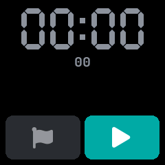 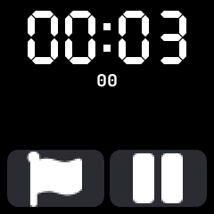 |
| [`timer`](apps/timer.md) | InfiniTime Timer, wasp-os timer | Pause, resume and reset. A progress ring, and a count of time since it rang. | 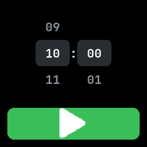 |
| [`alarm`](apps/alarm.md) | InfiniTime Alarm, wasp-os alarm | 12 alarms with weekday repeats, a 10 minute snooze, and a ring that stops itself after a minute. | 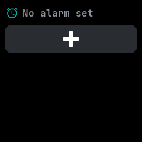 |
| [`pomodoro`](apps/pomodoro.md) | wasp-os pomodoro | A queue of up to 6 lengths, with presets and the buzz length set by swiping. | 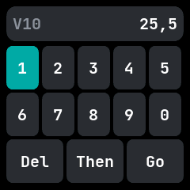 |
| [`calculator`](apps/calculator.md) | InfiniTime Calculator, wasp-os calculator | Fixed point in millionths, up to 15 digits. wasp-os's brackets and powers are left out. | 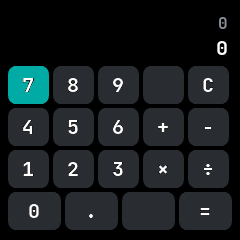 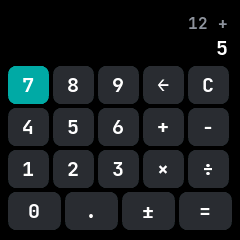 |
| [`dice`](apps/dice.md) | InfiniTime Dice | 1 to 9 dice of 2 to 99 sides; shake to roll. | 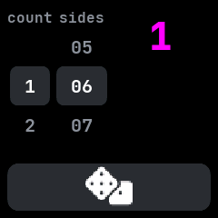 |
| [`flashlight`](apps/flashlight.md) | InfiniTime FlashLight, wasp-os flashlight | Three brightness levels and a red light. |  |
| [`system`](apps/system.md) | InfiniTime BatteryInfo and SystemInfo, PinetimeLite charging and low battery screens | Two pages swiped left and right, with the engine's page bar along the bottom. The system page, first, shows the firmware version, uptime, why the watch last restarted and free storage, and scrolls when they run long. The battery page beside it shows a tall battery on the left that fills again and again while charging, and on the right the charge, whether it is charging, full, low or critical, the voltage, and a warning to charge below 10 %; the watch opens straight onto it when the charger is plugged in or out, or the charge goes low. The bootloader version, memory and Bluetooth address are not shown yet. | 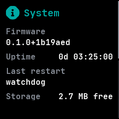  |
| [`phone-finder`](apps/phone-finder.md) | wasp-os phone_finder | Rings the phone. It cannot yet stop the ring from the watch. | 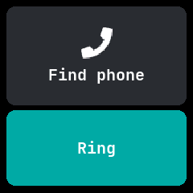 |
| [`software`](apps/software.md) | NeoTime, after wasp-os's Software app | Every installed app and face with a switch to turn it on or off, and the memory it needs while open. The watch checks each change first: an app too large for the heap, one that would leave the launcher without room, the launcher itself, the last face and the open app are refused, and a tap on one says why. | 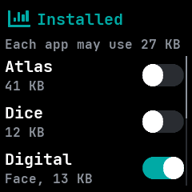 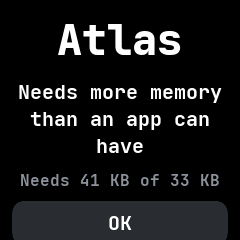 |
| [`launcher`](apps/launcher.md) | NeoTime | The installed apps, grouped as the companion set up, each with its icon and name; a tap opens one. The companion chooses the style: folders (the groups, each opening its apps; a swipe moves to the next group), sections (one list with a heading above each group), pages (a group a page, swiped left and right) or one plain list; and whether apps are rows or a grid of icons. Any other launcher can replace it. | 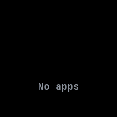 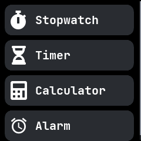 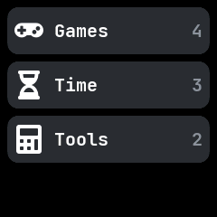 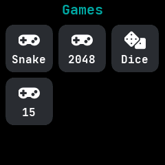  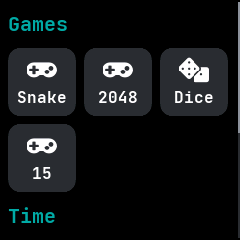 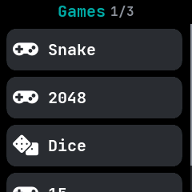 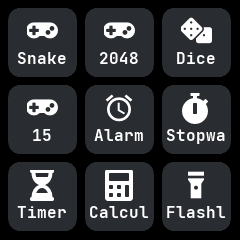 |

## Built into the firmware

These are written like apps but compiled into the firmware when it is built, so they are always
there, never listed in the launcher, and cannot be removed. The shell opens them from the face; see
[Navigation](architecture.md#firmware-firmware).

| Screen | From | Notes | Screen |
|---|---|---|---|
| [`notifications`](apps/notifications.md) | InfiniTime Notifications, wasp-os notification list | A swipe down on the face pulls it down, as does a double click from anywhere. The latest 5 notifications from the phone and from apps, newest first; a tap reads one in full and Dismiss removes it. Opens by itself when a notification wakes the screen. |  |
| [`quick-settings`](apps/quick-settings.md) | InfiniTime QuickSettings, Android's pull-down shade | A swipe down on the notifications pulls it down. The time and battery over six buttons: brightness, the flashlight, do not disturb, Bluetooth, the always-on screen and Settings. | 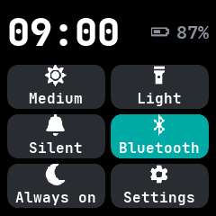 |

## Health and phone

| App | From | Notes | Screen |
|---|---|---|---|
| [`heart`](apps/heart.md) | InfiniTime HeartRate, wasp-os heart | Measures on opening; a chart of the last 24 readings. | 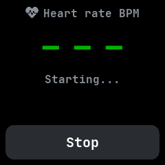 |
| [`steps`](apps/steps.md) | InfiniTime Steps, wasp-os step_counter and steplogger | Three pages swiped left and right: the goal ring with yesterday's steps and a resettable trip meter, the last seven days, and a day by hour, all from the system's step history. Tapping a day of the week opens it on the third page, whose arrows step a day back or forward. | 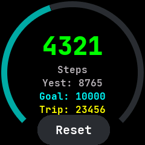 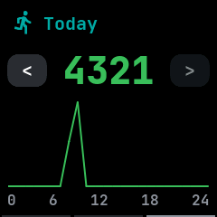 |
| [`sports`](apps/sports.md) | wasp-os sports | A stopwatch with the steps taken since it started. | 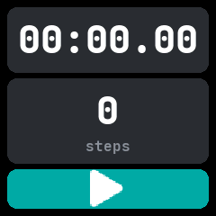 |
| [`music`](apps/music.md) | InfiniTime Music, wasp-os music_player | Track, progress, play and skip by swipe, and a volume row. | 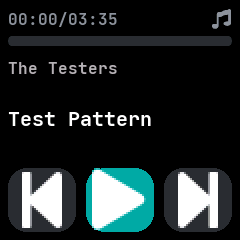 |
| [`remote`](apps/remote.md) | new | Up to 9 buttons the companion app sets up, each with a library icon; a tap buzzes and tells the phone which button it was, and the phone runs that button's action. It reads `/remote/buttons` when it opens and when the screen turns on. | 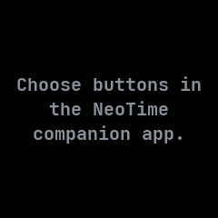   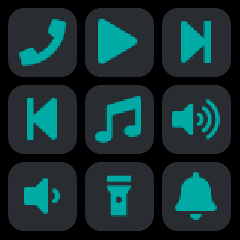 |
| [`weather`](apps/weather.md) | InfiniTime Weather, wasp-os weather | Conditions, low and high, and a 5 day forecast, all read from `current_weather`. | 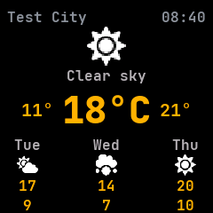 |
| [`navigation`](apps/navigation.md) | InfiniTime Navigation | The next turn, its distance in the wearer's units and the trip's progress. | 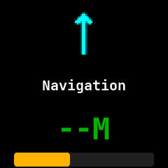 |
| [`metronome`](apps/metronome.md) | InfiniTime Metronome | Beats scheduled from the start time so they never drift; tap tempo. | 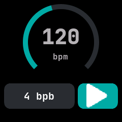 |
| [`motion`](apps/motion.md) | InfiniTime Motion | Charts of the raw x, y and z acceleration. |  |
| [`level`](apps/level.md) | wasp-os level | A spirit level with a saved calibration. | 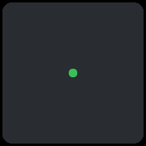 |
| [`beacon`](apps/beacon.md) | wasp-os beacon | Flashes the heart rate sensor's LED, while the app is in front. |  |

## Games and others

| App | From | Notes | Screen |
|---|---|---|---|
| [`twos`](apps/twos.md) | InfiniTime Twos, wasp-os play2048 | 2048 with a saved board and best score. |  |
| [`paddle`](apps/paddle.md) | InfiniTime Paddle | The paddle follows the finger. | 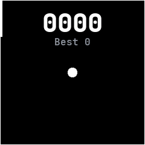 |
| [`puzzle15`](apps/puzzle15.md) | wasp-os puzzle15 | Every shuffle is solvable. | 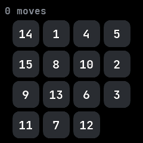 |
| [`snake`](apps/snake.md) | wasp-os snake | A 16 by 16 board. |  |
| [`four-in-a-row`](apps/four-in-a-row.md) | wasp-os four_in_a_row | 4 levels instead of 7, because the subset has no recursion. | 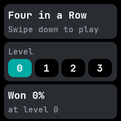 |
| [`game-of-life`](apps/game-of-life.md) | wasp-os game_of_life | A 16 by 16 board that wraps at the edges, instead of 60 by 60. |  |
| [`infinipaint`](apps/infinipaint.md) | InfiniTime InfiniPaint | A 20 by 20 grid of cells instead of free drawing, since there is no canvas. |  |
| [`haiku`](apps/haiku.md) | wasp-os haiku | Built-in verses, since apps cannot read files. | 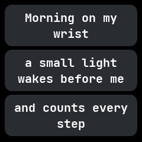 |
| [`notes`](apps/notes.md) | new | A text file the companion app keeps on the watch, read only and scrolled, in the font the companion app chose. | 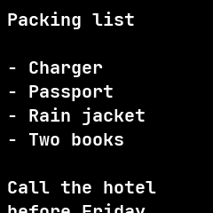 |
| [`morse`](apps/morse.md) | wasp-os morse | Typing in Morse code with taps and swipes. |  |
| [`settings`](apps/settings.md) | InfiniTime Settings, wasp-os settings | The watch-wide settings: brightness, screen timeout, always on, 12 or 24 hour clock, units, step goal, chimes, what wakes the screen, do not disturb and whether alarms ring in it, the theme, Bluetooth and firmware updates. | 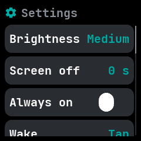 |
| [`hello`](apps/hello.md), [`template`](apps/template.md) | wasp-os hello and template | Starting points for new apps. | 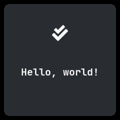 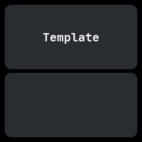 |

## Not ported

| App | From | Why |
|---|---|---|
| `demo`, `gallery` | wasp-os | Need full-screen images and reading files. |
| `disa_b_l_e` | wasp-os | The Bluetooth switch in Settings and quick settings does the same. |
| `read_me`, `test` | wasp-os | Developer tools, not apps. |
| Firmware update | both | Part of the system, not an app. |

## Limits

The ports use the API in [app-reference.md](app-reference.md) as `sdk/neotime` provides it: one
`CellGrid` for each game board, element writes, `range`, `count_where` and the text functions. They
fit the runtime's limits on state, handler writes, locals and loop steps. Four-in-a-row's search runs
a few steps a call on a 100 millisecond tick, so its hardest level thinks for up to about 3 seconds.

On the watch, `weather` shows no forecast until the phone's weather reaches it; the simulator shows
three days.
