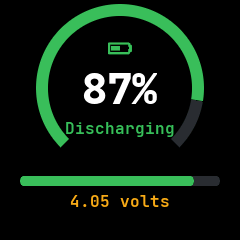
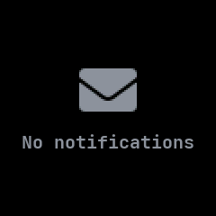
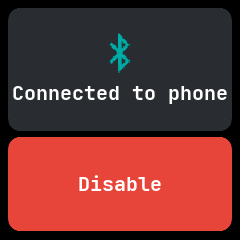

# Apps

NeoTime's first apps are ports of the apps in [InfiniTime](https://github.com/InfiniTimeOrg/InfiniTime)
and [wasp-os](https://github.com/wasp-os/wasp-os), written in the app language described in
[app-runtime.md](app-runtime.md) and [app-reference.md](app-reference.md). Where both firmwares have
the same app, the port merges them into one. Each app lives in `apps/<id>/app.tsx`, which names its
sources at the top. Watch faces are a separate package, listed in [faces.md](faces.md).

An app should be a thin layer over the shared parts in the firmware and the shared library: use
the SDK's widgets, components and functions rather than writing your own, and move anything a
second app needs into the library. RAM is the scarcest resource on the watch, and an app's own
code all takes RAM while it is open; see
[Building apps from shared parts](app-runtime.md#building-apps-from-shared-parts).

They compile to app images with `neotime-compiler`. They also type-check against `sdk/neotime`, a
stand-in for the `neotime` package, and every screen renders in a test.

The Screen column shows each app's main screen as the simulator draws it, and for the stopwatch,
the calculator and the launcher a second screen after some use. The pictures are the reference
screenshots in `harness/snapshots/screens/`, which the screenshot test keeps current; see
[Reference screenshots](testing.md#reference-screenshots).

## Checking the apps

From the repository root, with Node from `nix develop` or the system:

```sh
npm install
npm run check   # TypeScript over every app and face
npm test        # renders every screen of every app and face, plus their own tests
```

To compile them, inside `nix develop`:

```sh
for f in apps/*/app.tsx faces/*/face.tsx; do cargo run -q -p neotime-compiler -- --check "$f"; done
```

`-o <file>.ntapp` in place of `--check` writes the image, which the simulator opens with `--app`.

## Tools

| App | From | Notes | Screen |
|---|---|---|---|
| `stopwatch` | InfiniTime StopWatch, wasp-os stopwatch | Laps with split and total times. The side button starts and pauses. |   |
| `timer` | InfiniTime Timer, wasp-os timer | Pause, resume and reset. A progress ring, and a count of time since it rang. |  |
| `alarm` | InfiniTime Alarm, wasp-os alarm | 12 alarms with weekday repeats, a 10 minute snooze, and a ring that stops itself after a minute. |  |
| `pomodoro` | wasp-os pomodoro | A queue of up to 6 lengths, with presets and the buzz length set by swiping. |  |
| `calculator` | InfiniTime Calculator, wasp-os calculator | Fixed point in millionths, up to 15 digits. wasp-os's brackets and powers are left out. |   |
| `dice` | InfiniTime Dice | 1 to 9 dice of 2 to 99 sides; shake to roll. |  |
| `flashlight` | InfiniTime FlashLight, wasp-os flashlight | Three brightness levels and a red light. |  |
| `battery` | InfiniTime BatteryInfo, PinetimeLite charging and low battery screens | The charge in a ring, charging, full, low or critical, and the voltage; a bar that fills while charging, and a warning to charge below 10 %. The watch opens it when the charger is plugged in or out, or the charge goes low. |  |
| `phone-finder` | wasp-os phone_finder | Rings the phone. It cannot yet stop the ring from the watch. |  |
| `launcher` | NeoTime | The list of installed apps, each with its icon and name; a tap opens it. Any other launcher can replace it. |   |

## Health and phone

| App | From | Notes | Screen |
|---|---|---|---|
| `heart` | InfiniTime HeartRate, wasp-os heart | Measures on opening; a chart of the last 24 readings. |  |
| `steps` | InfiniTime Steps, wasp-os step_counter and steplogger | Goal ring with yesterday's steps and a resettable trip meter, the last seven days, and any of them by hour, all from the system's step history. |  |
| `sports` | wasp-os sports | A stopwatch with the steps taken since it started. |  |
| `music` | InfiniTime Music, wasp-os music_player | Track, progress, play and skip by swipe, and a volume row. |  |
| `notifications` | InfiniTime Notifications, wasp-os notification list | The latest 5 notifications from the phone and from apps, newest first; a tap reads one in full and Dismiss removes it. Opens by itself when a notification wakes the screen. |  |
| `weather` | InfiniTime Weather, wasp-os weather | Conditions, low and high, and a 5 day forecast, all read from `current_weather`. |  |
| `navigation` | InfiniTime Navigation | The next turn, its distance and the trip's progress. |  |
| `metronome` | InfiniTime Metronome | Beats scheduled from the start time so they never drift; tap tempo. |  |
| `motion` | InfiniTime Motion | Charts of the raw x, y and z acceleration. |  |
| `level` | wasp-os level | A spirit level with a saved calibration. |  |
| `beacon` | wasp-os beacon | Flashes the heart rate sensor's LED, while the app is in front. |  |
| `disable-bluetooth` | wasp-os disa_b_l_e | Turns Bluetooth off and on again, without the reboot wasp-os needed. |  |

## Games and others

| App | From | Notes | Screen |
|---|---|---|---|
| `twos` | InfiniTime Twos, wasp-os play2048 | 2048 with a saved board and best score. |  |
| `paddle` | InfiniTime Paddle | The paddle follows the finger. |  |
| `puzzle15` | wasp-os puzzle15 | Every shuffle is solvable. |  |
| `snake` | wasp-os snake | A 16 by 16 board. |  |
| `four-in-a-row` | wasp-os four_in_a_row | 4 levels instead of 7, because the subset has no recursion. |  |
| `game-of-life` | wasp-os game_of_life | A 16 by 16 board that wraps at the edges, instead of 60 by 60. |  |
| `infinipaint` | InfiniTime InfiniPaint | A 20 by 20 grid of cells instead of free drawing, since there is no canvas. |  |
| `haiku` | wasp-os haiku | Built-in verses, since apps cannot read files. |  |
| `morse` | wasp-os morse | Typing in Morse code with taps and swipes. |  |
| `settings` | InfiniTime Settings, wasp-os settings | The watch-wide settings: brightness, screen timeout, always on, 12 or 24 hour clock, units, step goal, chimes, do not disturb and the theme. |  |
| `hello`, `template` | wasp-os hello and template | Starting points for new apps. |   |

## Not ported

| App | From | Why |
|---|---|---|
| `demo`, `gallery` | wasp-os | Need full-screen images and reading files. |
| `read_me`, `test` | wasp-os | Developer tools, not apps. |
| Quick settings, firmware update | both | Part of the system, not apps. |

## Limits

The ports use the API in [app-reference.md](app-reference.md) as `sdk/neotime` provides it: one
`CellGrid` for each game board, element writes, `range`, `count_where` and the text functions. They
fit the runtime's limits on state, handler writes, locals and loop steps. Four-in-a-row's search runs
a few steps a call on a 100 millisecond tick, so its hardest level thinks for up to about 3 seconds.

On the watch, `weather` shows no forecast until the phone's weather reaches it; the simulator shows
three days.
