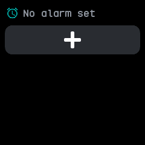
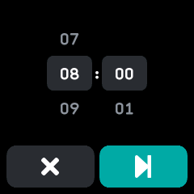
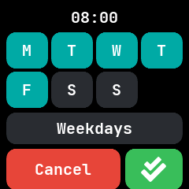
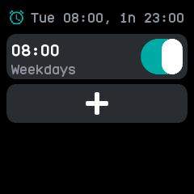
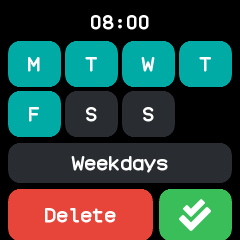

# Alarm

Up to twelve alarms, each ringing once or on chosen weekdays, merged from wasp-os's alarm and
InfiniTime's Alarm. Nothing runs while it waits: the watch wakes the app when the next alarm is due.

## Using it

- The top line shows when the next alarm rings and how long until then, or **No alarm set**.
- Tap the **plus** button to add an alarm. It is hidden once there are twelve.
- On the time screen, roll the **hour** and **minute** to the time. The rollers follow the 12 or 24
  hour clock setting. Tap the **cross** to give up, or the **next** arrow to pick the days.
- On the days screen, tap a **weekday** to turn it on or off, or tap the **repeat** button to cycle
  through Once, Every day, Weekdays and Weekend. Tap the **tick** to save; the alarm is switched on.
- Tap an alarm's time in the list to change it. Its days screen has **Delete** in place of Cancel.
- Flip an alarm's **switch** to turn it off or on without deleting it.
- When an alarm rings, the watch wakes and buzzes. Tap **Snooze** to ring again in ten minutes, or
  the **stop** button to dismiss it. The side button also stops the ring, and it stops on its own
  after a minute.
- An alarm set to ring once switches itself off after it rings.

## Screens

No alarms yet, with only the plus button.

Choosing the time, after tapping plus.

Choosing the days, here Weekdays, after tapping the next arrow.

The list after saving, with the next ring time at the top.

Changing a saved alarm: tap its time, then next. Delete removes it.

Ringing, with Snooze and stop.
