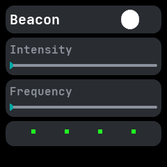
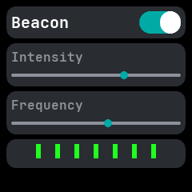

# Beacon

A beacon that flashes the green LED of the heart rate sensor, ported from wasp-os's beacon app. The
sensor times the flashes itself, so it uses little power.

## Using it

- Tap the **switch** beside the name to start or stop flashing.
- Drag the **Intensity** slider to set how bright each flash is, in four steps.
- Drag the **Frequency** slider to set how often it flashes, in eight steps from slow to nearly
  steady.
- The strip of green dashes at the bottom previews the pattern: thicker dashes are brighter, closer
  ones are faster.
- It keeps flashing with the screen off for as long as the app stays open. Leaving the app turns
  the LED off. The two sliders are remembered.
- It needs the heart rate permission.

## Screens

Switched off, at the lowest intensity and frequency.

Switched on with both sliders moved up; the preview shows thicker dashes closer together.
