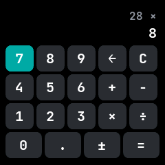
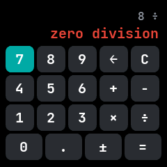

# Calculator

A calculator, merged from wasp-os's calculator and InfiniTime's Calculator. It works with up to
fifteen digits, six of them after the point.

## Using it

- Tap the **digit** keys and the **.** key to type a number. The number being typed shows in large
  text; the result so far and the waiting operation show small above it.
- Tap **+**, **-**, **×** or **÷** to apply the waiting operation and choose the next one.
- Tap **=** to work out the sum. Tapping **=** again repeats the last operation.
- Tap **±** to change the sign of the number being typed.
- Tap **←** to delete the last digit typed; with nothing typed it clears the result.
- Tap **C** to clear everything.
- A result that is too large or a division by zero shows a red message and buzzes; the next key
  starts afresh.
- The sum is kept when the app is closed.

## Screens

Cleared, showing zero.

Partway through 12 + 5: the result and the operation above, the number being typed below.

After 3.5 × 8 =: the result 28 above, with the last number and operation kept so that = repeats.

After 8 ÷ 0 =, the red message for a division by zero.
