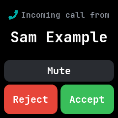
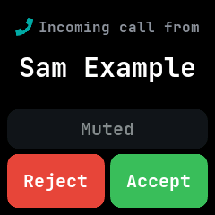
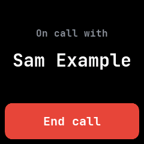

# Call

Answers the phone's calls from the watch, after InfiniTime's and Bangle.js's call screens.

## Using it

- When a call comes in, the watch lights up on this app and rings until you act, the call ends or
  two minutes pass. Do not disturb keeps it dark and still.
- The screen says **Incoming call from** and the caller's name, or their number when the phone has
  no name for them.
- Tap **Accept** to answer, or **Reject** to turn the call down and go back to what was open.
- Tap **Mute** to silence the phone and the watch and let the call ring out; you can still accept
  or reject it.
- Once the call is answered the screen shows **On call with** the caller and an **End call** button.
- When the call ends, on the phone or the watch, the app goes back to what was open before.
- Pressing the button leaves the app and stops the watch ringing; the phone still rings.
- Answering needs the NeoTime companion app on Android 8 or later, or Gadgetbridge; rejecting
  needs Android 9. Opened from the launcher with no call, the app says **No call**.
- A Bluetooth tool can ring it too, by writing a New Alert in the incoming call category, as for
  InfiniTime. No answer goes back to that tool, and the screen stays until you reject or leave it.

## Screens

A call ringing.

Muted, still ringing on the phone without a sound.

The call answered.

Opened with no call.
