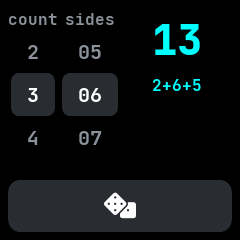
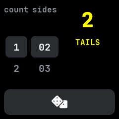

# Dice

Dice that roll one to nine dice of two to ninety-nine sides, ported from InfiniTime's Dice.

## Using it

- Roll the **count** wheel to choose how many dice to throw, from one to nine. Tap the number above
  or below the chosen one to step to it.
- Roll the **sides** wheel to choose the sides of each die, from 2 to 99.
- Tap the **dice** button at the bottom to roll. The watch buzzes, the total shows on the right and,
  with more than one die, each die's face shows below it, such as `2+6+5`.
- **Shake** the watch to roll too, while the app is open. Shakes less than a second apart count once.
- One two-sided die is a coin: it shows **HEADS** or **TAILS** under the number.
- Each roll changes colour between yellow, magenta and aqua, so a roll that lands on the same total
  is still noticed.
- The count and sides are kept for next time. Opening the app rolls once without a buzz.

## Screens

One six-sided die, as the app opens.

Three dice rolled: the total and each die's face. Step the count up twice and tap the dice button.

One two-sided die rolled as a coin, showing tails.
