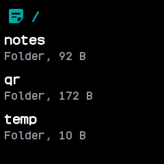

# Files

Lists what the watch keeps on its external flash, a folder at a time, with the size of each file,
so you can see what fills the storage.

## Using it

- The app opens on the top folder. Folders come first, then files, each in order of its name.
- Each row gives the name and the size in bytes, KB or MB. A folder says `Folder` and gives the size
  of every file inside it, all the way down.
- Scroll up and down through a long folder. Tap a folder to open it; its path is shown at the top.
- Click the side button to go back up a folder; from the top folder it leaves the app.
- Tapping a file does nothing; the app only lists.
- A folder shows its first 64 entries. Folders exist only through the files in them, so an empty
  folder never appears; a watch with nothing stored says **Empty**.
- The watch remembers only the last eight steps back, so from deep down the side button leaves the
  app before it reaches the top folder.

## Screens

The top folder, `/`: the notes, qr and temp folders, each with the size of everything inside it.

Inside `/qr`, after tapping qr: its two files, each with its size.
