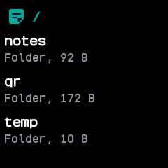
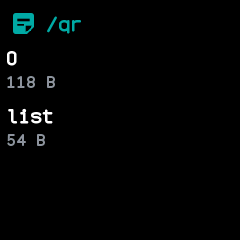

# Files

Lists what the watch keeps on its external flash, a folder at a time, with the size of each file,
so you can see what fills the storage.

## Using it

- The app opens on the top folder. Folders come first, then files, each in order of its name.
- Each row gives the name and the size in bytes, KB or MB. A folder says `Folder` and gives the size
  of every file inside it, all the way down.
- Tap a folder to open it. The folder's path is shown at the top.
- Click the side button to go back up a folder; from the top folder it leaves the app.
- Tapping a file does nothing; the app only lists.
- A folder shows its first 64 entries. Folders exist only through the files in them, so an empty
  folder never appears.
- Going back works through the last 8 folders opened; from deeper down, the side button leaves the
  app once those are used up.

## Screens

The top folder: each folder with the size of everything inside it.

Inside a folder: its files, each with its size.
