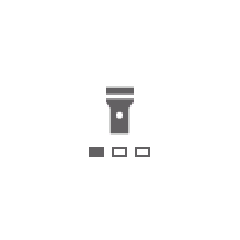

# Flashlight

Turns the screen into a white or red light, with three brightness levels. Merged from InfiniTime's
FlashLight and wasp-os's flashlight.

## Using it

- It opens already lit, at the level and colour last used, and keeps the screen on while it is open.
- Tap anywhere to switch the light off and on again.
- Swipe left for a dimmer light and right for a brighter one, in three levels. The three
  marks under the icon show the level.
- Swipe up or down to switch between a white light and a red light, which keeps your
  night vision.
- The level and the colour are remembered for next time.

## Screens

Lit white at full brightness, as it opens.

At the lowest level after two swipes left, with one mark filled.

The red light at the lowest level, after a swipe up.

Switched off with a tap: a white icon on black, with the level still showing.
