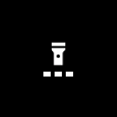

# Flashlight

A flashlight, merged from InfiniTime's FlashLight and wasp-os's flashlight. It opens already lit at
full brightness and keeps the screen on while open.

## Using it

- Tap anywhere to switch the light **off** and on again.
- Swipe **left** for a dimmer light and **right** for a brighter one, in three levels. The three
  marks under the icon show the level.
- Swipe **up** or **down** to switch between a white light and a **red** light, which keeps your
  night vision.
- The level and the colour are remembered for next time.

## Screens

Lit white at full brightness, as it opens.

At the lowest level after two swipes left, with one mark filled.

The red light, after a swipe up.

Switched off with a tap.
