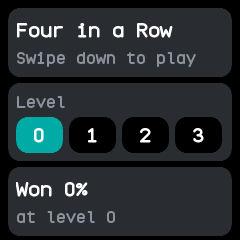
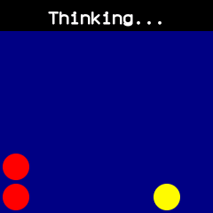
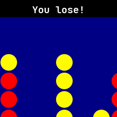

# 4 in a row

Four in a Row against the watch, ported from wasp-os's four_in_a_row. You play red and the watch
plays yellow.

## Using it

- The menu has three cards. Tap a **level** button, 0 to 3, to choose how hard the watch plays. Each
  level makes it look one move further ahead; at every level it takes a win and blocks a threat.
- The bottom card shows the share of games you have won at the chosen level. Levels and results are
  kept for next time.
- **Swipe down** on the menu, or tap the top card, to start a game. You and the watch take turns to
  go first, game by game at each level.
- In a game, **tap** above or on a column to move your red counter over it, then **swipe down** to drop
  it. The watch answers with yellow; while it works out its move the top shows **Thinking...**. Its
  first counter or two go in a random column.
- A full column, or a swipe while the watch is thinking, gives a short buzz and drops nothing.
- Four in a line across, up or diagonally wins. The top then says **You win!** with a short buzz,
  **You lose!** with a longer one, or **Draw** once the board is full. Swipe down to go back to the
  menu.
- Swiping right on the menu, or left, right or up in a game, goes back.

## Screens

The menu, with level 0 chosen and no games won yet.

A new game, with your red counter waiting over the middle column of the empty board.

The watch working out its move after your second red counter.

A lost game at level 2: the watch has four yellow counters up the middle column.
