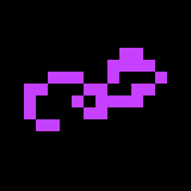
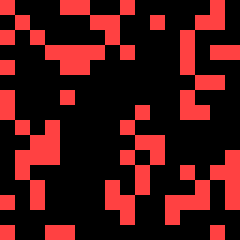

# Life

Conway's Game of Life, ported from wasp-os's game_of_life. A cell lives on with two or three live
neighbours and is born with exactly three, on a 16 by 16 board that wraps at its edges.

## Using it

- The board starts from an acorn, a small pattern that keeps growing, and steps on a generation
  about every 0.6 seconds.
- Each generation draws in the next of nine bright colours.
- **Tap** the screen to start the acorn again.
- **Long press** to scatter a random soup of cells instead.
- The screen stays on while the app is open.

## Screens

The acorn the board starts from.

The acorn ten seconds later, sixteen generations on.

A random soup, scattered with a long press.
