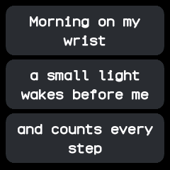
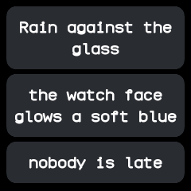

# Haiku

Shows a short haiku about life with a watch, one line to a card, and a new verse each time it
opens. From wasp-os's haiku.

## Using it

- Tap anywhere, or swipe down, for the next verse.
- Swipe up or right to leave the app, as well as clicking the side button.
- Six verses are built in. The app remembers which one it showed last, so the next opening moves
  on.

## Screens

The first verse, "Morning on my wrist", as it opens the first time.

The next verse, "Rain against the glass", after a tap.
