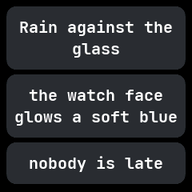

# Haiku

A haiku viewer, from wasp-os's haiku. It shows one short built-in verse, a line to a card, and a new
verse each time it opens.

## Using it

- Tap anywhere, or swipe **down**, for the next verse.
- Swipe **up** or **right** to leave the app.
- Six verses are built in. The app remembers which one it showed last, so the next opening moves
  on.

## Screens

The first verse, as it opens.

The next verse, after a tap.
