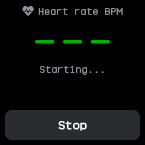
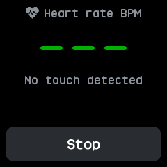
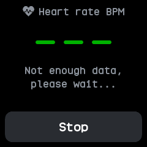
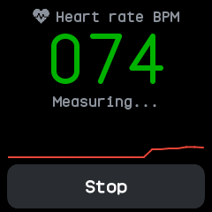
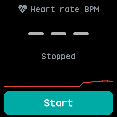

# Heart

A heart rate monitor, merged from InfiniTime's HeartRate and wasp-os's heart app. It starts
measuring as soon as it opens.

## Using it

- Wear the watch snugly and keep still. The large number is the latest reading in beats per
  minute, or **---** until there is one.
- The line below says what the sensor is doing: starting, no touch, waiting for enough data, or
  measuring.
- Once readings come in, a chart of the latest ones appears above the button.
- The heart at the top turns red while the sensor is on.
- Tap **Stop** to stop measuring, and **Start** to begin again. The screen stays on while it
  measures, and measuring stops when the app closes.
- To measure in the background, with the app closed, choose an interval under **Heart rate** in
  [Settings](settings.md).
- The watch keeps the average of each six minutes' readings, from the app or the background
  interval, in a daily log for 90 days.

## Screens

Just opened, while the sensor starts: no reading yet, so the number shows dashes.

The sensor does not feel skin, so it says No touch detected.

The sensor needs more data before its first reading.

Measuring: the latest reading, 74, with a chart of the readings so far.

Stopped, after tapping Stop: the chart stays and the button reads Start.

## With the companion app

- The companion syncs the heart rate log. The Heart plugin's page lists each of the last two weeks'
  days with its average, lowest and highest heart rate.
- While the app measures, each reading also goes to a phone app such as Gadgetbridge through the
  standard Bluetooth heart rate service.
