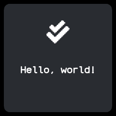

# Hello

The smallest app: one card with a check mark and the greeting "Hello, world!". From wasp-os's
hello.

## Using it

- There is nothing to press. Clicking the side button leaves, as in every app.
- It is a starting point for reading app code; [writing an app](../writing-apps.md) explains how
  apps are written.

## Screens

Its only screen: a check mark above "Hello, world!" on one card.
