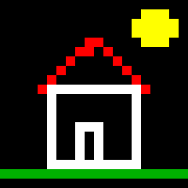
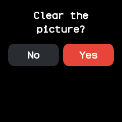

# Paint

Finger painting on a 20 by 20 grid, ported from InfiniTime's InfiniPaint.

## Using it

- **Touch** or **drag** to paint the squares under your finger in the brush colour, which starts
  white on a black canvas.
- **Long press** to change the brush colour. The watch buzzes and names the colour, going through
  magenta, green, white, red, cyan, yellow, blue and black. Black paints over mistakes.
- **Double tap** to ask to clear the picture, then tap **Yes** to clear it or **No** to keep it.
- Swipes do nothing, so a stroke never leaves the app; press the side button to leave.
- The picture and the brush colour are kept for next time.

## Screens

A blank canvas, as the app first opens.

A house with white walls and door, a red roof, a yellow sun and green grass, changing colour with
long presses.

The question a double tap asks before clearing the picture, with **No** and **Yes** buttons.
