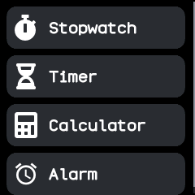
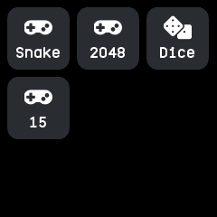
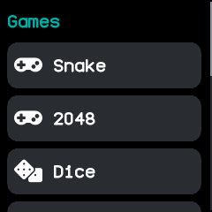
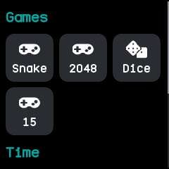

# Apps

The launcher lists every installed app with its icon and name, grouped the way you set up in the
companion app, and opens the one you tap. It is BattleTime's own, an ordinary app that any other
launcher can replace.

## Using it

- **Swipe up** on the watch face to open the launcher, and **swipe down** in it to close it and go
  back to the face. The side button also goes back.
- **Tap** an app to open it.
- The list scrolls up and down when the apps do not fit, with a scroll bar at the side.
- Apps turned off in the Software app are not listed.
- With no apps installed, it says **No apps**.

### Styles and views

The companion app chooses the **style**:

- **List**: one plain list of every app.
- **Folders**: a row per group, with its icon, name and how many apps it holds. Tap a folder to open
  it; in an open folder, **swipe left** and **right** to move to the next or the previous group.
- **Headings**: one list, with each group's name above its apps.
- **Pages**: one group at a time; **swipe left** and **right** to move to the next or the previous
  group.

It also chooses the **view**: a row per app, or a grid of icons three across.

## Screens

No apps installed yet.

The plain list style, a row per app.

The plain list style in the grid view.

The folders style: each group with its icon and how many apps it holds.

A folder opened by tapping it, here in the grid view.

The headings style: one list, with each group's name above its apps.

The headings style in the grid view.

The pages style: one group per page, swiped left and right.

## With the companion app

The companion app sets up the launcher: the style and view, which group each app goes in, and the
order of groups and apps. Groups start as Time, Phone, Communication, Health, Games, Tools, System
and Other, each group's apps by name, and you can sort by name or set an order of your own. It places a newly
installed app in the group the app asks for, until you move it. An app it has not placed, such as
one installed another way, goes in a group named **Other** at the end. The open launcher shows a
change at once.
