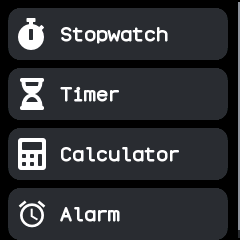
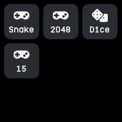

# Apps

The launcher: every installed app with its icon and name, grouped the way the companion app set
up. It is NeoTime's own, an ordinary app that any other launcher can replace.

## Using it

- **Tap** an app to open it.
- **Swipe down** to close the launcher and go back to the watch face.
- The companion app chooses the **style**: one plain list, **folders** that each open a group, one
  list with a **heading** per group, or a **page** per group.
- In the folders style, tap a folder to open it. In an open folder or in the pages style,
  **swipe left** and **right** to move to the next or the last group.
- The companion app also chooses the **view**: a row per app, or a grid of icons three across.
- Groups, and the apps in each, are in order of their names, unless the companion app sets an
  order of its own.
- The list scrolls when the apps do not fit.

## Screens

No apps installed yet.

The plain list style, a row per app.

The plain list style in the grid view.

The folders style: each group with its icon and how many apps it holds.

A folder opened by tapping it, here in the grid view.

The headings style: one list, with each group's name above its apps.

The headings style in the grid view.

The pages style: one group per page, swiped left and right.
