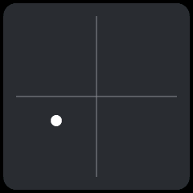
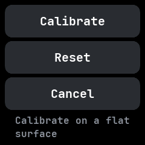

# Level

A spirit level, ported from wasp-os's level app. A bubble moves against the pull of gravity and
turns green when the watch is level.

## Using it

- Lay the watch on a surface. The **bubble** moves towards the higher side, and turns green within
  a few pixels of the centre.
- Tap anywhere to open the **menu**:
  - **Calibrate** takes the current reading as level. Do this with the watch on a flat surface.
  - **Reset** forgets the calibration.
  - **Cancel** goes back without changing anything.
- The calibration is remembered. It needs the motion permission, and reads the accelerometer only
  while the app is open.

## Screens

Level: the green bubble in the middle of the cross.

Tilted, with the bubble off to one side in white.

The menu, opened with a tap.
