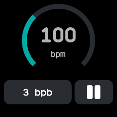

# Metronome

A metronome that beats on the vibration motor, ported from InfiniTime's Metronome. A long buzz opens
each bar and a short one marks the other beats.

## Using it

- Drag around the **ring** to set the tempo, from 40 to 220 beats a minute.
- Or tap the **number** in the middle along with a song: each tap within three seconds of the last
  sets the tempo from the time between them.
- Tap the **bpb** button to change the beats in a bar, from 1 to 9 and round again.
- Tap **play** to start and **pause** to stop. The screen stays on while it beats.
- Leaving the app stops it. The tempo and the bar length are remembered.

## Screens

Stopped at 120 beats a minute, four beats to the bar.

Beating at a tapped 100 beats a minute, three to the bar, with the pause button showing.
