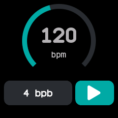

# Metronome

A metronome that beats on the vibration motor, with a long buzz opening each bar and a short one for
the other beats. Ported from InfiniTime's Metronome.

## Using it

- Tap the number in the middle along with a song to set the tempo: each tap within three seconds of
  the last sets it from the time between them, from 40 to 220 beats a minute.
- The ring around the number fills as the tempo rises. It shows the tempo but cannot be dragged.
- Tap the **bpb** button (beats per bar) to change the beats in a bar, from 1 to 9 and round again.
- Tap the **play** button to start and the **pause** button to stop. The screen stays on while
  it beats.
- Changing the tempo while it beats carries on from the latest beat, without a jump.
- Leaving the app stops it. The tempo and the bar length are remembered.

## Screens

Stopped at 120 beats a minute, four beats to the bar, with the play button lit.

Beating at a tapped 100 beats a minute, three to the bar, with the pause button showing.
