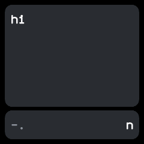
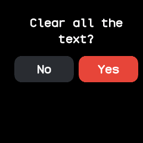

# Morse

A Morse code notepad: key letters with swipes and taps, and the watch writes them out as text. From
wasp-os's morse.

## Using it

- Swipe up for a line and down for a dot. The bottom card shows the dots and lines keyed so
  far and, on the right, the letter they make (? if they make none).
- Tap anywhere to end the letter and add it to the text. A tap with nothing keyed adds a space.
- Swipe right for a space; a second swipe right turns it into a new line.
- Swipe left to delete: it drops the letter being keyed, or else the last character.
- The top card shows as many of the last lines as fit. The text is kept when the app is closed,
  up to 96 characters, dropping the oldest.
- Long press anywhere to clear the text; it asks first, with **Yes** and **No**.

## Screens

Empty, before anything is keyed: the text card above and the keying card below.

"hi" keyed, with a line and a dot in progress that make an n.

The question after a long press; **Yes** clears the text, **No** keeps it.
