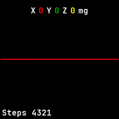
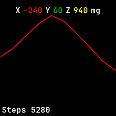

# Motion

An accelerometer check that charts the last second of readings on each axis and shows the latest
ones, with today's step count. Ported from InfiniTime's Motion.

## Using it

- Open it and move the watch. It reads the accelerometer ten times a second while open.
- The chart draws **X** in red, **Y** in green and **Z** in yellow, from -1.1 g at the bottom to
  1.1 g at the top.
- The row at the top shows the latest reading of each axis in thousandths of g (**mg**).
- **Steps** at the bottom left is today's step count.
- It has no buttons.

## Screens

Just opened, before the first reading: a flat line across the middle, with no numbers yet.

A second of readings while the watch tilts, with the latest at the top and the X line rising and
falling.
