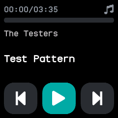
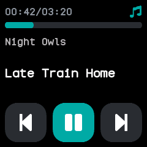
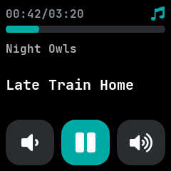
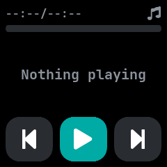

# Music

A remote for the phone's music player, merged from InfiniTime's Music and wasp-os's music_player.
It shows the artist, the track and how far into it the player is, and sends the phone play, pause,
skip and volume commands.

## Using it

- The phone must be connected through the NeoTime companion app. When the app opens it asks the
  phone what its player is doing, and it follows each report the phone sends.
- The top row shows the position and the track's length, and a music note that turns coloured while
  the track plays. The bar below fills as the track goes on.
- Tap the middle button, **play** or **pause**, to start or stop the phone's player. The button
  changes at once, without waiting for the phone.
- Tap the **previous** or **next** button, or swipe right or left, to skip a track.
- Swipe up to swap the outer buttons for **volume down** and **volume up**. Swipe down to bring the
  skip buttons back; a second swipe down leaves the app.
- Tracks over 99 minutes show hours and minutes, and anything over 99 hours shows as Inf.

## Screens

On opening, before the phone has said where the track is.

A track playing, 42 seconds in.

The volume buttons, after a swipe up.

Nothing playing, when the phone reports no track.
