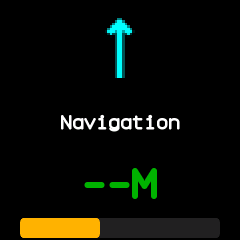
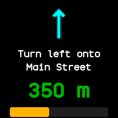

# Navigation

Turn-by-turn directions from the phone: the next turn's arrow, what to do there, the distance to it
and how much of the route is done. Ported from InfiniTime's Navigation.

## Using it

- Open it while the phone is giving directions. When it opens it asks the phone for the current
  step, and it follows each new step the phone sends.
- The arrow shows the next turn: straight on, a slight, ordinary or sharp turn left or right, a
  U-turn, a roundabout or the finish. The line under it says what to do there.
- The distance is in metres and kilometres, or in feet and miles if **Metric units** is off in
  [Settings](settings.md).
- The bar shows how much of the route is done, and turns red past 90 percent.
- Until the phone sends a step, the app shows **Navigation** and **--M**.
- There are no buttons; the side button goes back.

## Screens

On opening, before the phone has sent a step.

A step from the phone: the instruction, 350 m to go and the route about a third done.

## With the companion app

The directions come from a phone app that sends Gadgetbridge's Bangle.js navigation messages. The
NeoTime companion app follows no navigation itself, so with it alone the app stays waiting. Those
messages carry no progress, so the bar stays empty unless the sender supplies it.
