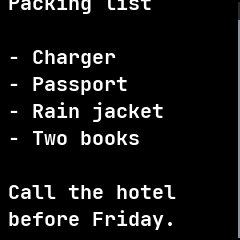
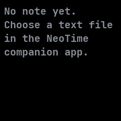

# Notes

Shows a text note that the NeoTime companion app keeps on the watch, read only.

## Using it

- In the companion app, choose a text file and a font. The phone writes the note to
  `/notes/note.txt` and the font's name to `/notes/font`.
- Drag up and down to scroll through a note longer than the screen. A bar at the right edge shows
  where you are.
- Without a note the app says to choose a text file in the companion app.
- The watch reads only the lines on screen, so a long note uses no more memory than a short one.

## Screens

The top of a note.

The same note dragged up to its end.

No note yet, until the companion app sends one.
