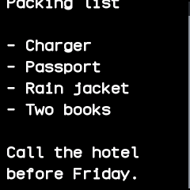
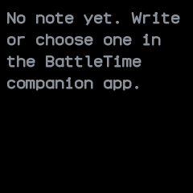

# Notes

Shows a text note from the BattleTime companion app on the watch, read only, such as a packing list or
a shopping list.

## Using it

- Open the app to read the note, in the font chosen in the companion app.
- Drag up and down to scroll through a note longer than the screen. A bar at the right edge shows
  where you are.
- Without a note the app says to write or choose one in the companion app.
- A note can be long: the watch reads only the lines on screen, never the whole note at once.

## Screens

The top of a note: a packing list.

The same note dragged up to its last line.

No note yet, with a reminder to write or choose one in the companion app.

## With the companion app

- The companion app's **Notes** screen sets the note: type it there, choose a text file, or give a
  web address for the app to fetch every minute, sending the text whenever it changes.
- Pick the font there too: small, normal, medium or large.
- The companion app sends the note and its font only when they differ from what the watch holds,
  and takes notes up to 64 kB.
