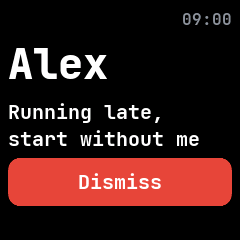

# Notifications

The notifications screen, from InfiniTime's Notifications screen and wasp-os's notification list.
It is built into the firmware and lists the latest few notifications from the phone and from apps,
newest first.

## Using it

- **Swipe down** on the watch face to pull it down. Swipe down again for
  [quick settings](quick-settings.md).
- Each row shows the title and the start of the text. **Tap** one to read it in full, with the app
  it came from and the time.
- Tap **Dismiss** to remove it, or press the side button to go back to the list.
- Opening it, or turning the screen on while it is open, marks every notification read.
- The watch keeps the five newest.

## Screens

With no notifications.

Three notifications from the phone, newest first.

One opened by tapping it.
