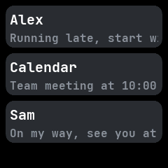
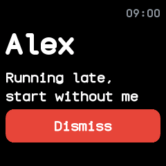
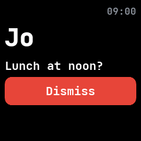

# Notifications

The notifications screen, from InfiniTime's Notifications screen and wasp-os's notification list.
It is built into the firmware and lists the latest few notifications from the phone and from apps,
newest first.

## Using it

- **Swipe down** on the watch face to pull it down. Swipe down again for
  [quick settings](quick-settings.md).
- Each row shows the title and the start of the text. **Tap** one to read it in full, with the app
  it came from and the time.
- Tap **Dismiss** to remove it, or press the side button to go back to the list.
- Opening it, or turning the screen on while it is open, marks every notification read.
- The watch keeps the five newest.
- When a notification arrives, the watch lights up on a preview of it, with a bar across the top
  that runs out over 7 seconds; then it goes back to what was open. A newer notification starts the
  bar again. **Tap** the preview to read it in full and keep it on screen, or press the side button
  to go back at once. Do not disturb, a ringing call and the phone finder keep the preview away, and
  it never opens over the notifications themselves.

## Screens

With no notifications.

Three notifications from the phone, newest first.

One opened by tapping it.

The preview a new notification opens, its bar running out.

The preview tapped, which keeps it and offers Dismiss.
