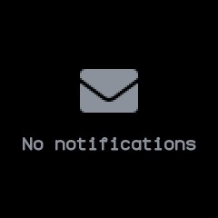
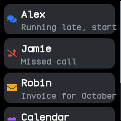
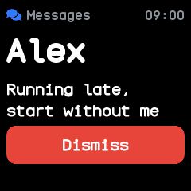
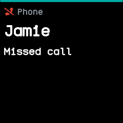
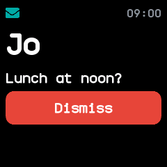

# Notifications

Lists the latest notifications from the phone and from apps, newest first, and previews each one as
it arrives. It is built into the firmware, from InfiniTime's Notifications screen and wasp-os's
notification list.

## Using it

- **Swipe down** on the watch face to pull it down, or double click the side button. Swipe down
  again for [quick settings](quick-settings.md); **swipe up** or press the side button to go back.
- Each row shows an icon for the kind of notification, then the title and the start of the text.
  Calls, missed calls, texts, chats, news, voicemail, calendar events and alerts each have their
  own icon; any other app's notifications show an envelope. The icon's colour tells the kind
  apart too: green for a call, red for a missed call, blue for a text, chat or voicemail, yellow
  for an email, purple for a calendar event, and the theme's accent for the rest.
- **Tap** one to read it in full, with the app it came from and the time.
- Tap **Dismiss** to remove it, or press the side button to go back to the list.
- Opening it, or turning the screen on while it is open, marks every notification read.
- The watch keeps the five newest.
- When a notification arrives, the watch buzzes and lights up on a preview of it, with a bar across the top
  that runs out over 7 seconds; then it goes back to what was open. A newer notification starts the
  bar again. **Tap** the preview to read it in full and keep it on screen, or press the side button
  to go back at once. Do not disturb, a ringing call and the phone finder keep the preview away, and
  it never opens over the notifications themselves.

## Screens

With no notifications.

Five notifications from the phone, newest first: a chat, a missed call, an email, a calendar event and a text, each with its icon in its own colour.

A chat opened by tapping it, with its app, the time it came and **Dismiss**.

The preview a new missed call opens, its bar along the top running out.

The preview tapped, which keeps the notification on screen with its time and **Dismiss**.

## With the companion app

The companion app forwards the phone's notifications to the watch, and one dismissed on the phone
goes from the watch too. A phone or computer without the companion app can also send notifications
through the standard Alert Notification service.
