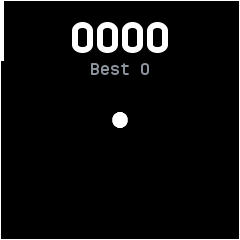
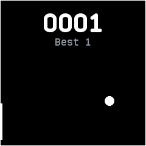

# Paddle

A one-player ball game, ported from InfiniTime's Paddle. A ball bounces off the walls and the paddle on the
left edge.

## Using it

- **Touch** or **drag** up and down anywhere on the screen to move the paddle to your finger's height.
- Each ball the paddle returns scores a point, shown in four digits at the top. A miss buzzes, puts
  the ball back in the middle and starts the count again from zero.
- The ball's slope changes a little each time it bounces off the right wall.
- The best score shows under the count and is kept for next time.
- Swipes do nothing, so a drag never leaves the app; press the side button to leave.

## Screens

The ball in the middle as the app opens, with no points scored yet.

The paddle moved down to the bottom left after returning the ball, scoring the first point and
setting the best to 1.
