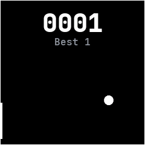

# Paddle

A one-player ball game, ported from InfiniTime's Paddle. A ball bounces off the walls and the paddle on the
left edge.

## Using it

- **Touch** or **drag** up and down anywhere on the screen to move the paddle to your finger's height.
- Each ball the paddle returns scores a point. A miss buzzes and starts the count again from the
  middle.
- The best score shows under the count and is kept for next time.
- Swipes do nothing, so a drag never leaves the app; press the side button to leave.

## Screens

The ball in the middle as the app opens, with the paddle at the top left.

The paddle moved down to return the ball, scoring the first point.
