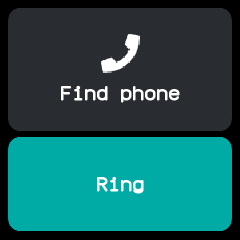
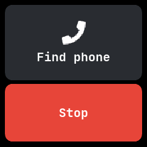
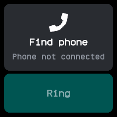

# Finder

Makes the connected phone ring so you can find it, and stops it again. Ported from wasp-os's
phone_finder.

## Using it

- Tap **Ring** to make the phone ring. A message says **Ringing your phone** and the button turns
  red and reads **Stop**.
- Tap **Stop** to stop the ringing. Leaving the app stops it too.
- Without a phone connected, the card says **Phone not connected** and the button is dimmed and
  cannot be tapped.

## Screens

Ready, with the phone connected.

Ringing, after tapping **Ring**; the button now reads **Stop**.

No phone connected, with the button dimmed.

## With the companion app

The watch asks the phone to start or stop ringing with Gadgetbridge's find-phone message, which
Gadgetbridge answers by ringing. The NeoTime companion app shows **The watch is looking for this
phone** on its main screen while the watch asks.
