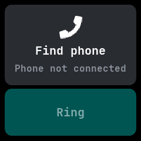

# Finder

Makes the connected phone ring so you can find it, ported from wasp-os's phone_finder.

## Using it

- Tap **Ring** to make the phone ring. A message says it is ringing and the button turns red.
- Tap **Stop** to stop the ringing. Leaving the app stops it too.
- The phone must be connected through the NeoTime companion app. Without it the card says
  **Phone not connected** and the button cannot be tapped.

## Screens

Ready, with the phone connected.

Ringing, after tapping Ring.

No phone connected, with the button greyed out.
