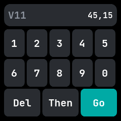
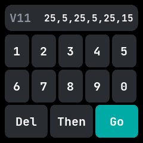

# Pomodoro

A pomodoro timer, ported from wasp-os's pomodoro app. You type a queue of lengths in minutes, such
as 25 then 5, and it runs them in turn, buzzing between each, until stopped or after 99 rounds.

## Using it

- The top line shows **V** and the buzz length in seconds on the left, and the queue on the right.
- Type a length with the **digit** keys, up to 999 minutes. Tap **Then** to start the next length;
  a queue holds up to six.
- Tap **Del** to remove the last digit, or the last comma after Then.
- Tap **Go** to start the queue. Go is lit when the queue can start.
- Swipe **left** or **right** to load a preset queue: 25,5, then 50,10, then 25,5,25,5,25,15.
- Swipe **up** or **down** to make each buzz a second longer or shorter, from 1 to 15 seconds.
- While it runs, the top line shows which length runs and how many rounds are done. Tap **+1** to
  add a minute to the current length, or **Stop** to end the queue.
- When a length ends the watch wakes and buzzes, then the next length starts on its own.

## Screens

The keypad with the default queue, 25 then 5, and a ten second buzz.

A typed queue of 45 then 15, with the buzz swiped up to eleven seconds.

The six-length preset, after a swipe left.

Running the first length in seven-segment digits, with Stop and +1.

Buzzing between two lengths.
