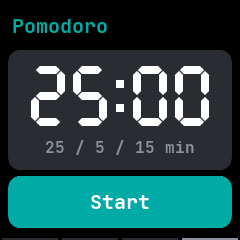
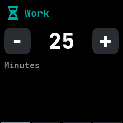
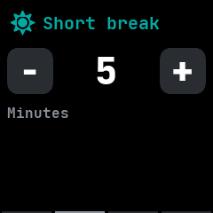
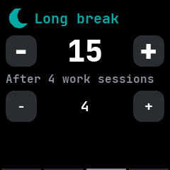
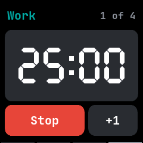
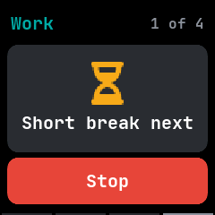
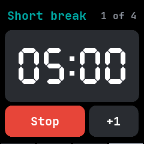

# Pomodoro

A pomodoro timer, after wasp-os's pomodoro app. Work and short breaks take turns, with a long break
in place of every few short ones, until you stop it.

## Using it

- The app opens on the **countdown**, the last of four pages. Swipe right to reach the pages that
  set the lengths, and left to come back.
- **Work**, **Short break** and **Long break** each have a page with **-** and **+** buttons that
  set the length in minutes, from 1 to 99. The long break page also sets how many work sessions
  come before each long break, from 2 to 8.
- Tap **Start** on the countdown. It runs a work session, then a short break, and so on; after the
  set number of work sessions the break is a long one, and the round starts again.
- The top of the countdown names the interval running and which work session of the round it is,
  or follows, such as **1 of 4**.
- When an interval ends the watch wakes and buzzes for ten seconds, names the interval that comes
  next, and then starts it.
- Tap **+1** to add a minute to the running interval, or **Stop** to end the round.
- A new length takes effect from the next interval that uses it.

## Screens

The countdown page on opening, with the work length and the three lengths below it.

The work length page, the first page.

The short break length page.

The long break page: its length, and how many work sessions come before it.

The first work session of four, counting down.

A work session has ended: the watch buzzes and names the short break that comes next.

The short break after the first work session.
