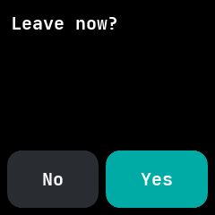
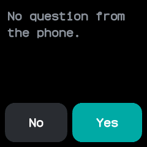

# Prompt

Shows a question from the companion app with **Yes** and **No** buttons, and sends back the answer
tapped on the watch.

## Using it

- Prompt is a temporary app: the companion app runs it without installing it, so it never shows in
  the launcher.
- When a question arrives the app opens over whatever the watch shows and turns the screen on.
- Tap **Yes** or **No**. The watch gives a short buzz, tells the phone the answer and goes back to
  the screen it covered.
- Clicking the side button goes back without answering, and so does the phone disconnecting.
- Without a question the app says the phone sent none.

## Screens

The phone's question, with **No** and **Yes** underneath.

No question from the phone.

## With the companion app

- On a computer, `neotime ask "Leave for the station now?"` asks the question with the companion's
  command line tool and waits for a tap.
- It prints `yes` or `no`, with a different exit status for each, so a script can act on the
  answer.
- Without a tap within 60 seconds, or the time given with `--timeout`, it closes the question on
  the watch and gives up.
