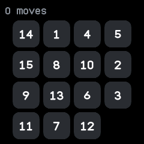
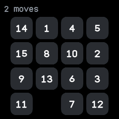
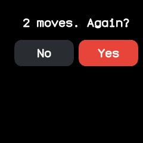
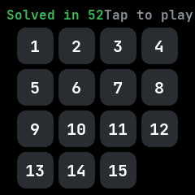

# 15

The 15 puzzle, ported from wasp-os's puzzle15. Slide the tiles into order, 1 to 15, with the gap in
the bottom right corner.

## Using it

- **Swipe** left, right, up or down to slide the tile beside the gap that way into it.
- The top left counts your moves; the top right shows your fewest moves to a solution, once you
  have one.
- **Tap** to ask to deal a new board: the question names your moves so far. Tap **Yes** to deal it
  or **No** to carry on.
- A solved board buzzes and says **Solved in** and the move count, in green. Swipes then do nothing;
  tap to deal a new board straight away.
- The board, the move count and the best are kept for next time. The first opening deals a random
  board that can always be solved.

## Screens

A freshly dealt board, before the first move.

Two moves in, after swiping right twice slid the 12 and then the 7 across into the gap.

The question a tap asks before dealing a new board, naming the two moves made so far.

The board solved in 52 moves, which is also the best so far.
