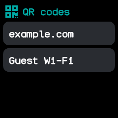
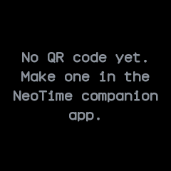

# QR code

Keeps up to eight QR codes made in the NeoTime companion app, such as links, text or Wi-Fi
networks, so another phone can scan them from the watch.

## Using it

- Open the app to see the codes listed by caption. Drag the list up and down when it is longer
  than the screen.
- Tap a code's caption to show it: black on white, drawn as large as fits, with its caption
  underneath. The screen goes to full brightness and stays on while the app is open, so a scanner
  reads it easily.
- Click the side button to go back from a code to the list.
- Without codes the app says to make them in the companion app.
- Codes added or changed while the app is open show the next time it opens or the screen turns on.

## Screens

The list, one row a code: a link and a Wi-Fi network.

A link's code, tapped in the list, with its caption underneath.

No codes yet, with a reminder to make them in the companion app.

## With the companion app

- The companion app's **QR code** screen makes the codes. Choose what the code holds: text or a
  link, or a Wi-Fi network's name, security and password.
- Give it a caption of up to 24 plain characters, or keep the one suggested; it names the code in
  the watch's list and shows under it. An error correction level trades a denser code for one that
  survives more damage.
- A preview shows the code before **Add to the watch** puts it at the end of the watch's list.
  Codes too large to scan on the watch's screen are refused.
- The same screen lists the codes on the watch, to **Rename** them, move them **Up** or **Down**,
  **Remove** one, or **Remove every code**. Once the watch holds eight, remove one to add another.
- On a computer, `neotime qr` does the same from the command line: `neotime qr https://example.com
  --label Example` or `neotime qr wifi Home secret` adds a code, and `neotime qr list`, `rename`,
  `move` and `remove` look after the list.
