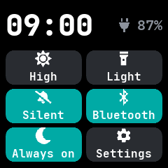
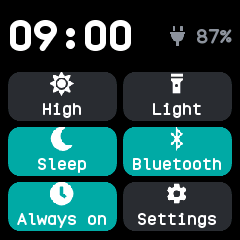

# Quick settings

A pull-down shade with the time, the battery and six buttons for the settings changed most often:
brightness, the flashlight, do not disturb, Bluetooth, the always-on screen and Settings. It is
built into the firmware, from InfiniTime's QuickSettings screen and Android's pull-down shade.

## Using it

- On the watch face, **swipe down** for the [notifications](notifications.md), then swipe down
  again. **Swipe up** or press the side button to put it away.
- The time and the battery charge sit at the top; a plug shows while charging.
- The **brightness** tile shows the level; tap it to step through low, medium and high.
- **Light** opens the flashlight app.
- **Silent** steps through three states, as InfiniTime's do not disturb button does: off, silent
  (do not disturb), and **Sleep**, which also stops touch, raise and shake from waking the screen
  and turns the always-on screen off. Its bell is crossed out while silent, and a moon shows in
  sleep mode; a tap in sleep mode turns both off.
- **Bluetooth** turns Bluetooth on and off until the next restart.
- **Always on** keeps the screen on.
- **Settings** opens the full [Settings](settings.md) app.
- A tile that is on is filled in the accent colour.

## Screens

As it opens, with only Bluetooth on.

High brightness, with do not disturb, Bluetooth and the always-on screen on, on the charger.

Sleep mode, the third state of the do not disturb tile, shown by a moon.
