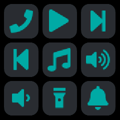

# Remote

Up to nine buttons set up in the NeoTime companion app, each running an action on the phone or
computer when tapped, such as playing music, finding the phone or calling a web address.

## Using it

- Tap a **button** to run its action. The watch gives a short buzz and tells the companion app
  which button it was; the companion app does the rest.
- Each button shows only the icon chosen for it.
- One button fills the screen, two sit side by side, three or four make a 2 by 2 grid and five to
  nine use three columns.
- The app reads the buttons again each time it opens or the screen turns on, so changes sent while
  it is open show then.
- Without buttons the app says to choose them in the companion app.

## Screens

No buttons set up yet, with a reminder to choose them in the companion app.

One button, a phone icon, filling the screen.

Four buttons in a 2 by 2 grid: phone, play, next and previous.

Nine buttons in three columns, from phone and media controls to a torch and a bell.

## With the companion app

- The companion app's **Remote** screen holds the buttons. **Add a button**, then give it a label
  (shown only in the companion app), an icon for the watch, and what it does:
  - **Ready-made**: play or pause, play, pause, next track, previous track, volume up, volume down,
    or find this device.
  - **Web request**: a method, an address and, where it takes one, a body.
  - **Command**: a shell command run on the computer running the desktop app, stopped after 30
    seconds.
  - **Android**: open a link, start an activity or send a broadcast, with optional extras.
- Each button can be edited, moved **Up** or **Down**, tried with **Test**, or removed. A button
  whose action this phone or computer cannot run says why, and cannot be tested.
- **Send to watch** puts the buttons on the watch. The actions stay in the companion app, so it
  must be connected for a tap to do anything.
- **Recent taps** lists each tap, from the watch or a test, and whether its action worked.
- On a computer, `neotime remote push` sends the buttons from the command line, and `neotime remote
  listen` stays connected and runs each button tapped on the watch. Media keys and Android actions
  need the app.
