# Settings

Changes the watch's settings, from the screen and the ways it wakes to the clock, the step goal,
the watch face and the theme. Merged from InfiniTime's Settings and wasp-os's settings app.

## Using it

- The main screen is one list; **swipe up** and **down** to scroll it.
- A row with a value on the right opens a screen of choices; tap one to choose it. The chosen one is
  filled in. Press the side button to go back to the list.
- A row with a **switch** changes as soon as it is tapped.
- **Brightness**: low, medium or high.
- **Screen off**: how long the screen stays on, from 5 seconds to 2 minutes.
- **Always on**: keeps the screen on.
- **Wake** opens the ways to wake the screen, from InfiniTime:
  - **Touch**: whether a touch wakes it: the button only, a tap, or a double tap.
  - **Raise wrist**: turning the watch towards you wakes it.
  - **Shake**: shaking the wrist wakes it, if harder than the **Shake strength**.
  - **Shake strength** opens a screen with two half rings: the outer one is the strength a shake
    must reach, which you can drag, and the inner one is how hard your wrist moves now. Tap
    **Calibrate**, get ready while it says **Ready!**, then shake as you would to wake the watch
    while it says **Shake!**; the strength is set just below your hardest shake. Tap the button
    again to stop early.
  - **Lower to sleep**: letting your arm fall turns the screen off.
- **24 hour clock** and **Metric units**.
- **Step goal**: the daily goal, set with **-** and **+** in steps of 500, from 1000 to 50000.
- **Chimes**: off, every hour or every half hour.
- **Heart rate**: how often the watch measures your heart rate when no app asks, as InfiniTime
  offers: off, always, or every 30 seconds, minute, 5, 10 or 30 minutes. Each measurement lasts
  until a reading, or 30 seconds at most, and runs with the screen off too.
- **Do not disturb**, and **Alarms in DND**: whether alarms still ring while it is on.
- **Sleep mode**: do not disturb that also stops every way of waking the screen but the button, and
  the always-on screen. Turning do not disturb off ends it.
- **Face**: the watch face, shown by name. Its screen steps back and on through the faces turned
  on in Software with the two arrow buttons, wrapping round, and the face changes at once, as
  InfiniTime's watch face setting does. If the chosen face is turned off or removed, the first face
  turned on shows instead.
- **Theme**: one of six preset themes, each shown in its own colours. The companion app can set
  colours of your own, which show here as **Own**.
- **Bluetooth**: off until the next restart.
- **Updates**: whether the watch takes firmware updates and app installs over Bluetooth. A tap
  steps through **On**, **Temporary** and **Off**; Temporary is on only until the watch next
  restarts, as InfiniTime's "till reboot", so it starts again with updates off. Confirming or
  rolling back a new firmware is on the System app's first page.
- **Date & time** sets the clock by hand, for when no phone has, as InfiniTime's date and time
  screens do. It opens on today's date as rollers for the day, month and year, with a page bar
  below; drag a roller up or down, or tap a number above or below the middle one to step it. The
  day stops at the month's last day, counting 29 February in a leap year. **Swipe left** for the
  time, as rollers for the hour and minute, with an **AM**/**PM** button on a 12 hour clock.
  **Set** sets the clock to that date and time at 00 seconds, in the watch's time zone, and goes
  back to the list; the side button leaves without changing it.

## Screens

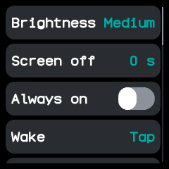

The top of the list.

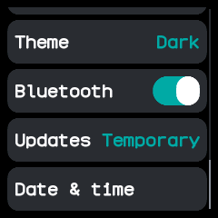

The end of the list, scrolled down, with updates on until the next restart.

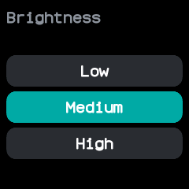

Brightness, opened from its row.

How long until the screen turns off, opened from **Screen off**.

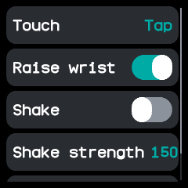

What wakes the screen, opened from **Wake**.

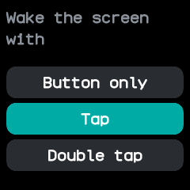

Which touch wakes the screen, opened from **Touch**.

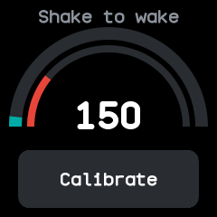

The shake strength, opened from **Shake strength**, with the wrist moving a little.

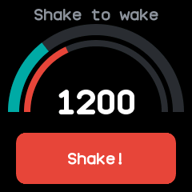

Recording a shake: the strength follows the hardest shake so far.

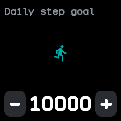

The daily step goal, opened from **Step goal**.

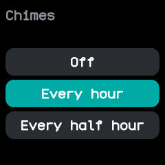

Chimes, opened from its row.

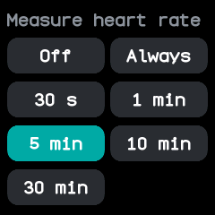

How often to measure the heart rate in the background, opened from **Heart rate**.

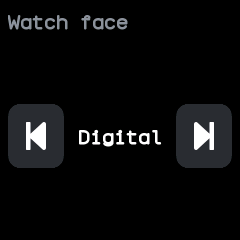

The watch face, opened from **Face**; the arrows step to the face before or after it.

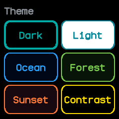

The preset themes, opened from **Theme**; the chosen one has a thicker border.

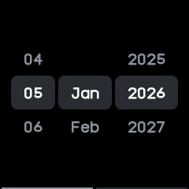

The date, opened from **Date & time** at the end of the list, starting from today.

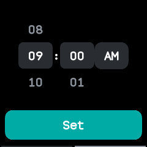

The time, a swipe left from the date, here on a 12 hour clock.

## With the companion app

Every change is saved on the watch, so the companion app sees it, and the companion can change the
same settings from the phone. It can also set theme colours of your own, which the **Theme** row
shows as **Own**.
