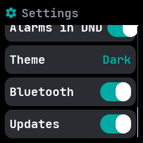
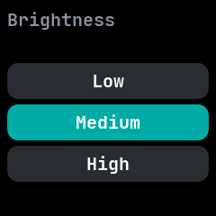
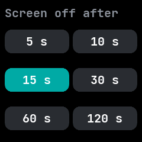
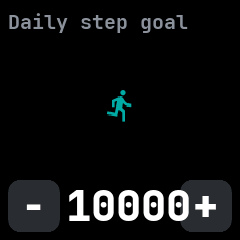
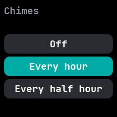

# Settings

The watch's settings, merged from InfiniTime's Settings and wasp-os's settings app. Every change is
saved on the watch, so the companion app sees it too.

## Using it

- The main screen is one list; **swipe up** and **down** to scroll it.
- A row with a value on the right opens a screen of choices; tap one to choose it. The chosen one is
  filled in. Press the side button to go back to the list.
- A row with a **switch** changes as soon as it is tapped.
- **Brightness**: low, medium or high.
- **Screen off**: how long the screen stays on, from 5 seconds to 2 minutes.
- **Always on**: keeps the screen on.
- **Wake**: whether a touch wakes the screen: the button only, a tap, or a double tap.
- **24 hour clock** and **Metric units**.
- **Step goal**: the daily goal, set with **-** and **+** in steps of 500, from 1000 to 50000.
- **Chimes**: off, every hour or every half hour.
- **Do not disturb**, and **Alarms in DND**: whether alarms still ring while it is on.
- **Theme**: one of six preset themes, each shown in its own colours. The companion app can set
  colours of your own, which show here as **Own**.
- **Bluetooth**: off until the next restart.
- **Updates**: whether the watch takes firmware updates.

## Screens

The top of the list.

The end of the list, scrolled down.

Brightness, opened from its row.

How long until the screen turns off, opened from **Screen off**.

What wakes the screen, opened from **Wake**.

The daily step goal, opened from **Step goal**.

Chimes, opened from its row.

The preset themes, opened from **Theme**; the chosen one has a thicker border.
