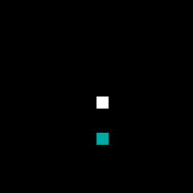
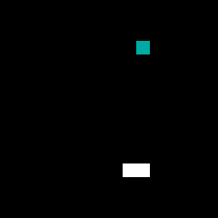
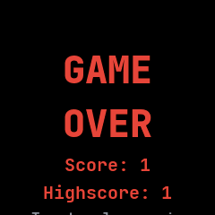

# Snake

Snake on a 16 by 16 board, ported from wasp-os's snake. Steer the snake to the food and it grows.

## Using it

- **Swipe** up, down, left or right to steer. The snake waits until the first swipe, then moves a
  square every quarter of a second.
- Eating the food, the coloured square, makes the snake one longer and puts new food somewhere free.
- Once it is longer than one square, the snake cannot turn straight back into itself.
- Running into a wall or into itself ends the game with a buzz. The screen says **GAME OVER** with
  the score, one point for each meal, and the high score, which is kept for next time.
- After a game, **tap** to play again with the food somewhere new, or **swipe** to leave.

## Screens

The start: a one-square white snake in the middle and the food below it.

The snake two squares long after its first meal, heading right, with new food up and to the right.

Game over after hitting the right wall, with a score and high score of 1. The **Tap to play again**
hint at the bottom is cut off by the screen edge.
