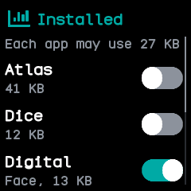

# Software

NeoTime's own app manager, after the app list of InfiniTime's settings and wasp-os's Software app.
It lists every installed app and watch face with a switch to turn it on or off.

## Using it

- Each row shows the name, **Face** for a watch face, and the memory it needs while open. The top
  line says how much memory each app may use.
- **Tap** a row to turn it on or off. **Swipe up** and **down** to scroll the list.
- The watch checks each change first. A row that cannot change opens a screen saying why: the app
  needs more memory than an app can have, the launcher would run out of memory, the launcher and the
  last watch face stay on, or the app is open now.
- Tap **OK** to go back to the list.

## Screens

The top of the list.

The end of the list, scrolled down.

After tapping an app that needs more memory than an app may use.

After tapping the only watch face.
